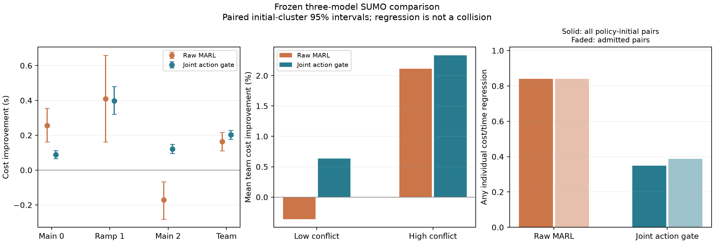
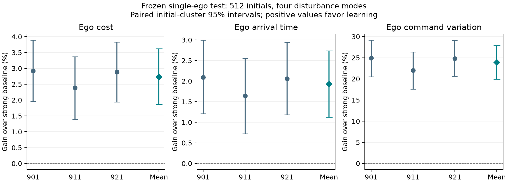
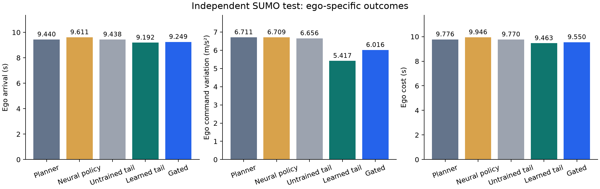
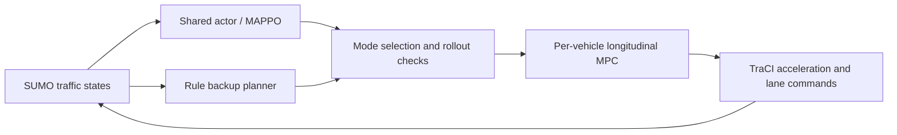

# CoopGate

**Reproducible confidence gating and cooperative merge control in Eclipse SUMO.**
V14 passed the frozen single-ego learning prerequisite. On the frozen V18
population, genuine three-actor model-based MARL improves mean team cost across
all three fixed trained models. A joint action gate improves the three-model mean further and checks
individual nominal performance against the same full baseline continuation.
V12's team-cost gain concealed an **8.26% ego arrival regression**; it does not
satisfy the single-ego prerequisite for MARL. V13 uses the ego's own arrival and
command variation, and jointly calibrates cost and arrival-time differences.
Standalone neural control and learning-augmented planning are reported separately.

This is a research prototype with conditional model-based safety guarantees.
The completed V14 single-ego study is **not MARL**. Historical V11 uses a centralized
contextual bandit; its online planner's gain must not be called a new MARL result.

## V19 development: disturbance-aware joint composition

Development probes, a paired ablation and an actuator-harness audit completed
**2,496 actual SUMO runs**, plus **186 post-hoc audit replays** and **120
observable-initial predictor audit runs**. These audit runs check implementation
identity, not additional independent efficacy samples. On the second probe's
32 initial scenes, jointly checked actor/baseline
compositions retain **0.82%** mean team-cost improvement while reducing observed
any-car performance regression from **39/85** admitted policy-initial pairs with
nominal gating to **1/46**. These correlated, small-sample counts are **not a risk
certificate**. The same gate has **745 ms p95** computation and does not yet meet
the 500 ms control period. Strong actuator lag also caused one baseline abort.

On those same scenes, the completed full-action-bank ablation improves cost by
**0.545%**, versus **0.822%** with joint composition. The additional paired gain is
**0.0279 s [0.0057, 0.0562]**, with 128 repeated baseline outcomes exactly matching.
This is a development interval, not an independent confirmation. Both methods
retain the same one harmful case; joint composition admits seven additional
model-initial pairs and incurs greater computation.

The independent **40,960-run** risk calibration is complete. Strict gating retains
**22.36–23.14%** actual episode adoption and **0.708–0.766%** mean team-cost gain
on calibration data. Only fixed model **1812** passes both prespecified 5% conditional
performance-risk bounds; models 1802 and 1822 do not. These are population bounds
under the declared initial/noise distribution, not per-state or arbitrary-noise
guarantees. Calibration gains do not replace independent final-test results.
[Complete calibration and all model outcomes](docs/v19_calibration_results.md).
[Development results](docs/v19_development_results.md)
and [theory/scope](docs/theory_v19_disturbance_risk.md) retain the unsuccessful designs,
individual regression, latency tail, and dynamics-assumption failures.
The [design-only power analysis](docs/v19_certification_power.md) explains why
at least 115 independent learning adoptions per candidate/target are required
even with zero observed harm; it reads no calibration outcomes.

Exact-command deduplication and caching now preserve all **667 paired decisions**
in **58 SUMO replays**, including the original harmful case, while reducing total
controller time **25.1%**. The same replay's p95 falls from **966 to 702 ms** and
still exceeds 500 ms. [Runtime evidence](docs/v19_cached_runtime.md) reports the
concurrent-load setting and all deadline misses.

A physical arrival-time lower bound now rejects provably losing candidates
early while retaining full forecasts for every accepted action. In another
58-run paired audit it preserves all 667 decisions and reduces total controller
time **6.84%** relative to caching. P95 improves from **703 to 648 ms**, but P99
and the maximum worsen; the 500 ms deadline remains unmet. The two timing-study
ratios must not be multiplied into a single benchmark result.
[Lower-bound derivation and complete measurements](docs/v19_bounded_runtime.md)
also retain profiling evidence that full feedback continuations dominate slow
decisions.

Two-worker disturbance evaluation now preserves the same **667 decisions** in
another **58 SUMO replays**, reducing complete-call wall time **15.22%** while
increasing controller-process CPU time **10.03%**. All admitted actions retain
the full 17-scenario check. P95 falls from **573 to 499 ms**, but **34/667** calls
still exceed 500 ms, P99 is **1,045 ms**, and the maximum is **2,573 ms**. One
model's P95 remains 548 ms. The [complete paired analysis](docs/v19_parallel_runtime.md)
includes speculative work and private cache overhead; it is not a hard real-time
result. Frozen risk/final study controllers remain unchanged.

The nominal predictor has additionally matched **60 whole profiles and 1,392
decisions** using only observed initial kinematics, a fixed internal engine seed,
and no actual future disturbance. Preparing all ten shadow profiles takes
**11–32 s** in this audit, including simulator startup and resets; it is not an
online real-time result. [Observable-state audit](docs/v19_observable_predictor.md)

The complete-profile deployment adapter has passed another **56 SUMO executions**
using explicitly synthetic calibration to exercise admission/fallback wiring:
18 deployment/reference pairs match across 409 decisions. This does not replace
real calibration or independent final comparison. Actual final replay coverage
was frozen before the final-test executions.

The matched [conformal/LTT/mean-SPI comparison](docs/v19_established_comparison.md)
has completed its separate **20,480-run** final test on 512 fresh IID initials,
followed by **156 actual deployment replays** and **10 nominal shadow runs**.
Every selected profile and replayed outcome matched. Strict gating preserves
**0.669–0.724%** mean team-cost gain and **20.90–22.27%** episode adoption across
the three fixed models, with positive paired gain intervals. Only model **1812**
also passes both calibration risk certificates; the all-model joint target is
not met. Raw model 1802's final gain interval crosses zero. Final strict-gate
P95 is **586–640 ms**, still above the control period. The
[complete final results](docs/v19_final_results.md) retain every model, failure,
comparison and guarantee boundary. These runs do not supply 20,480 independent
statistical samples, and the replays add no independent efficacy samples.
A **6,400-run** direct-transfer study has completed. An [analytic actuator bound](docs/v19_actuator_bounds.md)
also shows why the declared mild lag remains inside the original error envelope
while strong lag is outside its uniformly covered range; this is not a shifted
performance-risk guarantee.

The completed [direct-transfer results](docs/v19_transfer_results.md) reveal
both useful gating and important limits. Within the first three declared plant
ranges, nominal/strict gates each complete **1,440/1,440** runs, while raw learning
has 11 noncompletions and loses 8–9% in slow-yielding scenes. Strict-gate gains in
tight-headway scenes are **1.04–1.73%**, but gains in speed-asymmetric scenes are
small. Under strong lag, **57/1,600** runs do not complete, including baseline
failures; every run exceeds the original physical-error envelope. All failures
and capped outcomes remain in the analysis. The frozen **336-case replay audit
has passed**, reproducing all **68** study noncompletions; 291 saved full traces
also match step by step. No shifted-distribution risk certificate is claimed.

The [independent final-report audit](docs/v19_final_report_audit.md) has completed
the final comparison, calibration recount and deployment-replay verification.
It confirms that only model 1812 meets all joint requirements; the other two
models' lower final empirical harm frequencies do not alter calibration results.
Its completed-transfer preflight reproduces all 180 model-cell summaries and
matches all **2,389 zero-adoption outcomes** to their paired baselines. **22** of
those still fail under strong lag: correct fallback does not repair a baseline
outside its physical assumptions. The final audit keeps conditional certification,
adoption, and gain as separate requirements, and does not transfer a fixed-profile
conditional-risk certificate to a state-dependent selector.

All **46** harmful strict-gate calibration runs and 38 distinct paired baselines
have been replayed in **84 SUMO executions**. Every harmful run has exactly one
admission with a positive hindsight baseline-value difference; subsequent fallback
adds no positive difference in these cases. In **13** cases, losses occur only on
vehicles whose command did not change at that admission. This is a post-hoc
[coupling diagnosis](docs/v19_harm_mechanism_replay.md), not an online oracle.

The separate [V20 temporal-bank development](docs/v20_temporal_gate_development.md)
retains all original paths and tests three fixed extensions. A completed selected-state
screen identifies **42/46** old harmful admissions with sampled temporal paths,
while also rejecting **7/9** selected nonpositive steps. These counts are neither
closed-loop improvement nor a population risk estimate. A frozen **6,656-run**
paired SUMO study on 128 fresh initials is running for all three models and all
three extensions; no V19 final-test outcomes are used to develop V20.

A completed [action-attenuation diagnosis](docs/v20_action_repair_diagnosis.md)
checks **220 joint commands** at the same 55 selected states. Under the sampled
temporal bank, seven previously rejected commands have an attenuated alternative
with positive realized-branch team gain and no positive vehicle cost/time
component. Four original harmful branches remain. An independent review
reconstructs every choice and 34 selected realized branches. This is a local
one-action-then-baseline diagnostic, not a closed-loop adoption or risk result.

The [complete action-repair controller](docs/v20_repair_closed_loop.md) now retains
every original joint candidate and adds physically reprojected attenuation
candidates without relaxing the 33-path, all-vehicle performance conditions.
A frozen **640-run** SUMO development on 16 fresh initials compares the original
sampled gate, a repair-disabled reference implementation and full repair for all
three models. Every trajectory is saved. Reference identity and episode-adoption
inclusion are checked separately from realized gain and harm. All 640 runs and the
independently frozen review have now completed. Episode adoption rises from
**6.25–12.5% to 25–31.25%**, with small mean gains, but one new pulse-disturbance
case harms the rear vehicle and P95 rises to **3.02–3.42 s**. Model 1822 remains
below the 0.5% actual gain target. The [complete development results](docs/v20_repair_development_results.md)
retain this failure, all three models and timing costs; 16 initials cannot
establish a 5% conditional-risk certificate. The independent review reconstructed
all 640 physical traces, 8,788 candidate families and every distinct admitted
forecast without reusing the performance selector.

A frozen [paired repair extension](docs/v20_temporal_repair_extension.md) adds
**1,536 SUMO runs** for the same repair policy to the existing 128-initial
temporal-bank development pairing. It reuses those initial/noise identities
explicitly, adding **zero independent initials**, and preserves every original
bank and model. All new traces and distinct admitted forecasts are reviewed
after both native collections finish; no risk certificate is inherited.

A separate [repair runtime equivalence audit](docs/v20_fast_repair_verification.md)
freezes **57 actual SUMO replays** of 19 development cases, including every known
repair harm and each model's slowest call. It compares the reference with exact
command reuse and rejection-only physical bounds. Accepted commands retain all
33 complete forecasts; every pruned branch is checked against the original full
calculation outside timing. No speedup or real-time claim is made before completion.

## V18: joint gating improves the frozen three-model comparison

Models and protocol were frozen in **79beb44**, before **7,168 actual SUMO runs**
on 256 new initials with four paired disturbance modes. All models and failures
are retained; no checkpoint or training seed was selected using this set.

| Controller | Mean team cost s | Improvement | Completed runs |
|---|---:|---:|---:|
| Strong cooperative planner | 10.0884 | Reference | 1,024/1,024 |
| Raw MARL, fixed three-model average | 9.9238 | 1.63% | 3,069/3,072 |
| Joint nominal action gate, same models | 9.8861 | 2.01% | 3,072/3,072 |

Paired initial-cluster 95% improvement intervals are **[0.1116, 0.2160] s** for
raw MARL and **[0.1767, 0.2281] s** for gating. Raw learning regresses the rear
car on average; gating improves every car's mean cost and arrival time. Raw
high-/low-conflict gains are **2.11% / -0.36%**, versus **2.34% / 0.63%** with
gating. These are fixed ETA-based scene groups, not all complex/simple traffic.

**Eight of nine preregistered checks passed.** One raw model timed out on three
bias-disturbed runs, so the all-methods-complete condition failed. Every gated
run completed. All methods had zero recorded collision, contract violation and
administrative abort. All three timeouts were additionally replayed unchanged
with their baseline and gated counterparts; both completed in each case.

The gate has a **deterministic nominal** component-wise telescoping guarantee,
verified by reconstructing all **768** nominal gated trajectories. This does
**not** certify disturbed performance: strict any-car/cost/time regression
occurs in **268/768** gated policy-initial pairs, or **268/691** among pairs with
any learning admission. Raw learning regresses in 645/768 pairs. These are
descriptive paired counts, not independent binomial trials or safety incidents.
Measured gate computation p95 is 147–150 ms, not a worst-case timing guarantee.

[Full results and reproduction](docs/v18_independent_results.md) ·
[Frozen records and audit](artifacts/v18/independent_study) ·
[Per-model analysis](artifacts/v18/independent_analysis/analysis.json)



## Earlier cooperative development and preserved negative results

Three-actor MAPPO and local-critic PPO completed actual joint training after
V14 passed. In 2,560 new SUMO executions, MAPPO reduces team cost 5.06% against
ego-focused planning but increases ramp-vehicle cost by 1.40 s. Against stronger
cooperative planning it increases team cost 2.00%. Actor replacement diagnostics
also show that the main-road greedy behavior barely changes. These are preserved
negative results. The subsequent development uses established coupled
multi-agent policy iteration and dataset aggregation; final results are above.

[Complete cooperative pilot](docs/v15_development_results.md) ·
[Next development protocol](docs/v16_coupled_development.md)

The expanded coupled policy-iteration pilot now produces meaningful changes in
all three actors and actor-replacement effects. It still increases team cost
0.92% against the strong cooperative planner, so effectiveness is not accepted.
Actual SUMO fault recovery passed 384 runs, including 192 injected failures;
these forced-admission tests do not validate the statistical gate.
[Latest coupled results](docs/v16_stage2_results.md) ·
[Runtime recovery](docs/v16_runtime_recovery.md) ·
[Whole-profile interaction examples and ongoing development](docs/v17_development.md)

The next dataset-aggregated continuation improves team cost **1.67% against its
parent** on 2,560 fresh paired SUMO runs. Against strong cooperative planning its
**0.48%** mean gain still has an interval crossing zero, and the rear vehicle
regresses. Calibrated admission remains ineffective (zero held-out admissions).
This is measured development progress, not a passed cooperative gate.
[Complete V17 comparison](docs/v17_stage1_results.md) ·
[Coupled improvement and gate proof boundaries](docs/theory_v17_coupled_gate.md) ·
[Additional close prior work](docs/v17_related_work_audit.md)

Actual component-wise switching now exposes composition failures even with
exact nominal predictions. A separate **stepwise full-baseline advantage gate**
has a component-wise nominal telescoping guarantee. Its small 192-run SUMO
pilot reduces team cost **1.91%**, with average improvement for all three cars,
but two of 16 initial clusters still regress under a disturbance. Its p95
computation is 135.5 ms; it is not yet a statistically certified performance gate.
[Gate mechanism, proof scope and actual results](docs/v18_gate_development.md) ·
[Why more training did not automatically improve the policy](docs/v17_stage2_results.md)

## V14: standalone single-ego prerequisite passed

Three fresh training seeds, fixed budgets and acceptance criteria were
preregistered in **0d9e7b4**. Final networks and evaluation inputs were frozen in
**e36a6fb**, before **14,336 actual SUMO executions** on 512 new initials and four
disturbance modes. All nine prerequisite criteria passed, followed by 224 complete
trajectory audits, 4,778 Torch/compiled comparisons and 56 additional SUMO replays.

| Controller | Ego arrival s | Ego command variation m/s² | Ego cost s |
|---|---:|---:|---:|
| Unchanged strong planning baseline | 9.6223 | 7.2693 | 9.9858 |
| Standalone learned networks, three-seed mean | 9.4364 | 5.5315 | 9.7129 |
| Fixed final networks without parameter averaging | 9.4742 | 5.6512 | 9.7568 |

The primary learned policies reduce ego cost by **2.73%**, arrival time by
**1.93%**, and command variation by **23.91%**. Every seed improves both cost and
arrival time. Paired initial-cluster 95% improvement intervals are
**[0.1859, 0.3615] s** for cost and **[0.1078, 0.2634] s** for arrival.
High-conflict initials show 3.19% cost and 2.39% arrival improvement; low-conflict
arrival improvement is 0.48%. These fixed ETA-based strata are descriptive.

Training uses model-based approximate policy iteration, an established method
family. Deployment uses one neural network and the common physical safety
filter, with no future performance search. The final network uniformly averages
the last three iterations' parameters; this is neither an ensemble nor MARL.
Other-vehicle average arrival gains have an interval crossing zero; individual
non-degradation is not established. V13's gate results must not be reused for
these new policies. All negative development results remain available.

[Complete V14 results](docs/v14_single_results.md) ·
[Frozen test](artifacts/v14/single/protocol.json) ·
[Replay audit](artifacts/v14/single_audit.json) ·
[Development history](docs/v14_policy_iteration_development.md) ·
[Joint gating theory and MARL preparation](docs/v15_joint_gate_design.md)



```powershell
python tools/verify_single_v14.py --replay --require-acceptance
python tools/study_single_v14.py --out runs/my_v14_reproduction
```

## V13: ego gains and a gate that can return to the planning baseline

The protocol and all final checkpoints were frozen in **3bac214** before
**7,168 actual SUMO tests** (128 independent initial states × four error modes ×
14 controllers). Calibration used another 256 initials and 1,024 SUMO executions.
Three fresh Double DQN seeds each trained for 2,097,152 model transitions without
imitation labels. The learned policy proposes an action at every control cycle.

| Controller | Ego arrival s | Ego command variation m/s² | Ego cost s |
|---|---:|---:|---:|
| Strong rollout baseline | 9.4404 | 6.7114 | 9.7760 |
| Standalone neural policy | 9.6110 | 6.7094 | 9.9465 |
| Planner with untrained neural tail | 9.4375 | 6.6565 | 9.7703 |
| Planner with trained neural tail | 9.1924 | 5.4175 | 9.4633 |
| Joint cost/time confidence gate | 9.2490 | 6.0156 | 9.5498 |

The learning-augmented planner reduces ego cost by **3.20%**, arrival time by
**2.63%**, and command variation by **19.28%** relative to the strong baseline.
Its paired initial-cluster 95% cost-improvement interval is **[0.1905, 0.4507] s**.
Replacing trained weights with untrained weights removes most of the gain.
The V13 standalone actor did **not** establish superiority over the strong
planner. V14 above supplies the later independent prerequisite evidence.

The gate requires calibrated cost improvement and arrival non-degradation before
admission. It retains **72.33%** of the net cost gain while reducing harmful
admission from **4.36%** (always use the learning-augmented planner) to **1.11%**
of all policy episodes. Conditional harm among admitted episodes is **9.04%**;
these are different denominators. Low-conflict episodes return to the baseline
**99.15%** of the time. The high-conflict group's mean learning gain is 0.4394 s,
versus 0.0236 s in the low-conflict group. Grouping uses initial ETA separation,
not a general definition of road complexity.

**11/11 prespecified augmented-planning and gating criteria passed.** These do
not replace the failed standalone-policy prerequisite. Joint cost/time gating
has only one fewer harmful admission than cost-only calibration (17 versus 18);
this test does not establish a significant advantage for that extra constraint.
Its value is the explicit simultaneous performance condition.

Each of the learned-augmented and gated categories completed 1,536/1,536 runs
with zero recorded collisions, route-contract violations or aborts. Auditing
covers 112 complete traces, 633 compiled/Torch actor comparisons, and 56 actual
SUMO replays. Eight additional checkpoint-loss/runtime-fault takeover runs all
completed. Safety remains conditional on the stated exact-state, bounded-error,
fully controlled three-car model. The gate chooses once per merge; these are
not repeated online conformal guarantees. No communication-delay claim is made.

[V13 full results](docs/v13_ego_results.md) ·
[Theory and proof boundaries](docs/theory_ego_v13.md) ·
[Frozen protocol](artifacts/v13/ego/protocol.json) ·
[Complete summary](artifacts/v13/ego/summary.json) ·
[Negative development results](docs/v13_development.md)



```powershell
python tools/verify_ego_v13.py --replay --require-acceptance
python tools/study_ego_v13.py --out runs/my_v13_reproduction
```

## V12: why the evaluation objective had to change

Three sequential PPO policies, 1,024 calibration executions and 5,632 fresh
paired SUMO tests establish a team-cost improvement, but **not an ego improvement**.
The calibrated gate retains 87.67% of the team-cost gain and reduces harmful
cost admissions from 13.80% (always learned) to 1.30% of all policy episodes.
The ego still arrives 2.94% later with gating. All original data and frozen
criteria remain available; passing the ten team criteria does not override this
failure. V13 adds a separate arrival non-degradation condition to admission.

[V12 complete results and limitation](docs/v12_single_results.md) ·
[V12 mathematical scope](docs/theory_v12_single.md) ·
[V13 ego-specific theory and gate](docs/theory_ego_v13.md) ·
[V13 protocol frozen before testing](artifacts/v13/ego/protocol.json)

```powershell
python tools/verify_single_v12.py --replay
python tools/study_ego_v13.py --out runs/my_v13_reproduction
```

## V11: faster merging with lower command variation

V10 optimized arrival time alone and increased average command changes relative
to V9. V11 uses a **lexicographic arrival/total-variation objective**: time first,
then smaller changes on time ties. Commands lie on a fixed 0.625 m/s² lattice,
so both costs are integers. A hold-enabled feedback family supplements the
original binary proposal/brake family; each receives a coordinate rollout.
Every trial retains the unchanged joint V9 robust backup certificate.

The code, ten criteria and **200 fresh initial states × four error modes × nine
methods** were frozen in commit `7fc085e` before 7,200 actual SUMO executions.
**9/10 criteria passed.** Arrival-time reduction was **0.9777%**,
below the prespecified 1% target; this criterion remains **unmet**. No threshold
was revised after testing. Both co-primary intervals exclude zero. The two co-primary
endpoints compare V11 with the frozen V10 controller on identical states and
exogenous disturbance tapes.

| Mean over 600 perturbed runs per method | V10 | V11 | Reduction |
|---|---:|---:|---:|
| Capped mean arrival time | 9.717 s | 9.622 s | 0.98% |
| Three-car command total variation | 34.433 m/s² | 19.732 m/s² | 42.69% |
| Mean command change rate | 1.005 m/s³ | 0.584 m/s³ | 41.90% |

The paired 97.5% seed-cluster intervals for the mean reductions are
[0.063, 0.129] s and [13.435, 15.980] m/s².
Both co-primary endpoints receive this prespecified confidence-level allocation;
bootstrap inference is approximate. The 600 conditions contain **200 independent
initial-state clusters**, not 600 independent scenes. Total variation is not
divided by episode duration, preventing slower driving from diluting it.

The complete controller finished **800/800** runs with
0 recorded collisions, 0
route-violation episodes, 0 aborts and 0 timeouts.
Warm controller-cycle P95 is **8.34 ms**;
warm first-response P95, including initialization and the first TraCI cycle, is
**24.69 ms**. All failures remain in the data.

There are still adverse outcomes: versus V10, perturbed arrival time improves
in 113/200 clusters, ties in 41, and regresses in 46.
The nominal theorem is a **lexicographic bound versus the base policies**,
not componentwise dominance, not a guarantee versus V10, and not a realized
performance bound under disturbances. Independent paired experiments test the
two improvements. Command variation is not measured physical jerk or passenger
comfort.

Matched ablations remove the variation objective, the hold family, or the
second family sweep. No-learning, fixed and random proposals isolate the
learning contribution. Learning's extra arrival gain over no-learning is
0.73% (descriptive 95% interval for seconds saved:
[0.033, 0.110]).
The online planner's entire gain must not be attributed to reinforcement learning.

The scope remains **three cooperative fixed-route vehicles, exact measurements
and a known ±0.5 m/s² actuator-error bound**. SUMO pauses during computation;
warm timing quantiles do not establish worst-case or delay-aware real-time
performance. Rollout, safety filtering and lexicographic optimization are prior
art; this work provides a concrete construction, conditional proofs and frozen
comparative evidence. Published-method comparisons and broader traffic settings
remain necessary for a strong paper submission.

[V11 results and ablations](docs/v11_results.md) · [Theory and proofs](docs/theory_v11.md) ·
[Frozen protocol](artifacts/v11/protocol.json) · [All runs](artifacts/v11/study/episodes.csv) ·
[Fixed trajectory example](artifacts/v11/trajectory_example.png) ·
[Unmet criterion and historical regressions](docs/v11_acceptance.md) ·
[Related work and novelty limits](docs/related_work_v11.md)

```powershell
pip install -e ".[dev,fast]"
python tools/verify_release_v11.py --replay
python tools/replay_v11.py --gui --disturbance bias --out runs/my_v11_demo
python tools/study_v11.py --out runs/my_v11_reproduction
```

The verifier checks provenance, exact accounting, statistics and replays;
passing it does not turn a failed performance target into a success.
`python tools/verify_release_v11.py --require-acceptance` additionally enforces
all ten performance criteria and intentionally exits nonzero for this release.

## V10: certificate-constrained online rollout

V10 recomputes the better traditional/learned base continuation at every control
cycle, then searches intermediate acceleration commands one vehicle at a time.
Every trial passes the unchanged **joint V9 robust backup certificate** before
its nominal task cost is evaluated. A trial replaces the incumbent only when
its integer arrival cost strictly decreases. Global policy time is preserved.

The conditional guarantees are separate: robust route safety for the declared
bounded actuator error, and closed-loop performance improvement **only in the
nominal zero-error model**. An independent earliest-arrival lower bound prunes
uncompetitive tails without changing the chosen coordinate-search action.
Coordinate rollout and predictive safety filtering are established methods;
this implementation does not claim a new generic MARL algorithm.

The source and nine acceptance criteria were frozen in commit `bfab9dd` before
**200 new initial states × four error modes × eight methods**. The protocol
compares V9 traditional/learned/full-search controllers with no-learning,
fixed/random/learned proposals and a binary-action rollout ablation. Learned
proposal gains are reported separately from the online planner's gains.

All **nine predeclared criteria passed** in 6,400 actual SUMO executions.
Across the 600 perturbed conditions per method, V10 reduces mean capped arrival
cost by **3.67% versus V9 learned switching**, **3.46% versus V9 full
search**, and **7.29% versus the same-certificate traditional baseline**.
The primary paired saving is 0.368 s, with a 95% seed-cluster bootstrap interval
[0.325, 0.410] s; dense-scene improvement versus V9 learned switching is
4.48%. The target completed **800/800** runs without recorded collisions,
route violations, aborts or timeouts. All matched controls also completed.

| Same-machine warm measurement | V9 learned pair | V10 rollout |
|---|---:|---:|
| First response P95 | 8.63 ms | 19.03 ms |
| Controller cycle P95 | 0.14 ms | 6.84 ms |
| Mean command slew under perturbations | 0.934 m/s³ | 0.992 m/s³ |

**Tradeoffs retained:** online work and average command slew increase. Under
perturbations, 177/200 initial-state clusters improve, 17 tie and 6 regress
versus V9 learned switching. Zero-error tests show no regression in 200 scenes.
Learning adds a modest **0.64%** over no-learning rollout; the main gain comes
from online planning. Secondary intervals are descriptive, without a multiple
comparison significance claim.

A differential audit on 94 predesignated, correlated diagnostic states finds
zero command/value mismatches with pruning disabled, while eliminating 85.24%
of tail feedback evaluations. These states are not extra independent evidence.
[Inspect a predesignated trajectory comparison](artifacts/v10/trajectory_example.png).


The scope remains three cooperative vehicles, exact measurements, fixed routes
and a known ±0.5 m/s² actuator-error bound. SUMO pauses during computation.
Warm timings are not worst-case real-time or delay-aware control guarantees.
The learner is the frozen V6 contextual bandit; no new MARL training is implied.

[V10 paired results](docs/v10_results.md) · [Proofs and prior art](docs/theory_v10.md) ·
[Frozen protocol](artifacts/v10/protocol.json) · [Raw runs](artifacts/v10/study/episodes.csv)

```powershell
pip install -e ".[dev,fast]"
python tools/verify_release_v10.py --replay
python tools/replay_v10.py --gui --disturbance bias --out runs/my_v10_demo
python tools/study_v10.py --out runs/my_v10_reproduction
```

## V9: feedback switching with bounded actuator error

V9 extends the declared model to **acceleration error up to ±0.5 m/s² at every
0.1 s substep**. Monotone interval propagation, joint conflict-occupancy checks
and a braking suffix to a stopped invariant set provide a conditional robust
route certificate. Selected profiles run in feedback from measured state;
tracking mismatch no longer automatically discards the policy forever.

The frozen learned ensemble proposes one profile. The controller compares its
nominal rollout with the baseline, chooses one, and robustly certifies every
executed action. Learning proposes; the interval certificate authorizes.

The protocol and six improvement criteria were frozen before **200 new initial
states × four error modes × seven methods = 5,600 actual SUMO executions**.
Each method sees the same initial state and exogenous error tape; zero error,
random error, persistent bias and intermittent pulses are all retained.

| Method, 800 executions each | Completed | Controller aborts | Route-violation episodes | Warm first-response P95 |
|---|---:|---:|---:|---:|
| V8 cached plan | 638 | 162 | 3 | 7.90 ms |
| Nominal feedback, no robust bound | 674 | 126 | 5 | 37.93 ms |
| Robust traditional baseline | 800 | 0 | 0 | 6.61 ms |
| **Robust learned pair** | **800** | **0** | **0** | **8.52 ms** |
| Robust full search | 800 | 0 | 0 | 41.25 ms |

All methods recorded zero SUMO collisions. Aborts and route violations are
distinct and may overlap; the old methods are tested **outside their original
exact-model guarantee**. Aborted episodes receive 25 s cost, never disappear
from the denominator. Fixed- and random-proposal robust pairs also complete
all 800 executions without violations; safety comes from the certificate.

Across the three nonzero error modes, the learned pair reduces mean arrival
cost by **3.18% versus the same-certificate traditional baseline**, **2.89%
versus a training-selected fixed proposal**, and **2.12% versus a random
proposal**. The last two controls use the same two-candidate budget. Savings
versus the robust baseline are 0.333 s, with descriptive 95% paired cluster
bootstrap interval **[0.266, 0.404] s**. Resampling uses 200 independent initial
states, preserving the repeated error modes within each cluster.

**Tradeoffs retained:** the learned pair is worse than the robust baseline on
15/200 initial states after averaging their three perturbed runs. Full search
is 0.062 s faster on average under disturbances but has higher first-response
cost. This is neither a per-scene performance-dominance result nor a new MARL
algorithm. All six predeclared improvement criteria passed.

The proof requires a known error bound, exact measurements, three cooperative
vehicles and fixed routes. Command slew limits do not bound the slew of noisy
actual acceleration. Unknown bounds, perception error, uncooperative actors,
delay-aware closed-loop operation and real vehicles remain unvalidated.
Compile and warm the controller before connecting to the simulator.

[V9 results and ablations](docs/v9_results.md) · [Interval and recursion proofs](docs/theory_v9.md) ·
[Frozen protocol](artifacts/v9/protocol.json) · [Raw episodes](artifacts/v9/study/episodes.csv)

```powershell
pip install -e ".[dev,fast]"
python tools/verify_release_v9.py --replay
python tools/replay_v9.py --gui --disturbance bias --out runs/my_v9_demo
python tools/study_v9.py --out runs/my_v9_reproduction
```

## V8: exact pruning and faster verified execution

The frozen controller now has a strict float64 compiled evaluation kernel and
an optimistic earliest-arrival lower bound. Pruning preserves the best choice
in the **same 37-profile library**, including the original tie-breaking rule.
The learned ensemble can order candidates; it cannot authorize a command or
prune a candidate. The per-step recoverability certificate remains active.

A protocol frozen before testing covers **200 new scenes / 1,400 actual SUMO
executions**, with seven methods in randomized order within each scene:

| Method | Warm first-response P95 | Nominal mean arrival | Dense mean arrival |
|---|---:|---:|---:|
| Traditional baseline | 10.13 ms | 11.035 s | 10.345 s |
| Original two-profile verification | 134.21 ms | 10.143 s | 9.885 s |
| Compiled two-profile verification | **5.57 ms** | 10.143 s | 9.885 s |
| Compiled full search | 9.73 ms | 10.090 s | 9.633 s |
| Natural-order exact pruning | **7.94 ms** | **10.090 s** | **9.633 s** |
| Learned-order exact pruning | 8.35 ms | 10.090 s | 9.633 s |
| Original full search | 173.98 ms | 10.090 s | 9.633 s |

Compiled two-profile verification preserves every original choice and cuts
warm first-response P95 by **95.85%**. Exact pruning recovers the full library's
**8.56% nominal / 6.88% dense** mean arrival-time improvement over the baseline.
Compared with two-profile verification, it improves **61 scenes**, ties 139,
and worsens none. Every compiled candidate cost and every full-search/pruned
choice matches the original evaluator. All six predeclared criteria passed.

**Contribution separation:** learned ordering cuts certificate calls by 56.4%
versus compiled full search and 12.2% versus natural ordering, but inference
overhead makes its end-to-end P95 slightly slower than natural ordering.
The large speedup over Python is primarily implementation work; the fair
same-backend pruning comparison is **9.73 → 7.94 ms**. This does not establish
novel reinforcement learning or resolve V7's failed risk calibration.

All executions completed without recorded collisions or contract violations.
The scope remains three cooperative vehicles, fixed routes, an exact model,
and a finite profile library. Simulation pauses during computation; these are
not delay-aware closed-loop or worst-case execution-time guarantees. A fresh
process/cache required **1.55 s imports + 4.49 s first-call compilation**,
excluding OS process launch. Warm the controller before connecting it to SUMO.

[V8 measured results](docs/v8_results.md) · [Lower-bound proof and limits](docs/theory_v8.md) ·
[Frozen protocol](artifacts/v8/protocol.json) · [Result figure](artifacts/v8/results.png)

```powershell
pip install -e ".[dev,fast]"
python tools/verify_release_v8.py --replay
python tools/replay_v8.py --gui --method bb_natural --out runs/my_v8_demo
python tools/study_v8.py --out runs/my_v8_reproduction
```

Use a new output directory for each demo or study. Choose `--method bb_learned`
to inspect learned ordering with the same physical checks and optimal choice.

## V7: conditional-risk diagnosis and two-profile verification

The frozen V6 selector was evaluated with **1,024 new calibration states** from
two declared regimes. A finite-grid Clopper–Pearson procedure controls accepted
nonbaseline performance-regression risk simultaneously across regimes and
thresholds, under its stated sampling and exact-model assumptions. **No threshold
qualified at risk 10% and confidence 95%.** The resulting all-fallback controller
has zero performance gain, not a measured zero conditional risk. This negative
result is retained alongside all **960 SUMO executions on 160 new scenes**.

A separate protocol, motivated by calibration outcomes and frozen before its
test, adds **online two-profile verification**: compare the entire model rollout
of the learned proposal with the baseline, choose the cheaper plan, then execute
with the existing certificate and stale-plan fallback. On **80 additional new
scenes / 320 SUMO executions**:

| Two-profile verification | Nominal (40) | Dense (40) |
|---|---:|---:|
| Mean arrival-time improvement vs baseline | 8.34% | 5.92% |
| Full teacher's mean gain retained | 94.4% | 67.0% |
| Worse-than-baseline scenes | 0/40 | 0/40 |

First-response P95 is **139.74 ms**, versus **183.30 ms** for the 37-profile
teacher and **11.13 ms** for the unverified learner on the same supplement.
This is a modest computation saving over full search, not a low-cost confidence
score or a hard-real-time guarantee. All **1,280 executions** completed without
recorded collisions or route-contract violations in the declared exact model.
No model-mismatch or real-vehicle guarantee is implied; a stale-plan fallback
does not preserve the original whole-episode performance bound.

The maximum-conformal-quantile baseline uses the same new calibration data but
is very conservative: on dense tests it accepts 4/80 proposals, two regress,
and mean gain is -0.06%. More calibration alone does not fix the score's
selection quality. Dense traffic is now a **calibrated regime**, not unseen OOD.
The two studies have disjoint test scenes; compare methods within each study.

[V7 results and negative findings](docs/v7_results.md) ·
[Conditional-risk theory and limitations](docs/theory_v7.md) ·
[Main protocol](artifacts/v7/protocol.json) ·
[Independent supplement protocol](artifacts/v7_pair/protocol.json)

```powershell
python tools/verify_release_v7.py --replay
python tools/study_v7.py --out runs/my_v7_reproduction
python tools/study_v7_pair.py --out runs/my_v7_pair_reproduction
```

## V6: learned schedule selection and a calibrated performance gate

V6 learns **which joint feedback schedule to use** from the initial traffic
state. Three models form a centralized ensemble trained with full-information
offline contextual-bandit objectives. This is not a new decentralized MARL
algorithm. A separate one-sided conformal bound on excess arrival cost decides
whether to accept the learned schedule or revert to the constant baseline;
the joint braking certificate still checks every executed low-level action.

Training, validation and calibration use **768 / 128 / 256 new nominal states**.
The protocol was committed before training, and checkpoints plus the calibration
threshold were committed before testing. Six methods then ran **720 real SUMO
episodes on 120 independent new scenes**.

| Mean capped arrival time (s) | Nominal | Dense shift |
|---|---:|---:|
| Constant baseline | 10.931 | 10.453 |
| Best fixed schedule from training | 10.978 | 10.442 |
| Distilled selector | 10.344 | 10.100 |
| Bandit selector | 10.272 | 10.019 |
| Calibrated selector | **10.267** | **10.233** |
| Full planning teacher | 10.108 | 9.681 |

On nominal scenes the calibrated selector saves **6.07%** relative to the baseline
and retains **80.7%** of the teacher's mean gain. It reduces worse-than-baseline
cases from 11/60 to 1/60 while adopting nonbaseline schedules in 34/60 cases.
First-response P95 is **13.75 ms**, versus **230.53 ms** for the full teacher;
high-level inference/selection P95 is 0.71 ms. All 720 executions complete with
no recorded collisions or route-contract violations under the declared model.

**Calibration limitations are material:** empirical proposal-bound coverage is
83.3% on nominal tests, below the nominal 90% target, and 70% under dense shift.
The theoretical bound is marginal over calibration and new exchangeable scenes,
not conditional on acceptance and not a collision-risk guarantee. Under dense
shift the gate retains only 28.4% of teacher gain (2.10% improvement over baseline)
and is slower on average than the ungated learned selector. No OOD guarantee is
claimed. This evidence does not establish a novel general conformal method.

[V6 results](docs/v6_results.md) · [Theory and prior work](docs/theory_v6.md) ·
[Frozen protocol](artifacts/v6/protocol.json) · [Raw results](artifacts/v6/study/episodes.csv)

```powershell
python tools/verify_release_v6.py --replay
python tools/replay_v6.py --gui --out runs/my_v6_demo
python tools/study_v6.py --out runs/my_v6_reproduction
```

## V5: full-horizon planning establishes useful learning headroom

The new controller compares **37 jointly certified feedback schedules** through
completion, including the original constant-acceleration gate as an incumbent.
It plans from the current initial state before execution, checks the saved plan
each cycle, and falls back to the original feedback gate if the plan becomes
stale. The candidate library and evaluation protocol were committed before
testing on **80 new scenes, five methods, 400 real SUMO executions**.

| Mean capped per-car arrival time (s), lower is better | Nominal | Dense |
|---|---:|---:|
| Constant acceleration + joint certificate | 10.971 | 10.346 |
| Previously frozen RL127 + same certificate | 10.971 | 10.346 |
| Same portfolio selected by 2-second progress | 11.004 | 10.325 |
| Full arrival objective, without early coasting | 10.850 | 10.162 |
| Full arrival objective and early-coasting portfolio | **10.171** | **9.592** |

The full portfolio reduces mean arrival time by **7.29% in each distribution**:
64/80 paired scenes improve and 16 tie. All 400 executions complete with no
recorded collisions or route-contract violations. Initial planning P95 is
243.25 ms; first response including planning P95 is 256.87 ms (maximum 292.11 ms);
execution-cycle P95 is 16.13 ms. These are measured single-worker times, not WCET
or evidence of robustness to execution delays.

This is a **deterministic planning teacher, not a newly improved MARL policy**.
The same exact-model, fixed-route, three-controlled-car limitations apply.
Retaining the incumbent gives a simple non-worsening property only when the
model matches execution; it is neither global optimality nor a novel general
theorem. The useful new result is measurable room to improve the learner:
anticipatory yielding plus a full arrival objective outperforms its old teacher.

[V5 results](docs/v5_results.md) · [Theory and prior work](docs/theory_v5.md) ·
[Frozen protocol](artifacts/v5/protocol.json) · [Raw paired results](artifacts/v5/study/episodes.csv)

```powershell
python tools/verify_release_v5.py --replay
python tools/replay_v5.py --gui --out runs/my_v5_demo
python tools/study_v5.py --out runs/my_v5_reproduction
```

## V4: fixed-route two-to-one merge pilot

V4 moves the backup contract into a **two-incoming-road / one-outgoing-road SUMO
merge** with three fully controlled cars. It checks conflict-zone occupancy
intervals inside each simulator substep and preserves command memory in the
joint stopping tail. Its proof concerns this route-coordinate contract; the
network has no internal junction links and does not establish arbitrary vehicle
geometry safety, robustness to model error, or mixed-traffic deployment.

Three seeds each trained for 6,000 shielded PPO steps after behavioral cloning.
The frozen pilot contains **960 primary executions**, eight methods, and 20
matched scenes in each of two distributions. The principal finding is negative
for the learning contribution:

| Mean capped per-car arrival time (s), lower is better | Nominal | Dense |
|---|---:|---:|
| Constant acceleration + joint certificate | 11.308 | 10.467 |
| Learned proposals + same certificate | 11.408 | 10.489 |

Both methods completed every tested episode without contract violations. Two
learned seeds matched the constant baseline's arrival times on every scene; the
third was slightly slower. ETA ordering and a 125-action local search did not
beat that baseline. The search's incomplete episodes also demonstrate that safe
stopping does not imply task completion. **These results do not establish MARL
efficiency gains or a publishable novel algorithm.**

An additional post-study audit ran 80 development executions. Hindsight selection
among static priority variants improved only 3/20 cases, saving 0.15 s on average;
this is not a deployable learned policy. Single-worker full-cycle P95 for gated
RL was 15.10 ms (five preselected scenes), not a worst-case timing guarantee.

[V4 results](docs/v4_results.md) · [Theory, assumptions and prior work](docs/theory_v4.md) ·
[Frozen protocol](artifacts/v4/protocol.json) · [Raw results and checkpoints](artifacts/v4)

```powershell
python tools/verify_release_v4.py --replay
python tools/replay_v4.py --gui --out runs/my_v4_gui
python tools/study_v4.py --seed 127
python tools/study_v4.py --seed 139
python tools/study_v4.py --seed 151
# Optional fresh training and independent reproduction output:
python tools/train_v4.py --seed 127 --out runs/my_v4_train127
python tools/study_v4.py --seed 127 --checkpoint runs/my_v4_train127/policy.pt --out runs/my_v4_study127
```

Reproduction defaults use published checkpoints and write to `runs/`; existing
results are never overwritten. Earlier V2/V3 evidence remains unchanged.

## V3: joint braking witnesses and exact chain selection

V3 adds a **separate fixed-lane longitudinal benchmark**: three controlled cars
and an external braking leader. It does not certify or supersede the V2 merge.
The simulator follows an explicit sampled acceleration adapter; the conditional
proof assumes exact dynamics, fixed ordering, bounded leader braking, and joint
compliance with the backup. The primary results are:

- Actuator-command memory in the backup trajectory, a recoverable-set argument,
  and a concrete counterexample to unchecked per-car switching.
- An exact chain dynamic program for the same binary mode-selection problem:
  O(nH) trajectory/compatibility work and O(n) selection under the stated structure.
- Three independently trained policies and **2,020 primary SUMO executions**
  across nine methods, two test distributions, and a separate risk-check set.
- Zero collisions and gap violations in the gated RL test/certification runs,
  but **no demonstrated progress advantage over strong gated baselines**.
  ID mean progress: RL 416.41 m, MPC 427.54 m, constant acceleration 433.36 m.
- Exact outputs in 150 supplementary replay steps; chain implementation full-cycle
  P95 **12.00 ms** on the development machine. This is not a worst-case guarantee.

Learning inside a shield, joint backup checks, and compositional safety already
exist in prior work. This release establishes a reproducible, scoped result;
it does not establish a new general safety framework or real-vehicle readiness.

[V3 results and limitations](docs/v3_results.md) · [Theory and related work](docs/theory_v3.md) ·
[Frozen protocol](artifacts/v3/final/protocol.json) · [Raw data](artifacts/v3/final)


After installing the project (instructions below):

```powershell
python tools/verify_release_v3.py --replay
python tools/replay_v3.py --gui --chain --out runs/my_v3_gui
python tools/study_v3.py --seed 83
python tools/study_v3.py --seed 97
python tools/study_v3.py --seed 109
# Optional fresh training, then pass its checkpoint to study_v3.py:
python tools/train_v3.py --seed 83 --out runs/my_v3_train83
python tools/study_v3.py --seed 83 --checkpoint runs/my_v3_train83/policy.pt --out runs/my_v3_study83
```

Study defaults use published checkpoints and write to `runs/v3_reproduction/seed*`;
existing episode files are never overwritten. The replay uses the real SUMO-GUI.
The V3 manuscript generator is `tools/build_v3_manuscript.py` (requires `python-docx`).
No communication-delay experiment is included.

## 中文说明

本项目研究多车交互中强化学习与传统规控的切换。使用真实的 Eclipse SUMO
交通仿真器，通过 TraCI 读取状态、下发加速度与换道指令。V1/V2场景为三辆受控车、
两辆 SUMO 背景车的双车道合流。背景车不由 MAPPO 控制。

V1初版区分：

- **实现目标**：真实仿真闭环、MAPPO、OSQP 纵向 MPC、传统回退、独立/迭代/联合门控。
- **实验目标**：在相同策略和测试种子下，比较安全、任务完成、RL 使用率和计算开销。
- **研究假设**：有限背景行为假设与组合搜索是否改善切换；优势必须由数据支持。
- **未完成的理论目标**：统计校准、整回合风险保证、递归可行性证明。

门控的 `score` 是预测安全裕度经过 sigmoid 变换的**启发式分数**，不是安全概率。
MPC 只跟踪纵向速度；横向由 SUMO 连续换道模型执行。没有通信延迟实验。

## V2 完成的研究推进

在连续合流路网上训练了三个独立策略，完成 **1030次主实验、90次记忆消融和15次计算耗时实验**。
V2增加备用相对收益筛选、连续时间制动余量，以及与执行器换道承诺一致的预测接口。
完整门控和传统规控在15个同分布场景均全部完成，在15个更强制动场景均完成13个。
完整门控三组策略的强制动碰撞数为0、0、1；去制动余量后为8、7、5。
去收益筛选使两组策略的强制动成功数从13降至5。执行器记忆消融未显示稳定收益。

这些结果支持**学习策略退化防护**的初步定位，尚未证明整体优于传统规控。
完整门控在ID和变化场景的RL使用比例仅约4.7%和2.1%。独立门控在ID场景更快，
但在更强制动下发生更多碰撞。所有负面结果一并发布。
完整门控每回合平均约40个ID决策周期、50个变化场景决策周期处于未验证备用状态，
当前预测检查没有建立逐步安全覆盖；经验完成率不能替代可恢复性证明。

四个冻结控制器（传统、三个完整门控策略）各运行100个独立认证场景，全部成功且无碰撞。
对碰撞和未完成两个事件做8项同时检验，整体95%置信水平下风险上界均约4.95%。
这个有限样本结论只适用于指定SUMO分布，传统基线也通过，不能解释为真实道路安全或性能优越。

三车工程测量中，完整循环包含策略、门控、MPC和TraCI，P95约48.05 ms、最大69.16 ms，
220个决策周期中没有超过500 ms；这是本机样本测量，不是最坏执行时间保证。
150 ms软预算可能产生不同策略，不能自动继承完整枚举的风险检验结果。

[全部数据和消融结果](docs/v2_results.md) · [数学推导与条件](docs/theory_v2.md) ·
[与已有研究的区别及局限](docs/novelty_v2.md) · [冻结协议和开发修正记录](docs/v2_protocol.md)


### 复核与复现V2

安装后可直接使用发布的三个检查点。默认复现写入 `runs/`，拒绝覆盖已有实验。

```powershell
python tools/verify_release_v2.py --replay
python tools/study_v2.py --seed 31 --out runs/v2_reproduction
python tools/study_v2.py --seed 47 --out runs/v2_reproduction
python tools/study_v2.py --seed 59 --out runs/v2_reproduction
python tools/supplement_v2.py --seed 31 --out runs/v2_reproduction
python tools/supplement_v2.py --seed 47 --out runs/v2_reproduction
python tools/supplement_v2.py --seed 59 --out runs/v2_reproduction
# Run timing only after other experiment processes have finished:
python tools/supplement_v2.py --timing --out runs/v2_reproduction
# Open the real SUMO-GUI using a V2 controller:
coopgate evaluate --checkpoint artifacts/v2_final/seed31/policy.pt --methods paired --seeds 1 --continuous-network --commit-lane-changes --budget-ms 10000 --gui --out runs/v2_gui
```

重新训练可使用 `python tools/train_v2.py --seed 31 --out runs/v2_train31`，种子47和59同理；
评估时通过 `tools/study_v2.py --checkpoint runs/v2_train31/policy.pt` 指定新权重。
V2的检查点、逐回合CSV、原始轨迹、训练日志、代码哈希及独立认证集均在
[`artifacts/v2_final`](artifacts/v2_final)，该目录有独立的 `SHA256SUMS.json`。
`tools/build_v2_manuscript.py --out <path.docx>` 从这些结果生成中文论文二稿（需要python-docx）。
V1默认配置与历史数据保留；修正路网和训练方式后，不能将V1/V2差异全部归因于门控算法。

## Quick start (Python 3.11+)

```powershell
python -m venv .venv
.\.venv\Scripts\python -m pip install torch --index-url https://download.pytorch.org/whl/cpu
.\.venv\Scripts\python -m pip install -e ".[dev]"
.\.venv\Scripts\python -m pytest -q
.\.venv\Scripts\coopgate smoke
# Open the actual SUMO simulator GUI:
.\.venv\Scripts\coopgate smoke --gui
```

On Linux/macOS, replace `.\.venv\Scripts\` with `.venv/bin/`. The `eclipse-sumo`
wheel supplies SUMO and netconvert. Linux may require system OpenGL/FOX libraries;
see the CI workflow and SUMO installation documentation.

```powershell
coopgate train --steps 12000 --seed 7 --out runs/train7
coopgate evaluate --checkpoint runs/train7/policy.pt --seeds 5 --out runs/eval7
coopgate render runs/eval7/trace_joint_robust_nominal.json runs/demo.gif
```

Two independently trained policies and held-out scene seeds are recommended even
for a pilot. A publication study needs a larger, preregistered seed budget and
stronger baselines. `--gui` on `evaluate` executes the same experiment in SUMO-GUI.

## Architecture



The centralized critic is used only during training. Actors use ego-centered
observations of the other four vehicles; the joint supervisor uses the shared
group state at deployment. **The complete system is not fully decentralized.**
The state observations come from SUMO, not a learned perception stack.

## Baselines

| CLI name | Meaning |
|---|---|
| `traditional` | Rule-based target speed/lane + MPC |
| `mappo` | Learned target speed/lane + MPC, without gate |
| `independent` | Each vehicle checks the all-RL prediction, then switches independently |
| `mamps_style` | Monotone iterative mode switching inspired by MAMPS |
| `joint_nominal` | Exhaustive eight-mode search with a nominal background forecast |
| `joint_robust` | Same search with three background acceleration hypotheses |

`mamps_style` is an **adaptation**, not a faithful reproduction of the original
paper's safety-certified system. In particular, this repository does not prove an
invariant terminal safe set. `joint_robust` means worst-case over a **finite set**
of hypotheses, not robustness against every possible background behavior.

Controlled vehicles use SUMO `speedMode=96`, `laneChangeMode=0`; implicit safety
interventions are disabled to avoid crediting simulator shielding to our methods.
Acceleration and jerk are constrained by the MPC. Emergency braking can override
comfort jerk bounds and is explicitly counted. Background vehicles retain SUMO
behavior models. When no candidate passes the checks, emergency braking is a
minimum-risk attempt, never recorded as a safety certificate.

## Reproducibility and metrics

- Training: shared 64x64 categorical actor, centralized 64x64 critic; clipped PPO
  with team GAE, separate terminal/truncation handling, fixed seed.
- Nine actions: three speed targets times stay/left/right; boundary actions clip
  to available lanes.
- Scenarios: nominal, denser initial gaps, braking background lead vehicle.
- Identical evaluation scene seeds and identical frozen policy for all methods.
- Outputs: raw `episodes.csv`, `summary.json`, `manifest.json`, rollout traces,
  comparison PNG/PDF. Collision and success intervals use episode-level Wilson
  intervals. Successful traversal time excludes failures and is labeled as such.
- `render` creates a **trajectory replay from actual SUMO logs**, not a camera
  recording. Real simulator visualization is available through `--gui`.
- A zero empirical collision count does not imply zero risk. Correlated agents
  or consecutive frames are not counted as independent safety trials.

## Research status

See [comparison with prior work](docs/research_comparison.md) for the concrete
hypotheses and [experiment protocol](docs/experiment_protocol.md) for scope.
Pilot artifacts, when present, are under `artifacts/`. Training checkpoints are
small enough to retain for reproducibility; large private runs stay in ignored
`runs/`. The paper draft reports the actual pilot, including negative findings.

Important limitations: finite-horizon approximate predictor, no terminal-set
certificate, no calibrated probability, fixed three-agent topology, longitudinal
MPC only, short training runs, no CARLA dynamics validation yet, no real vehicle
tests, no guaranteed real-world safety, and no established publication novelty.

## Prior work and simulator

- [MAMPS (2019)](https://arxiv.org/abs/1910.12639): multi-agent predictive shielding
  and cascading fallback conflicts are prior art.
- [MAPPO (NeurIPS 2022)](https://arxiv.org/abs/2103.01955) and
  [official implementation](https://github.com/marlbenchmark/on-policy).
- [Spatial-Temporal-Aware Safe MARL (ICRA 2023)](https://arxiv.org/abs/2210.02300).
- [Conformal Policy Learning](https://arxiv.org/abs/2311.01457).
- [Eclipse SUMO documentation](https://eclipse.dev/sumo/docs/).

Code here is a compact independent implementation; third-party simulator and
library licenses remain their own. Original project code is MIT licensed.

## Measured pilot results

Two policies were trained from scratch for 50,000 decision steps each. Every
method was evaluated on the same 15 held-out scenes (5 per variant), for each
policy. There are 180 evaluation executions, **not 180 independent scenes**.
The traditional rows repeat the same policy-independent baseline.

| Method | Seed 7 collisions / successes | Seed 19 collisions / successes |
|---|---|---|
| Traditional + MPC | 0 / 15 | 0 / 15 |
| MAPPO + MPC | 0 / 0 | 14 / 1 |
| Independent gate | 0 / 0 | 0 / 10 |
| MAMPS-style adaptation | 0 / 0 | 0 / 1 |
| Joint nominal search | 0 / 0 | 0 / 3 |
| Joint finite-hypothesis search | 0 / 0 | 2 / 6 |

Each cell reports **collision count / successful episode count**, both out of
15. Traditional control completed all scenes in a mean 22.93 s. These results
do **not** demonstrate an advantage of the proposed joint gate. Independent
gating helped the seed-19 policy; seed 7 illustrates that collision avoidance
alone does not imply task completion. Adding hypotheses did not eliminate
model mismatch or unsafe recovery. All results, including failures, are retained.


[Seed 7 raw episodes](artifacts/seed7/episodes.csv) ·
[Seed 19 raw episodes](artifacts/seed19/episodes.csv) ·
[Prior-work comparison and next research questions](docs/research_comparison.md)

### Run the released checkpoints

After installing the project, use the venv's `coopgate` executable (or activate
the venv before these commands). The scene seeds are 20000–20004, 21000–21004,
and 22000–22004 for nominal, dense, and braking respectively.

```powershell
coopgate evaluate --checkpoint artifacts/seed7/policy.pt --seeds 5 --start-seed 20000 --out runs/reproduce7
coopgate evaluate --checkpoint artifacts/seed19/policy.pt --seeds 5 --start-seed 20000 --out runs/reproduce19
coopgate smoke --gui
```

`artifacts/SHA256SUMS.json` records file checksums. `requirements-pilot.txt`
records the Windows pilot environment; the CPU PyTorch index is included.
Cross-platform numerical differences remain possible.

### Simulator and replay

Actual SUMO-GUI frame (traditional controller, scene 20000):


Replay of the first predetermined nominal test scene using the seed-19 policy
and joint finite-hypothesis gate (not a simulator camera recording):


The manuscript generator is `tools/build_manuscript.py` and requires
`python-docx`. It builds a Chinese first draft from the released measurements.
The current work is a reproducible research prototype, not a submission-ready
claim of novelty or certified safety.
