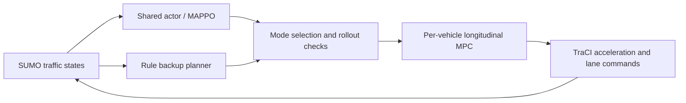

# CoopGate

**Multi-agent controller switching in real Eclipse SUMO.** A runnable research
prototype with MAPPO, longitudinal MPC, rule-based backup, six matched baselines,
episode-level metrics, and reproducible replay. This is **not a certified safety
system or a claim of a novel algorithm**.

## 中文说明

本项目研究多车交互中强化学习与传统规控的切换。使用真实的 Eclipse SUMO
交通仿真器，通过 TraCI 读取状态、下发加速度与换道指令。当前场景为三辆受控车、
两辆 SUMO 背景车的双车道合流。背景车不由 MAPPO 控制。

初版已经区分：

- **实现目标**：真实仿真闭环、MAPPO、OSQP 纵向 MPC、传统回退、独立/迭代/联合门控。
- **实验目标**：在相同策略和测试种子下，比较安全、任务完成、RL 使用率和计算开销。
- **研究假设**：有限背景行为假设与组合搜索是否改善切换；优势必须由数据支持。
- **未完成的理论目标**：统计校准、整回合风险保证、递归可行性证明。

门控的 `score` 是预测安全裕度经过 sigmoid 变换的**启发式分数**，不是安全概率。
MPC 只跟踪纵向速度；横向由 SUMO 连续换道模型执行。没有通信延迟实验。

## Quick start (Python 3.11+)

```powershell
python -m venv .venv
.\.venv\Scripts\python -m pip install torch --index-url https://download.pytorch.org/whl/cpu
.\.venv\Scripts\python -m pip install -e ".[dev]"
.\.venv\Scripts\python -m pytest -q
.\.venv\Scripts\coopgate smoke
# Open the actual SUMO simulator GUI:
.\.venv\Scripts\coopgate smoke --gui
```

On Linux/macOS, replace `.\.venv\Scripts\` with `.venv/bin/`. The `eclipse-sumo`
wheel supplies SUMO and netconvert. Linux may require system OpenGL/FOX libraries;
see the CI workflow and SUMO installation documentation.

```powershell
coopgate train --steps 12000 --seed 7 --out runs/train7
coopgate evaluate --checkpoint runs/train7/policy.pt --seeds 5 --out runs/eval7
coopgate render runs/eval7/trace_joint_robust_nominal.json runs/demo.gif
```

Two independently trained policies and held-out scene seeds are recommended even
for a pilot. A publication study needs a larger, preregistered seed budget and
stronger baselines. `--gui` on `evaluate` executes the same experiment in SUMO-GUI.

## Architecture



The centralized critic is used only during training. Actors use ego-centered
observations of the other four vehicles; the joint supervisor uses the shared
group state at deployment. **The complete system is not fully decentralized.**
The state observations come from SUMO, not a learned perception stack.

## Baselines

| CLI name | Meaning |
|---|---|
| `traditional` | Rule-based target speed/lane + MPC |
| `mappo` | Learned target speed/lane + MPC, without gate |
| `independent` | Each vehicle checks the all-RL prediction, then switches independently |
| `mamps_style` | Monotone iterative mode switching inspired by MAMPS |
| `joint_nominal` | Exhaustive eight-mode search with a nominal background forecast |
| `joint_robust` | Same search with three background acceleration hypotheses |

`mamps_style` is an **adaptation**, not a faithful reproduction of the original
paper's safety-certified system. In particular, this repository does not prove an
invariant terminal safe set. `joint_robust` means worst-case over a **finite set**
of hypotheses, not robustness against every possible background behavior.

Controlled vehicles use SUMO `speedMode=96`, `laneChangeMode=0`; implicit safety
interventions are disabled to avoid crediting simulator shielding to our methods.
Acceleration and jerk are constrained by the MPC. Emergency braking can override
comfort jerk bounds and is explicitly counted. Background vehicles retain SUMO
behavior models. When no candidate passes the checks, emergency braking is a
minimum-risk attempt, never recorded as a safety certificate.

## Reproducibility and metrics

- Training: shared 64x64 categorical actor, centralized 64x64 critic; clipped PPO
  with team GAE, separate terminal/truncation handling, fixed seed.
- Nine actions: three speed targets times stay/left/right; boundary actions clip
  to available lanes.
- Scenarios: nominal, denser initial gaps, braking background lead vehicle.
- Identical evaluation scene seeds and identical frozen policy for all methods.
- Outputs: raw `episodes.csv`, `summary.json`, `manifest.json`, rollout traces,
  comparison PNG/PDF. Collision and success intervals use episode-level Wilson
  intervals. Successful traversal time excludes failures and is labeled as such.
- `render` creates a **trajectory replay from actual SUMO logs**, not a camera
  recording. Real simulator visualization is available through `--gui`.
- A zero empirical collision count does not imply zero risk. Correlated agents
  or consecutive frames are not counted as independent safety trials.

## Research status

See [comparison with prior work](docs/research_comparison.md) for the concrete
hypotheses and [experiment protocol](docs/experiment_protocol.md) for scope.
Pilot artifacts, when present, are under `artifacts/`. Training checkpoints are
small enough to retain for reproducibility; large private runs stay in ignored
`runs/`. The paper draft reports the actual pilot, including negative findings.

Important limitations: finite-horizon approximate predictor, no terminal-set
certificate, no calibrated probability, fixed three-agent topology, longitudinal
MPC only, short training runs, no CARLA dynamics validation yet, no real vehicle
tests, no guaranteed real-world safety, and no established publication novelty.

## Prior work and simulator

- [MAMPS (2019)](https://arxiv.org/abs/1910.12639): multi-agent predictive shielding
  and cascading fallback conflicts are prior art.
- [MAPPO (NeurIPS 2022)](https://arxiv.org/abs/2103.01955) and
  [official implementation](https://github.com/marlbenchmark/on-policy).
- [Spatial-Temporal-Aware Safe MARL (ICRA 2023)](https://arxiv.org/abs/2210.02300).
- [Conformal Policy Learning](https://arxiv.org/abs/2311.01457).
- [Eclipse SUMO documentation](https://eclipse.dev/sumo/docs/).

Code here is a compact independent implementation; third-party simulator and
library licenses remain their own. Original project code is MIT licensed.

## Measured pilot results

Two policies were trained from scratch for 50,000 decision steps each. Every
method was evaluated on the same 15 held-out scenes (5 per variant), for each
policy. There are 180 evaluation executions, **not 180 independent scenes**.
The traditional rows repeat the same policy-independent baseline.

| Method | Seed 7 collisions / successes | Seed 19 collisions / successes |
|---|---|---|
| Traditional + MPC | 0 / 15 | 0 / 15 |
| MAPPO + MPC | 0 / 0 | 14 / 1 |
| Independent gate | 0 / 0 | 0 / 10 |
| MAMPS-style adaptation | 0 / 0 | 0 / 1 |
| Joint nominal search | 0 / 0 | 0 / 3 |
| Joint finite-hypothesis search | 0 / 0 | 2 / 6 |

Each cell reports **collision count / successful episode count**, both out of
15. Traditional control completed all scenes in a mean 22.93 s. These results
do **not** demonstrate an advantage of the proposed joint gate. Independent
gating helped the seed-19 policy; seed 7 illustrates that collision avoidance
alone does not imply task completion. Adding hypotheses did not eliminate
model mismatch or unsafe recovery. All results, including failures, are retained.


[Seed 7 raw episodes](artifacts/seed7/episodes.csv) ·
[Seed 19 raw episodes](artifacts/seed19/episodes.csv) ·
[Prior-work comparison and next research questions](docs/research_comparison.md)

### Run the released checkpoints

After installing the project, use the venv's `coopgate` executable (or activate
the venv before these commands). The scene seeds are 20000–20004, 21000–21004,
and 22000–22004 for nominal, dense, and braking respectively.

```powershell
coopgate evaluate --checkpoint artifacts/seed7/policy.pt --seeds 5 --start-seed 20000 --out runs/reproduce7
coopgate evaluate --checkpoint artifacts/seed19/policy.pt --seeds 5 --start-seed 20000 --out runs/reproduce19
coopgate smoke --gui
```

`artifacts/SHA256SUMS.json` records file checksums. `requirements-pilot.txt`
records the Windows pilot environment; the CPU PyTorch index is included.
Cross-platform numerical differences remain possible.

### Simulator and replay

Actual SUMO-GUI frame (traditional controller, scene 20000):


Replay of the first predetermined nominal test scene using the seed-19 policy
and joint finite-hypothesis gate (not a simulator camera recording):


The manuscript generator is `tools/build_manuscript.py` and requires
`python-docx`. It builds a Chinese first draft from the released measurements.
The current work is a reproducible research prototype, not a submission-ready
claim of novelty or certified safety.
