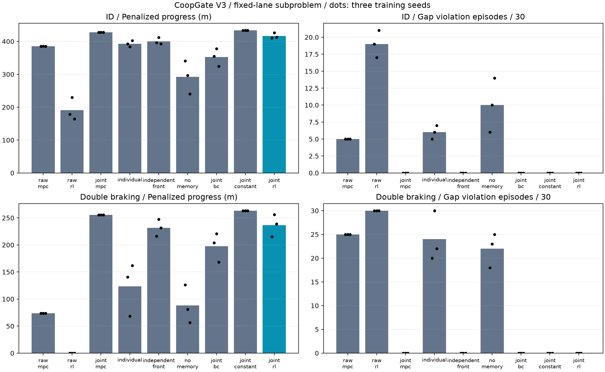
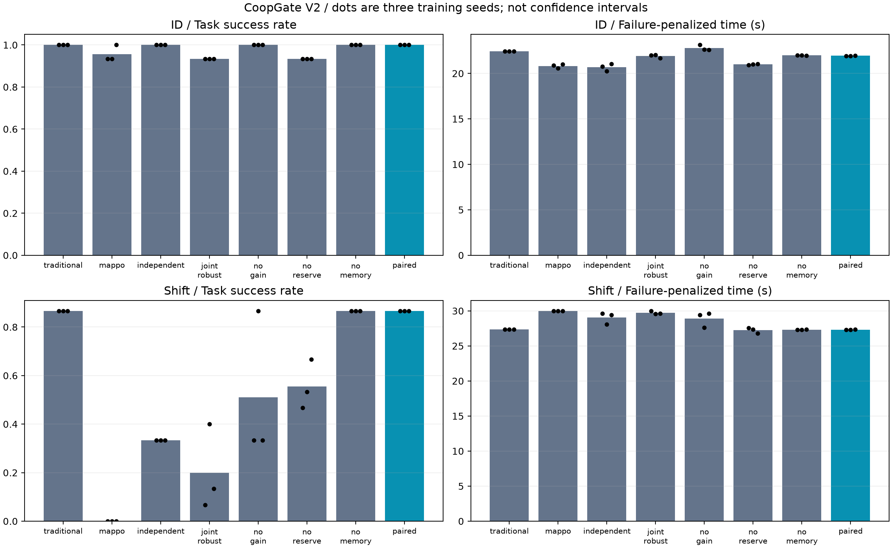
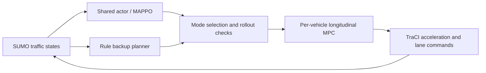
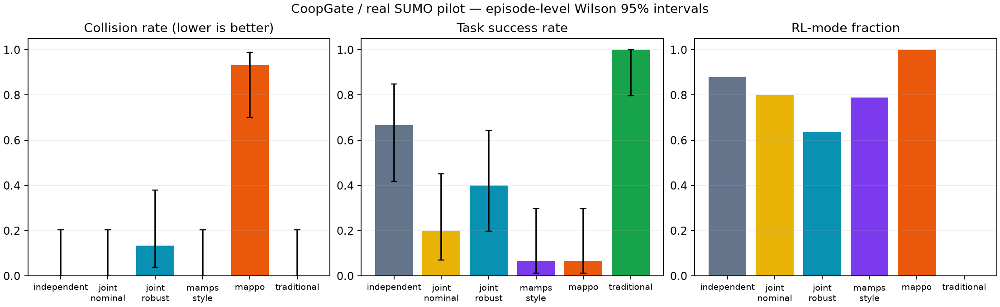
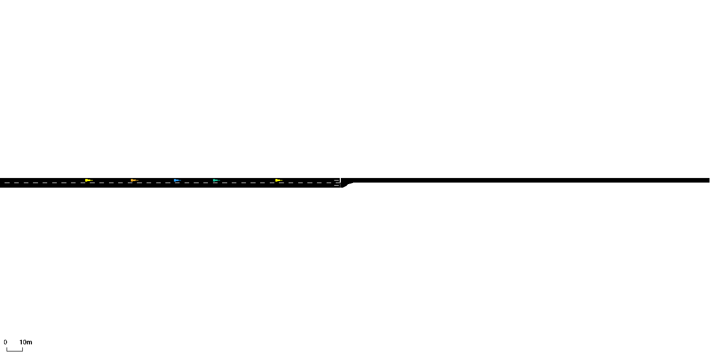
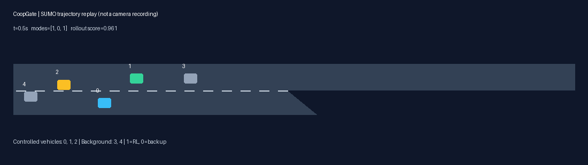

# CoopGate

**Multi-agent controller switching in real Eclipse SUMO.** A runnable research
prototype with MAPPO, longitudinal MPC, rule-based backup, matched baselines,
episode-level metrics, and reproducible replay. This is **not a certified safety
system or a claim of a novel algorithm**.

## V4: fixed-route two-to-one merge pilot

V4 moves the backup contract into a **two-incoming-road / one-outgoing-road SUMO
merge** with three fully controlled cars. It checks conflict-zone occupancy
intervals inside each simulator substep and preserves command memory in the
joint stopping tail. Its proof concerns this route-coordinate contract; the
network has no internal junction links and does not establish arbitrary vehicle
geometry safety, robustness to model error, or mixed-traffic deployment.

Three seeds each trained for 6,000 shielded PPO steps after behavioral cloning.
The frozen pilot contains **960 primary executions**, eight methods, and 20
matched scenes in each of two distributions. The principal finding is negative
for the learning contribution:

| Mean capped per-car arrival time (s), lower is better | Nominal | Dense |
|---|---:|---:|
| Constant acceleration + joint certificate | 11.308 | 10.467 |
| Learned proposals + same certificate | 11.408 | 10.489 |

Both methods completed every tested episode without contract violations. Two
learned seeds matched the constant baseline's arrival times on every scene; the
third was slightly slower. ETA ordering and a 125-action local search did not
beat that baseline. The search's incomplete episodes also demonstrate that safe
stopping does not imply task completion. **These results do not establish MARL
efficiency gains or a publishable novel algorithm.**

An additional post-study audit ran 80 development executions. Hindsight selection
among static priority variants improved only 3/20 cases, saving 0.15 s on average;
this is not a deployable learned policy. Single-worker full-cycle P95 for gated
RL was 15.10 ms (five preselected scenes), not a worst-case timing guarantee.

[V4 results](docs/v4_results.md) · [Theory, assumptions and prior work](docs/theory_v4.md) ·
[Frozen protocol](artifacts/v4/protocol.json) · [Raw results and checkpoints](artifacts/v4)

```powershell
python tools/verify_release_v4.py --replay
python tools/replay_v4.py --gui --out runs/my_v4_gui
python tools/study_v4.py --seed 127
python tools/study_v4.py --seed 139
python tools/study_v4.py --seed 151
# Optional fresh training and independent reproduction output:
python tools/train_v4.py --seed 127 --out runs/my_v4_train127
python tools/study_v4.py --seed 127 --checkpoint runs/my_v4_train127/policy.pt --out runs/my_v4_study127
```

Reproduction defaults use published checkpoints and write to `runs/`; existing
results are never overwritten. Earlier V2/V3 evidence remains unchanged.

## V3: joint braking witnesses and exact chain selection

V3 adds a **separate fixed-lane longitudinal benchmark**: three controlled cars
and an external braking leader. It does not certify or supersede the V2 merge.
The simulator follows an explicit sampled acceleration adapter; the conditional
proof assumes exact dynamics, fixed ordering, bounded leader braking, and joint
compliance with the backup. The primary results are:

- Actuator-command memory in the backup trajectory, a recoverable-set argument,
  and a concrete counterexample to unchecked per-car switching.
- An exact chain dynamic program for the same binary mode-selection problem:
  O(nH) trajectory/compatibility work and O(n) selection under the stated structure.
- Three independently trained policies and **2,020 primary SUMO executions**
  across nine methods, two test distributions, and a separate risk-check set.
- Zero collisions and gap violations in the gated RL test/certification runs,
  but **no demonstrated progress advantage over strong gated baselines**.
  ID mean progress: RL 416.41 m, MPC 427.54 m, constant acceleration 433.36 m.
- Exact outputs in 150 supplementary replay steps; chain implementation full-cycle
  P95 **12.00 ms** on the development machine. This is not a worst-case guarantee.

Learning inside a shield, joint backup checks, and compositional safety already
exist in prior work. This release establishes a reproducible, scoped result;
it does not establish a new general safety framework or real-vehicle readiness.

[V3 results and limitations](docs/v3_results.md) · [Theory and related work](docs/theory_v3.md) ·
[Frozen protocol](artifacts/v3/final/protocol.json) · [Raw data](artifacts/v3/final)



After installing the project (instructions below):

```powershell
python tools/verify_release_v3.py --replay
python tools/replay_v3.py --gui --chain --out runs/my_v3_gui
python tools/study_v3.py --seed 83
python tools/study_v3.py --seed 97
python tools/study_v3.py --seed 109
# Optional fresh training, then pass its checkpoint to study_v3.py:
python tools/train_v3.py --seed 83 --out runs/my_v3_train83
python tools/study_v3.py --seed 83 --checkpoint runs/my_v3_train83/policy.pt --out runs/my_v3_study83
```

Study defaults use published checkpoints and write to `runs/v3_reproduction/seed*`;
existing episode files are never overwritten. The replay uses the real SUMO-GUI.
The V3 manuscript generator is `tools/build_v3_manuscript.py` (requires `python-docx`).
No communication-delay experiment is included.

## 中文说明

本项目研究多车交互中强化学习与传统规控的切换。使用真实的 Eclipse SUMO
交通仿真器，通过 TraCI 读取状态、下发加速度与换道指令。V1/V2场景为三辆受控车、
两辆 SUMO 背景车的双车道合流。背景车不由 MAPPO 控制。

V1初版区分：

- **实现目标**：真实仿真闭环、MAPPO、OSQP 纵向 MPC、传统回退、独立/迭代/联合门控。
- **实验目标**：在相同策略和测试种子下，比较安全、任务完成、RL 使用率和计算开销。
- **研究假设**：有限背景行为假设与组合搜索是否改善切换；优势必须由数据支持。
- **未完成的理论目标**：统计校准、整回合风险保证、递归可行性证明。

门控的 `score` 是预测安全裕度经过 sigmoid 变换的**启发式分数**，不是安全概率。
MPC 只跟踪纵向速度；横向由 SUMO 连续换道模型执行。没有通信延迟实验。

## V2 完成的研究推进

在连续合流路网上训练了三个独立策略，完成 **1030次主实验、90次记忆消融和15次计算耗时实验**。
V2增加备用相对收益筛选、连续时间制动余量，以及与执行器换道承诺一致的预测接口。
完整门控和传统规控在15个同分布场景均全部完成，在15个更强制动场景均完成13个。
完整门控三组策略的强制动碰撞数为0、0、1；去制动余量后为8、7、5。
去收益筛选使两组策略的强制动成功数从13降至5。执行器记忆消融未显示稳定收益。

这些结果支持**学习策略退化防护**的初步定位，尚未证明整体优于传统规控。
完整门控在ID和变化场景的RL使用比例仅约4.7%和2.1%。独立门控在ID场景更快，
但在更强制动下发生更多碰撞。所有负面结果一并发布。
完整门控每回合平均约40个ID决策周期、50个变化场景决策周期处于未验证备用状态，
当前预测检查没有建立逐步安全覆盖；经验完成率不能替代可恢复性证明。

四个冻结控制器（传统、三个完整门控策略）各运行100个独立认证场景，全部成功且无碰撞。
对碰撞和未完成两个事件做8项同时检验，整体95%置信水平下风险上界均约4.95%。
这个有限样本结论只适用于指定SUMO分布，传统基线也通过，不能解释为真实道路安全或性能优越。

三车工程测量中，完整循环包含策略、门控、MPC和TraCI，P95约48.05 ms、最大69.16 ms，
220个决策周期中没有超过500 ms；这是本机样本测量，不是最坏执行时间保证。
150 ms软预算可能产生不同策略，不能自动继承完整枚举的风险检验结果。

[全部数据和消融结果](docs/v2_results.md) · [数学推导与条件](docs/theory_v2.md) ·
[与已有研究的区别及局限](docs/novelty_v2.md) · [冻结协议和开发修正记录](docs/v2_protocol.md)



### 复核与复现V2

安装后可直接使用发布的三个检查点。默认复现写入 `runs/`，拒绝覆盖已有实验。

```powershell
python tools/verify_release_v2.py --replay
python tools/study_v2.py --seed 31 --out runs/v2_reproduction
python tools/study_v2.py --seed 47 --out runs/v2_reproduction
python tools/study_v2.py --seed 59 --out runs/v2_reproduction
python tools/supplement_v2.py --seed 31 --out runs/v2_reproduction
python tools/supplement_v2.py --seed 47 --out runs/v2_reproduction
python tools/supplement_v2.py --seed 59 --out runs/v2_reproduction
# Run timing only after other experiment processes have finished:
python tools/supplement_v2.py --timing --out runs/v2_reproduction
# Open the real SUMO-GUI using a V2 controller:
coopgate evaluate --checkpoint artifacts/v2_final/seed31/policy.pt --methods paired --seeds 1 --continuous-network --commit-lane-changes --budget-ms 10000 --gui --out runs/v2_gui
```

重新训练可使用 `python tools/train_v2.py --seed 31 --out runs/v2_train31`，种子47和59同理；
评估时通过 `tools/study_v2.py --checkpoint runs/v2_train31/policy.pt` 指定新权重。
V2的检查点、逐回合CSV、原始轨迹、训练日志、代码哈希及独立认证集均在
[`artifacts/v2_final`](artifacts/v2_final)，该目录有独立的 `SHA256SUMS.json`。
`tools/build_v2_manuscript.py --out <path.docx>` 从这些结果生成中文论文二稿（需要python-docx）。
V1默认配置与历史数据保留；修正路网和训练方式后，不能将V1/V2差异全部归因于门控算法。

## Quick start (Python 3.11+)

```powershell
python -m venv .venv
.\.venv\Scripts\python -m pip install torch --index-url https://download.pytorch.org/whl/cpu
.\.venv\Scripts\python -m pip install -e ".[dev]"
.\.venv\Scripts\python -m pytest -q
.\.venv\Scripts\coopgate smoke
# Open the actual SUMO simulator GUI:
.\.venv\Scripts\coopgate smoke --gui
```

On Linux/macOS, replace `.\.venv\Scripts\` with `.venv/bin/`. The `eclipse-sumo`
wheel supplies SUMO and netconvert. Linux may require system OpenGL/FOX libraries;
see the CI workflow and SUMO installation documentation.

```powershell
coopgate train --steps 12000 --seed 7 --out runs/train7
coopgate evaluate --checkpoint runs/train7/policy.pt --seeds 5 --out runs/eval7
coopgate render runs/eval7/trace_joint_robust_nominal.json runs/demo.gif
```

Two independently trained policies and held-out scene seeds are recommended even
for a pilot. A publication study needs a larger, preregistered seed budget and
stronger baselines. `--gui` on `evaluate` executes the same experiment in SUMO-GUI.

## Architecture



The centralized critic is used only during training. Actors use ego-centered
observations of the other four vehicles; the joint supervisor uses the shared
group state at deployment. **The complete system is not fully decentralized.**
The state observations come from SUMO, not a learned perception stack.

## Baselines

| CLI name | Meaning |
|---|---|
| `traditional` | Rule-based target speed/lane + MPC |
| `mappo` | Learned target speed/lane + MPC, without gate |
| `independent` | Each vehicle checks the all-RL prediction, then switches independently |
| `mamps_style` | Monotone iterative mode switching inspired by MAMPS |
| `joint_nominal` | Exhaustive eight-mode search with a nominal background forecast |
| `joint_robust` | Same search with three background acceleration hypotheses |

`mamps_style` is an **adaptation**, not a faithful reproduction of the original
paper's safety-certified system. In particular, this repository does not prove an
invariant terminal safe set. `joint_robust` means worst-case over a **finite set**
of hypotheses, not robustness against every possible background behavior.

Controlled vehicles use SUMO `speedMode=96`, `laneChangeMode=0`; implicit safety
interventions are disabled to avoid crediting simulator shielding to our methods.
Acceleration and jerk are constrained by the MPC. Emergency braking can override
comfort jerk bounds and is explicitly counted. Background vehicles retain SUMO
behavior models. When no candidate passes the checks, emergency braking is a
minimum-risk attempt, never recorded as a safety certificate.

## Reproducibility and metrics

- Training: shared 64x64 categorical actor, centralized 64x64 critic; clipped PPO
  with team GAE, separate terminal/truncation handling, fixed seed.
- Nine actions: three speed targets times stay/left/right; boundary actions clip
  to available lanes.
- Scenarios: nominal, denser initial gaps, braking background lead vehicle.
- Identical evaluation scene seeds and identical frozen policy for all methods.
- Outputs: raw `episodes.csv`, `summary.json`, `manifest.json`, rollout traces,
  comparison PNG/PDF. Collision and success intervals use episode-level Wilson
  intervals. Successful traversal time excludes failures and is labeled as such.
- `render` creates a **trajectory replay from actual SUMO logs**, not a camera
  recording. Real simulator visualization is available through `--gui`.
- A zero empirical collision count does not imply zero risk. Correlated agents
  or consecutive frames are not counted as independent safety trials.

## Research status

See [comparison with prior work](docs/research_comparison.md) for the concrete
hypotheses and [experiment protocol](docs/experiment_protocol.md) for scope.
Pilot artifacts, when present, are under `artifacts/`. Training checkpoints are
small enough to retain for reproducibility; large private runs stay in ignored
`runs/`. The paper draft reports the actual pilot, including negative findings.

Important limitations: finite-horizon approximate predictor, no terminal-set
certificate, no calibrated probability, fixed three-agent topology, longitudinal
MPC only, short training runs, no CARLA dynamics validation yet, no real vehicle
tests, no guaranteed real-world safety, and no established publication novelty.

## Prior work and simulator

- [MAMPS (2019)](https://arxiv.org/abs/1910.12639): multi-agent predictive shielding
  and cascading fallback conflicts are prior art.
- [MAPPO (NeurIPS 2022)](https://arxiv.org/abs/2103.01955) and
  [official implementation](https://github.com/marlbenchmark/on-policy).
- [Spatial-Temporal-Aware Safe MARL (ICRA 2023)](https://arxiv.org/abs/2210.02300).
- [Conformal Policy Learning](https://arxiv.org/abs/2311.01457).
- [Eclipse SUMO documentation](https://eclipse.dev/sumo/docs/).

Code here is a compact independent implementation; third-party simulator and
library licenses remain their own. Original project code is MIT licensed.

## Measured pilot results

Two policies were trained from scratch for 50,000 decision steps each. Every
method was evaluated on the same 15 held-out scenes (5 per variant), for each
policy. There are 180 evaluation executions, **not 180 independent scenes**.
The traditional rows repeat the same policy-independent baseline.

| Method | Seed 7 collisions / successes | Seed 19 collisions / successes |
|---|---|---|
| Traditional + MPC | 0 / 15 | 0 / 15 |
| MAPPO + MPC | 0 / 0 | 14 / 1 |
| Independent gate | 0 / 0 | 0 / 10 |
| MAMPS-style adaptation | 0 / 0 | 0 / 1 |
| Joint nominal search | 0 / 0 | 0 / 3 |
| Joint finite-hypothesis search | 0 / 0 | 2 / 6 |

Each cell reports **collision count / successful episode count**, both out of
15. Traditional control completed all scenes in a mean 22.93 s. These results
do **not** demonstrate an advantage of the proposed joint gate. Independent
gating helped the seed-19 policy; seed 7 illustrates that collision avoidance
alone does not imply task completion. Adding hypotheses did not eliminate
model mismatch or unsafe recovery. All results, including failures, are retained.



[Seed 7 raw episodes](artifacts/seed7/episodes.csv) ·
[Seed 19 raw episodes](artifacts/seed19/episodes.csv) ·
[Prior-work comparison and next research questions](docs/research_comparison.md)

### Run the released checkpoints

After installing the project, use the venv's `coopgate` executable (or activate
the venv before these commands). The scene seeds are 20000–20004, 21000–21004,
and 22000–22004 for nominal, dense, and braking respectively.

```powershell
coopgate evaluate --checkpoint artifacts/seed7/policy.pt --seeds 5 --start-seed 20000 --out runs/reproduce7
coopgate evaluate --checkpoint artifacts/seed19/policy.pt --seeds 5 --start-seed 20000 --out runs/reproduce19
coopgate smoke --gui
```

`artifacts/SHA256SUMS.json` records file checksums. `requirements-pilot.txt`
records the Windows pilot environment; the CPU PyTorch index is included.
Cross-platform numerical differences remain possible.

### Simulator and replay

Actual SUMO-GUI frame (traditional controller, scene 20000):



Replay of the first predetermined nominal test scene using the seed-19 policy
and joint finite-hypothesis gate (not a simulator camera recording):



The manuscript generator is `tools/build_manuscript.py` and requires
`python-docx`. It builds a Chinese first draft from the released measurements.
The current work is a reproducible research prototype, not a submission-ready
claim of novelty or certified safety.
