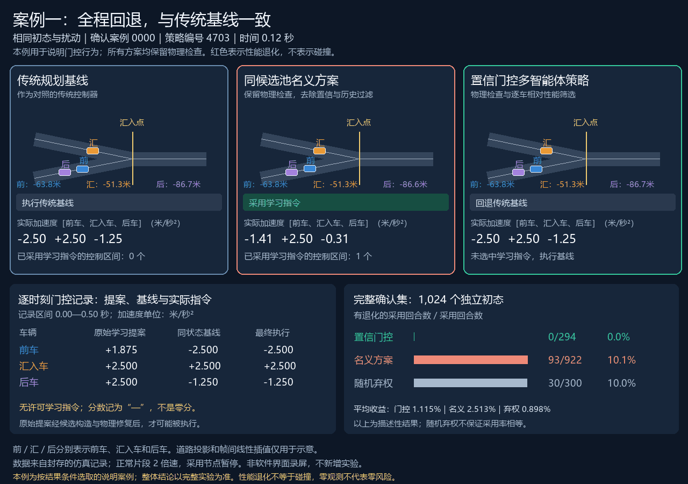
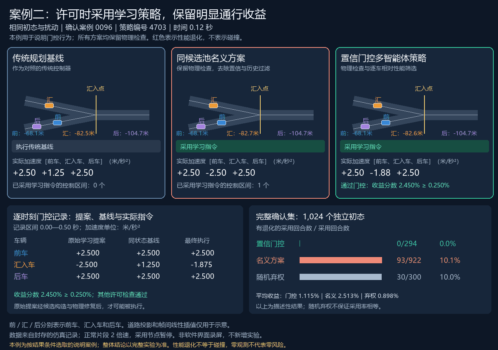
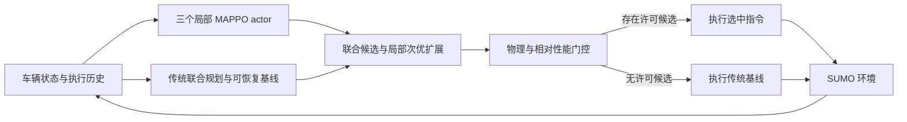
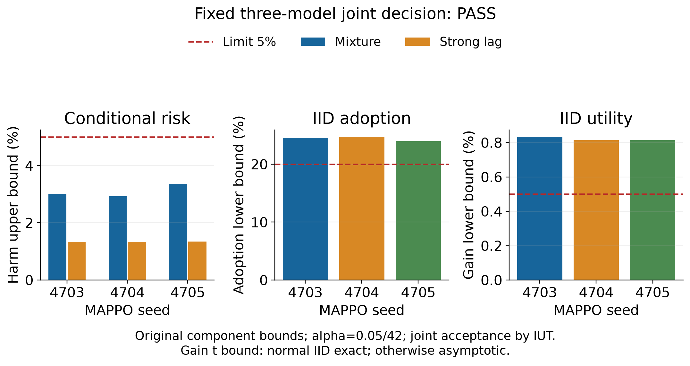

# CoopGate

**置信门控的 MAPPO 多车协同决策：筛选学习候选，未通过时回退传统规划。**

[完整实验与数据](https://github.com/Leo-7GOAT/CoopGate/releases/tag/mappo-attempt6-complete-20261104) · [研究报告](docs/mappo_top_two_attempt6_completed_20261104.md) · [论文稿](artifacts/mappo_ctde_20261101/paper_completed_top_two_20261104/CoopGate_MAPPO候选搜索与置信门控论文_20261104.docx) · [架构对比](docs/architecture_comparison.md) · [历史记录](docs/research_history.md)

CoopGate 是一个基于 SUMO 的三车汇入项目。MAPPO 负责提出联合加速度候选，传统规划提供同状态下的基线指令。门控比较两种方案的预测结果，检查可恢复性和逐车性能，再决定执行哪一条指令。项目目前完成了仿真闭环和独立验证，实车适配尚未完成。

## 仿真案例与执行记录

### 1 回退一致性：不采用学习指令时，与传统基线一致

确认案例 **0000** 全程没有采用学习指令。门控与配对传统基线的每一步时间、实际指令和物理状态完全相同，团队代价也相同。完整记录中另核对了 **19,277 个成功零采用回合（含对照方法）**。



一致性检查针对成功的零采用回合。采用学习指令后，后续状态可能改变，性能需要另外评估；正式校准中出现过逐车退化，因此这里不作全场景不退化的保证。

### 2 收益实例：许可时采用学习候选，汇入车提前 2.5 秒到达



确认案例 **0096** 来自密集汇入场景，三种方案共享初态、执行器和扰动。按确认分片 0 的顺序，选择首个“模型 4703 有学习采用、团队代价改善至少 5%、无观测逐车退化”的回合，未按收益大小选最大值。该例按结果条件选取，用于说明行为，不能代替整体统计。

| 本例指标 | 传统基线 | 置信门控 |
| --- | ---: | ---: |
| 前车到达时间 | 7.0 秒 | 7.0 秒 |
| 汇入车到达时间 | 13.0 秒 | **10.5 秒** |
| 后车到达时间 | 8.5 秒 | 8.5 秒 |
| 团队平均代价 | 9.791667 | **8.916667** |
| 相对基线团队代价改善 | — | **8.936%** |

同候选池名义方案在本例中取得了相同结果：门控保留了这次学习机会，没有额外提高收益。模型 4703 在完整确认集的平均收益为 1.115%，8.936% 只是本例的结果。[原始记录摘录](media/gate_story/benefit.json) · [结果图](media/gate_story/benefit/comparison.png)

### 3 逐时刻决策：看分数、许可条件和实际执行指令

当前门控的执行规则是：

```text
存在通过全部物理、逐车相对性能、相位及适用历史检查的候选
并且该候选的预测收益分数 ≥ 0.25% → 执行选中的学习候选
否则 → 执行同状态下计算的传统基线
```

这里的“置信”使用**有限预测路径上的最坏相对收益分数**，不是动作安全概率，也不是最终闭环收益。分数达到门槛并非唯一条件；回退记录可能没有形成许可候选，此时分数为“—”，不能补成 0 或断言必然小于门槛。

下表直接摘自案例 0096 的汇入车记录。区间以仿真时间表示，加速度单位为米/秒²；“同状态基线”在门控当前状态计算，不是独立基线回合在同一时刻的命令。

| 执行区间 | 原始学习提案 | 同状态基线 | 许可候选收益分数 | 最终指令 | 采用结果 |
| --- | ---: | ---: | ---: | ---: | --- |
| 0.0–0.5 秒 | -2.500 | +1.250 | 2.450% | -1.875 | 学习候选 |
| 0.5–1.0 秒 | -2.500 | -3.750 | — | -3.750 | 传统基线 |
| 1.0–1.5 秒 | -3.125 | -3.750 | — | -3.750 | 传统基线 |
| 1.5–2.0 秒 | -2.500 | -5.000 | 0.557% | -3.750 | 学习候选 |

原始 actor 提案还经过候选组合与物理修复，所以最终学习指令不必等于原始提案。动画左下角同步显示三车的这组字段，在首次采用和门控回合提前结束时暂停。[采用时刻截图](media/gate_story/benefit/adoption.png) · [提前结束截图](media/gate_story/benefit/finish.png)

所有画面都是**实际 SUMO 记录的同步示意回放，非当前在线推理或软件界面录屏**；道路投影与帧间插值仅用于展示，不新增实验和统计推断。正常片段 2 倍速，关键节点有暂停。[回放来源与校验](media/gate_story/benefit/provenance.json)

另保留[逐车性能保护的对比案例 0160](media/gate_comparison/comparison.gif)：门控减少了命令变化代价，但没有更早到达，不能把它包装成通行效率提升。

## 实现与改进

1. **三角色联合训练。** 三个独立局部 actor、训练期集中式 critic、联合 on-policy rollout、GAE 与 PPO 更新；三个角色均有参数更新和实际部署控制贡献。部署不调用 critic，模型由既有策略暖启动。
2. **相对传统基线的候选级门控。** 同状态计算基线，检查候选的物理可恢复性、逐车成本与到达时间、越界相位及观测历史预测；未找到许可候选时执行基线。收益分数是有限预测路径上的最坏相对收益，**不是安全概率**。
3. **持续搜索与局部次优扩展。** 将额外许可条件纳入候选搜索，避免第一个候选被否决后丢弃全部替代方案；保留原候选，至多新增四个由 actor 局部第二选择构造的修复请求。条件集合包含性质不推出真实闭环成本必然改善。
4. **同候选池对照。** 使用同一扩展候选池的名义控制和随机弃权对照；固定三模型、独立校准与确认数据，完整报告收益、采用率、逐车退化及实际回调耗时。

MAPPO 和预测安全过滤采用已有方法。本项目主要改动是把附加许可条件放进候选搜索，并加入有限的局部次优候选。开发实验比较的是这两项改动的组合效果，尚未单独识别各自贡献。

## 执行链路



共享门控集中执行，整个系统不是完全分散式。当前控制输出是三车纵向加速度；基线为有限联合候选规划加可恢复停车检查，不能统一称为通用 MPC。

## 数学模型

下面的符号对应当前代码。车辆编号为 $i\in\{1,2,3\}$；$z_{t,i}$ 是 actor 采样的离散动作，$u_{t,i}$ 是经过候选构造、物理修复和门控后实际执行的加速度指令，两者需要区分。

### 联合策略与 MAPPO 更新

三个 actor 分别读取局部观测 $o_{t,i}$ 和动作掩码 $M_{t,i}$。训练时共享团队奖励，由集中式价值网络 $V_\phi(s_t)$ 估计回报；执行时不调用 critic。

```math
\pi_\theta(\mathbf z_t\mid\mathbf o_t,\mathbf M_t)
=\prod_{i=1}^{3}\pi_{\theta_i}(z_{t,i}\mid o_{t,i},M_{t,i}).
```

优势估计使用 TD 残差和 GAE。$d_t$ 表示真实终止，$e_t$ 表示回合边界；边界阻止优势跨回合回传。采样批次长度截断本身不等于真实终止。

```math
\begin{aligned}
\delta_t&=r_t+\gamma(1-d_t)V_\phi(s_{t+1})-V_\phi(s_t),\\
\widehat A_t&=\delta_t+\gamma\lambda(1-e_t)\widehat A_{t+1},\\
G_t&=\widehat A_t+V_\phi(s_t).
\end{aligned}
```

PPO 的似然比按每辆车的原始采样动作计算。日志保存过滤前的动作和旧策略概率，不能用过滤后的实际指令替换采样动作。

```math
r_{t,i}(\theta)=
\frac{\pi_{\theta_i}(z_{t,i}\mid o_{t,i},M_{t,i})}
{\pi_{\theta_i^{\mathrm{old}}}(z_{t,i}\mid o_{t,i},M_{t,i})}.
```

```math
L_{\mathrm{clip}}(\theta)=
\mathbb E_{t,i}\!\left[
\min\!\left(
 r_{t,i}\widehat A_t,
 \mathrm{clip}(r_{t,i},1-\epsilon,1+\epsilon)\widehat A_t
\right)\right].
```

上式只统计仍参与任务的车辆。实现最小化下面的总损失，其中价值损失 $L_V$ 使用缩放后的 Huber 误差及价值截断，$\mathcal H$ 为动作分布熵。

```math
L_{\mathrm{total}}=-L_{\mathrm{clip}}+0.5L_V-0.01\mathcal H.
```

训练奖励包含团队阶段代价和势函数塑形。训练环境、优势回传与损失计算见 [mappo_ctde.py](src/coopgate/mappo_ctde.py)。

### 执行器与车辆运动

控制指令每 0.5 秒更新一次，在五个 0.1 秒物理子步内保持不变。$m$ 是执行器记忆，$g$ 为增益，$d$ 为阻力系数，$\xi$ 为外部创新；物理子步用 $k$ 编号。

```math
\begin{aligned}
m_{k+1,i}&=\rho_i m_{k,i}+(1-\rho_i)u_{k,i},\\
a_{k,i}&=g_i m_{k+1,i}-d_i v_{k,i}^{2}+\xi_{k,i},\\
v_{k+1,i}&=\mathrm{clip}(v_{k,i}+h a_{k,i},0,20),\\
p_{k+1,i}&=p_{k,i}+h v_{k+1,i},\qquad h=0.1.
\end{aligned}
```

当时间常数 $\tau_i>0$ 时，$\rho_i=\exp(-h/\tau_i)$；无滞后时取零。在线门控使用声明的参数区间，不读取真实隐藏记忆、随机参数和未来创新。

车辆成本由到达时间和实际指令的总变化量组成。$I_{t,i}$ 表示车辆在该控制时刻尚未完成任务，未完成回合按 25 秒截断；这里的指令变化量不能直接解释为实测车身 jerk。

```math
J_i=T_i+0.05\sum_{t=0}^{N-1}I_{t,i}|u_{t,i}-u_{t-1,i}|,
\qquad J_{\mathrm{team}}=\frac{1}{3}\sum_{i=1}^{3}J_i.
```

### 候选收益分数与执行选择

门控状态 $x$ 包含车辆状态、时间、已执行命令历史和记忆区间。$V_B^\omega(x)$ 表示一直执行基线的剩余预测成本，$Q_B^\omega(x,u)$ 表示先执行候选一步、随后转回基线的成本。对本次检查使用的有限预测路径集合 $\Omega(x)$，定义收益分数：

```math
c(x,u)=\min_{\omega\in\Omega(x)}
\frac{V_B^\omega(x)-Q_B^\omega(x,u)}{V_B^\omega(x)},
\qquad V_B^\omega(x)>0.
```

用 $K(x,u)=1$ 表示物理可恢复性、逐车成本及到达时间、相位和适用历史检查均通过。许可候选还必须达到收益门槛：

```math
\mathcal F(x)=\{u\in\mathcal C(x):K(x,u)=1,\ c(x,u)\ge\eta\},
\qquad \eta=0.0025=0.25\%.
```

存在许可候选时，按名义预测成本排序选取；许可集合为空时，执行已经计算的同状态基线 $b(x)$。

```math
u_t\in\arg\min_{u\in\mathcal F(x_t)}\widehat Q_{B,\mathrm{nom}}(x_t,u)
\quad\text{if }\mathcal F(x_t)\ne\varnothing.
```

```math
u_t=b(x_t)\quad\text{if }\mathcal F(x_t)=\varnothing.
```

这是有限预测中的筛选规则，不是逐状态安全概率，也不保证真实闭环成本单调下降。历史拟合与候选搜索的实现见 [TopTwoHistoryGate](experiments/top_two_candidates/gate.py)。

### 闭环收益与采用后的退化风险

每个独立初态都运行配对基线。收益按实际完整回合计算，而不是直接使用门控的预测分数：

```math
\Delta=100\,\frac{J_B-J_G}{J_B}.
```

回合中至少采用过一次学习指令记为事件 $A$。若任一车辆成本或到达时间比基线增加超过 $\varepsilon_h=10^{-9}$，或发生执行失败，则记为退化事件 $D$。

```math
D=\left[\bigcup_{i=1}^{3}
\left(\{J_i^G>J_i^B+\varepsilon_h\}\cup
\{T_i^G>T_i^B+\varepsilon_h\}\right)\right]
\cup\{\mathrm{execution\ failure}\},
\qquad R=\Pr(D\mid A).
```

$R$ 保护的是采用后的逐车相对性能，不是碰撞概率。统计验证同时约束风险、采用率和平均收益；全回退虽然能保持零采用回合的一致性，却无法通过采用率和收益门槛。[完整统计口径](docs/mappo_top_two_attempt6_completed_20261104.md)

## 与端到端和分层架构有什么区别

| 比较维度 | 典型端到端驾驶 | 典型分层规控 | CoopGate 当前实现 |
| --- | --- | --- | --- |
| 主要问题 | 从观测学出驾驶输出 | 决策、规划、控制如何分工 | 是否采用当前学习候选 |
| 典型链路 | 图像或状态 → 网络 → 轨迹或控制 | 行为决策 → 规划 → 跟踪控制 | 学习候选与传统基线 → 门控 → 执行 |
| RL 的位置 | 可用于训练驾驶网络，也可用模仿学习 | 可位于行为层或其他层 | 三个 actor 生成协同加速度候选 |
| 回退机制 | 是否设置由具体实现决定 | 是否设置由具体实现决定 | 在当前任务中显式计算并执行基线 |
| 当前证据 | 本项目未进行统一性能对照 | 本项目未复现 PPO→A*→MPC 对照 | 已完成固定路线三车 SUMO 验证 |

**门控与分层可以组合。** 分层强调模块分工，门控强调采用条件；端到端网络也可以带门控。这里比较组织方式，不声称本项目普遍优于端到端或分层系统。[详细解释与参考文献](docs/architecture_comparison.md)

## 已完成实验

**7,168 个独立初态，59,392 个方法回合，全部完成独立控制器与物理回放。** 其中校准 6,144 个初态、43,008 回合；IID 确认 1,024 个初态、16,384 回合。三个固定模型共同通过原登记的联合判定。

| MAPPO 模型 | 平均配对代价改善 | 改善下界 | 采用率下界 | 混合条件退化风险上界 |
| --- | ---: | ---: | ---: | ---: |
| 4703 | 1.115% | 0.833% | 24.513% | 3.008% |
| 4704 | 1.093% | 0.814% | 24.699% | 2.928% |
| 4705 | 1.099% | 0.814% | 23.958% | 3.361% |
| 原定门槛 | — | > 0.5% | ≥ 20% | ≤ 5% |



- **退化定义：** 任一车辆成本或到达时间比配对基线变差，或执行失败；该风险不是碰撞概率。校准有害采用数为 5/1819、5/1865、8/1835，确认目标为 0/294、0/296、0/288；零观测不代表零风险。
- **筛选对照：** 同候选池随机弃权控制仍有 30、38、32 个有害采用回合，平均收益为 0.898%、0.896%、0.923%。弃权概率由校准样本估计，不保证确认集或总体采用率相等；这些对照是描述性比较。
- **回退核对：** 19,277 个成功零采用回合的指令、时间及物理轨迹与配对基线完全一致。
- **统计口径：** 原登记水平 0.05/42，采用率下界至少 20%、混合与强滞后风险上界均不超过 5%、收益下界严格超过 0.5%；三个模型均须通过。收益 t 界在正态 IID 下精确，否则为渐近推断。[全部方法、数值及假设](docs/mappo_top_two_attempt6_completed_20261104.md)

## 快速运行

Python 3.11+。以下创建独立演示环境，不改动历史实验的冻结运行环境：

```bash
python -m venv .venv-demo
# Linux/macOS: source .venv-demo/bin/activate
# Windows PowerShell: .\.venv-demo\Scripts\Activate.ps1
python -m pip install -e ".[dev,fast]"
python -m pip install -r requirements-baselines.txt
coopgate smoke
coopgate smoke --gui
```

`smoke` 用于确认 SUMO 连通性，不是论文完整实验或 MAPPO 训练入口。Linux 的系统依赖见 [CI 工作流](.github/workflows/test.yml)。

复核完整已完成实验：克隆仓库，下载 [Release](https://github.com/Leo-7GOAT/CoopGate/releases/tag/mappo-attempt6-complete-20261104) 中全部 **36 个 `completed_part_*.zip`**，分别解压到仓库根目录，不要拼接，然后执行：

```bash
python tools/mappo_completed_top_two_attempt6.py
```

复核器要求原运行依赖版本与登记一致；不匹配时会拒绝，不应修改登记文件绕过检查。中文动画可直接用公开摘录重建，无需下载完整实验；系统需提供微软雅黑、Noto Sans CJK 或文泉驿微米黑字体：

```bash
python tools/render_gate_story.py --case benefit --out runs/gate-benefit
python tools/render_gate_story.py --case fallback --out runs/gate-fallback
```

## 代码与研究资料

| 内容 | 入口 |
| --- | --- |
| 联合 MAPPO 训练与模型加载 | [mappo_ctde.py](src/coopgate/mappo_ctde.py) · [部署审计](src/coopgate/mappo_deployment.py) |
| 当前候选搜索与门控 | [TopTwoHistoryGate](experiments/top_two_candidates/gate.py) |
| 当前实验入口与固定方案 | [运行器](tools/run_mappo_top_two_formal.py) · [登记协议](docs/mappo_top_two_formal_attempt6_20261104_protocol.md) |
| 完整结果与全部对照 | [实验报告](docs/mappo_top_two_attempt6_completed_20261104.md) · [正式分析](artifacts/mappo_ctde_20261101/formal_mappo_attempt6_top_two_recovery_20261104/analysis) |
| 论文及可复核原始数据 | [完整发布](https://github.com/Leo-7GOAT/CoopGate/releases/tag/mappo-attempt6-complete-20261104) |
| 历史失败、恢复过程与旧版本 | [研究记录索引](docs/research_history.md) |

## 适用范围与限制

当前结果限定于固定路线三车、已知执行器类别、结构化同步状态及声明的扰动分布。未证明裸 MAPPO 普遍优于强规划器，也未证明集中式 critic 相对 IPPO 的独立优势。MPS/MAMPS 为共享物理检查的适配器，不能当成完整先进方法复现。

完整门控回调 P95 为 **163–186 ms**，最大 **1.87–2.62 s**，仍有调用超过 500 ms 控制周期。当前没有硬实时、视觉端到端、自由横向规划或实车安全保证；论文稿也不等于已经发表。旧实验与负面结果均保留在[历史索引](docs/research_history.md)。
