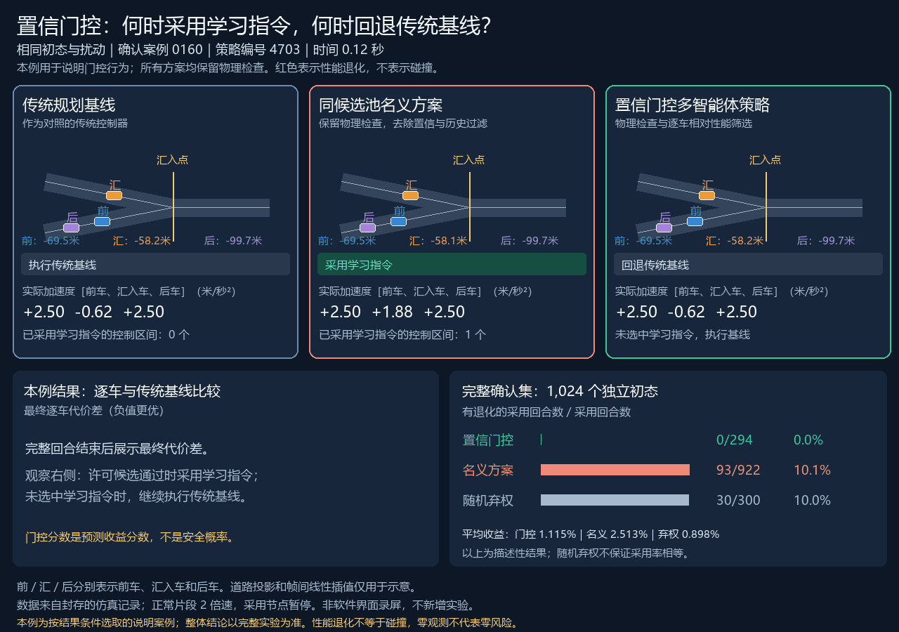
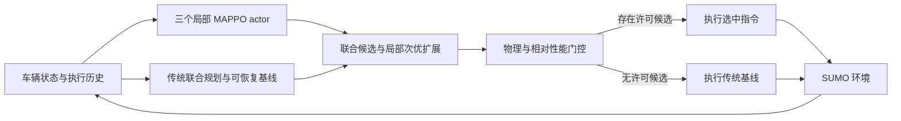

# CoopGate

**置信门控的 MAPPO 多车协同决策：筛选学习候选，未通过时回退传统规划。**

[完整实验与数据](https://github.com/Leo-7GOAT/CoopGate/releases/tag/mappo-attempt6-complete-20261104) · [研究报告](docs/mappo_top_two_attempt6_completed_20261104.md) · [论文稿](artifacts/mappo_ctde_20261101/paper_completed_top_two_20261104/CoopGate_MAPPO候选搜索与置信门控论文_20261104.docx) · [架构对比](docs/architecture_comparison.md) · [历史记录](docs/research_history.md)

CoopGate 研究固定路线三车汇入中的一个问题：**学习策略提出的动作，什么时候可以执行，什么时候应交还传统基线？** 项目使用真实联合训练的 MAPPO 生成候选，以物理可恢复性和逐车相对性能约束筛选，在 Eclipse SUMO 中完成闭环验证。当前是仿真研究实现，尚未完成实车部署。

## 仿真记录回放



左、中、右三栏共享相同初态、执行器和扰动，分别展示传统基线、去掉置信与历史过滤的同候选池方案、完整置信门控。所有方案均保留物理检查。动画在首次采用学习指令时暂停，展示 **0.396% 的预测收益分数通过 0.250% 门槛**，其余未选中学习指令的区间执行基线。

本例中，名义控制采用 5 个学习控制区间，汇入车代价比基线增加 0.0625；门控只采用 1 个区间，代价减少 0.125。**三方到达时间相同，该例的改善来自实际命令变化项，不能解读为通行更快或避免碰撞。** 右下角同时展示模型 4703 在全部 1,024 个确认初态上的退化数与平均收益，保留名义方案平均收益更高的取舍。

案例按分片 0 的顺序选择首个“门控有采用、名义方案有逐车成本退化”的模型 4703 回合，不按收益大小排序；这是为解释行为而按结果条件选取的案例，不是代表性随机样本。**道路投影与帧间插值为示意，数据来自封存 SUMO 记录，非 GUI 录屏，不新增实验。** 正常片段 2 倍速，采用节点和结尾有停顿。[静态结果图](media/gate_comparison/comparison.png) · [记录摘录](media/gate_comparison/case.json) · [来源校验](media/gate_comparison/provenance.json) · [基础回放](media/recorded_replay.gif)

## 核心贡献

1. **可核验的三角色 MAPPO。** 三个独立局部 actor、训练期集中式 critic、联合 on-policy rollout、GAE 与 PPO 更新；三个角色均有参数更新和实际部署控制贡献。部署不调用 critic，模型由既有策略暖启动。
2. **相对传统基线的候选级门控。** 同状态计算基线，检查候选的物理可恢复性、逐车成本与到达时间、越界相位及观测历史预测；未找到许可候选时执行基线。收益分数是有限预测路径上的最坏相对收益，**不是安全概率**。
3. **持续搜索与局部次优扩展。** 将额外许可条件纳入候选搜索，避免第一个候选被否决后丢弃全部替代方案；保留原候选，至多新增四个由 actor 局部第二选择构造的修复请求。条件集合包含性质不推出真实闭环成本必然改善。
4. **区分筛选效果与少用学习策略。** 使用同一扩展候选池的名义控制和随机弃权对照；固定三模型、独立校准与确认数据，完整报告收益、采用率、逐车退化及实际回调耗时。

MAPPO、预测安全过滤及学习加备份已有研究先例；本项目的改进集中在候选搜索与相对性能筛选的组合及其完整验证。独立开发实验验证了整套候选改动，尚未单独隔离持续搜索和次优扩展各自的贡献。

## 执行链路



共享门控集中执行，整个系统不是完全分散式。当前控制输出是三车纵向加速度；基线为有限联合候选规划加可恢复停车检查，不能统一称为通用 MPC。

## 与端到端和分层架构有什么区别

| 比较维度 | 典型端到端驾驶 | 典型分层规控 | CoopGate 当前实现 |
| --- | --- | --- | --- |
| 主要问题 | 从观测学出驾驶输出 | 决策、规划、控制如何分工 | 是否采用当前学习候选 |
| 典型链路 | 图像或状态 → 网络 → 轨迹或控制 | 行为决策 → 规划 → 跟踪控制 | 学习候选与传统基线 → 门控 → 执行 |
| RL 的位置 | 可用于训练驾驶网络，也可用模仿学习 | 可位于行为层或其他层 | 三个 actor 生成协同加速度候选 |
| 回退机制 | 是否设置由具体实现决定 | 是否设置由具体实现决定 | 在当前任务中显式计算并执行基线 |
| 当前证据 | 本项目未进行统一性能对照 | 本项目未复现 PPO→A*→MPC 对照 | 已完成固定路线三车 SUMO 验证 |

**门控与分层可以组合。** 分层强调模块分工，门控强调采用条件；端到端网络也可以带门控。这里比较组织方式，不声称本项目普遍优于端到端或分层系统。[详细解释与参考文献](docs/architecture_comparison.md)

## 已完成实验

**7,168 个独立初态，59,392 个方法回合，全部完成独立控制器与物理回放。** 其中校准 6,144 个初态、43,008 回合；IID 确认 1,024 个初态、16,384 回合。三个固定模型共同通过原登记的联合判定。

| MAPPO 模型 | 平均配对代价改善 | 改善下界 | 采用率下界 | 混合条件退化风险上界 |
| --- | ---: | ---: | ---: | ---: |
| 4703 | 1.115% | 0.833% | 24.513% | 3.008% |
| 4704 | 1.093% | 0.814% | 24.699% | 2.928% |
| 4705 | 1.099% | 0.814% | 23.958% | 3.361% |
| 原定门槛 | — | > 0.5% | ≥ 20% | ≤ 5% |


- **退化定义：** 任一车辆成本或到达时间比配对基线变差，或执行失败；该风险不是碰撞概率。校准有害采用数为 5/1819、5/1865、8/1835，确认目标为 0/294、0/296、0/288；零观测不代表零风险。
- **筛选对照：** 同候选池随机弃权控制仍有 30、38、32 个有害采用回合，平均收益为 0.898%、0.896%、0.923%。弃权概率由校准样本估计，不保证确认集或总体采用率相等；这些对照是描述性比较。
- **回退核对：** 19,277 个成功零采用回合的指令、时间及物理轨迹与配对基线完全一致。
- **统计口径：** 原登记水平 0.05/42，采用率下界至少 20%、混合与强滞后风险上界均不超过 5%、收益下界严格超过 0.5%；三个模型均须通过。收益 t 界在正态 IID 下精确，否则为渐近推断。[全部方法、数值及假设](docs/mappo_top_two_attempt6_completed_20261104.md)

## 快速运行

Python 3.11+。以下创建独立演示环境，不改动历史实验的冻结运行环境：

```bash
python -m venv .venv-demo
# Linux/macOS: source .venv-demo/bin/activate
# Windows PowerShell: .\.venv-demo\Scripts\Activate.ps1
python -m pip install -e ".[dev,fast]"
python -m pip install -r requirements-baselines.txt
coopgate smoke
coopgate smoke --gui
```

`smoke` 用于确认 SUMO 连通性，不是论文完整实验或 MAPPO 训练入口。Linux 的系统依赖见 [CI 工作流](.github/workflows/test.yml)。

复核完整已完成实验：克隆仓库，下载 [Release](https://github.com/Leo-7GOAT/CoopGate/releases/tag/mappo-attempt6-complete-20261104) 中全部 **36 个 `completed_part_*.zip`**，分别解压到仓库根目录，不要拼接，然后执行：

```bash
python tools/mappo_completed_top_two_attempt6.py
```

复核器要求原运行依赖版本与登记一致；不匹配时会拒绝，不应修改登记文件绕过检查。中文动画可直接用公开摘录重建，无需下载完整实验；系统需提供微软雅黑、Noto Sans CJK 或文泉驿微米黑字体：

```bash
python tools/render_gate_comparison.py --out runs/gate-comparison
```

## 代码与研究资料

| 内容 | 入口 |
| --- | --- |
| 联合 MAPPO 训练与模型加载 | [mappo_ctde.py](src/coopgate/mappo_ctde.py) · [部署审计](src/coopgate/mappo_deployment.py) |
| 当前候选搜索与门控 | [TopTwoHistoryGate](experiments/top_two_candidates/gate.py) |
| 当前实验入口与固定方案 | [运行器](tools/run_mappo_top_two_formal.py) · [登记协议](docs/mappo_top_two_formal_attempt6_20261104_protocol.md) |
| 完整结果与全部对照 | [实验报告](docs/mappo_top_two_attempt6_completed_20261104.md) · [正式分析](artifacts/mappo_ctde_20261101/formal_mappo_attempt6_top_two_recovery_20261104/analysis) |
| 论文及可复核原始数据 | [完整发布](https://github.com/Leo-7GOAT/CoopGate/releases/tag/mappo-attempt6-complete-20261104) |
| 历史失败、恢复过程与旧版本 | [研究记录索引](docs/research_history.md) |

## 当前边界

当前结果限定于固定路线三车、已知执行器类别、结构化同步状态及声明的扰动分布。未证明裸 MAPPO 普遍优于强规划器，也未证明集中式 critic 相对 IPPO 的独立优势。MPS/MAMPS 为共享物理检查的适配器，不能当成完整先进方法复现。

完整门控回调 P95 为 **163–186 ms**，最大 **1.87–2.62 s**，仍有调用超过 500 ms 控制周期。当前没有硬实时、视觉端到端、自由横向规划或实车安全保证；论文稿也不等于已经发表。旧实验与负面结果均保留在[历史索引](docs/research_history.md)。
