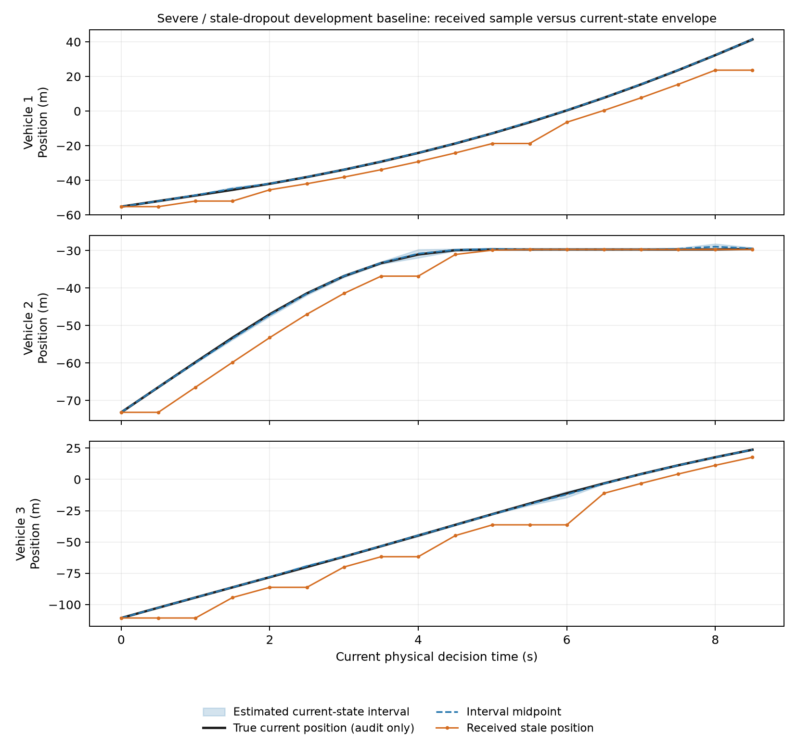

# 陈旧观测状态区间：完整开发轨迹上的覆盖与定位误差

该离线分析正常退出，使用已完成并封存的 V45 全部 39 条真实 SUMO 轨迹、三个旧
开发初态。先提交实现、数学范围、检查和审计器，再生成固定报告。未读取正在运行的
正式实验效果，没有新增 SUMO 执行、训练、控制动作或独立统计样本。

全部 **791 次接收观测**均核对，包括 778 个成功返回的决策及 13 次中止前最后观测。
三个初态各包含十三种原方法/模型组合，没有删去失败或几何违规轨迹。所有估计先由
公共字段计算完，再与真实状态和执行器记忆比较；最大区间包含违反量均为 **0**。

## 描述性结果

位置误差是在该组全部接收帧及三辆车上取平均，不是独立样本的总体误差估计。
中点仅用于说明定位精度，不能将区间替换成一个确定状态来继承原安全证书。

| 观测条件 | 接收帧（含终端） | 原观测位置 MAE | 区间中点位置 MAE | 原最大位置误差 | 中点最大位置误差 |
|---|---:|---:|---:|---:|---:|
| 干净参考 | 356 | 0 m | 0 m | 0 m | 0 m |
| 偏置＋抖动 | 278 | 1.1773 m | 1.1749 m | 1.6630 m | 1.6630 m |
| 陈旧＋丢帧 | 157（含13终端） | 6.4011 m | 0.1199 m | 25.3979 m | 0.9316 m |

陈旧组最大年龄为三个决策周期，即 1.5 s；状态区间最大位置宽度 **4.9003 m**，
最大速度宽度 **6.2963 m/s**。这揭示了两件不同的事：按时间戳补偿能减少本开发点的
位置偏差，但实际不确定性仍不可忽略。偏置组误差变化很小，不能将陈旧组结果推广为
任意感知扰动都得到同样改善。

下图只展示预定严重失配/陈旧观测开发点的基线轨迹，含导致原控制器中止的最后观测。
黑线真值仅供离线审计；蓝色包络由公共输入产生。原任务失败保持，不将此图解释为
新的闭环控制或成功停车结果。完整数值仍覆盖全部 39 条轨迹。

## 数学与信息边界

在准确来源时间戳、有界测量误差、命令前缀和声明模型范围内，状态/执行器区间具有
实数运算下的归纳包含论证。代码通过端点、独立随机参数和隐藏 FIFO 的传播检查，
另核对每个公共前缀与完整流同前缀一致、错误来源时间戳的拒绝以及输入不被修改。

这不是已验证的区间算术实现。程序使用 float64 与工程外扩，不能因这些有限检查
通过就宣称所有实数轨迹都获得机器证书。测量来源时间戳必须可信，不能用接收时刻
代替来源时刻；模型范围若不覆盖真实动力学，归纳前提不成立。

该估计器获得了原 lag_strong 控制器没有的公开信息：每车来源时间戳和覆盖三种组合
执行器族的外包络。没有访问实际参数、真实执行器记忆或未来创新。比较仅说明在这些
额外前提下的状态估计行为；不是同信息条件的控制方法排名。

## 尚未证明的控制结论

没有让任何车辆执行新控制命令。原有任务超时、中止、几何违规、收益和采用率全部
保持原结果；原精确状态停车证书也未恢复。把中点送给旧控制器仍会忽略区间宽度及
它的执行器模型失配，不能因此宣称安全兜底已经可靠。

后续控制验证须区分时间戳补偿、执行器模型范围及真正按状态集合检查恢复条件的
作用，保留全部失败，并使用独立测试验证收益/采用代价。该开发不替换正在运行的
完整失配实验、独立风险验收或已冻结的公平对照。

- [实现与归纳逻辑](aged_observation_envelope.md)
- [全部逐帧估计、误差与输入哈希](../artifacts/diagnostics/aged_observation_envelope/report.json)
- [审计实现](../tools/audit_aged_observation_envelope.py)
- [传播和接口检查](../tests/test_aged_observation_envelope.py)
- [因果前缀与时间戳检查](../tests/test_aged_observation_causality.py)

报告 SHA-256：`453ce65cbd1a0de87b5e83b27a5fc8b8469f4912102f71a5ff0c19a4304b1aa9`。
