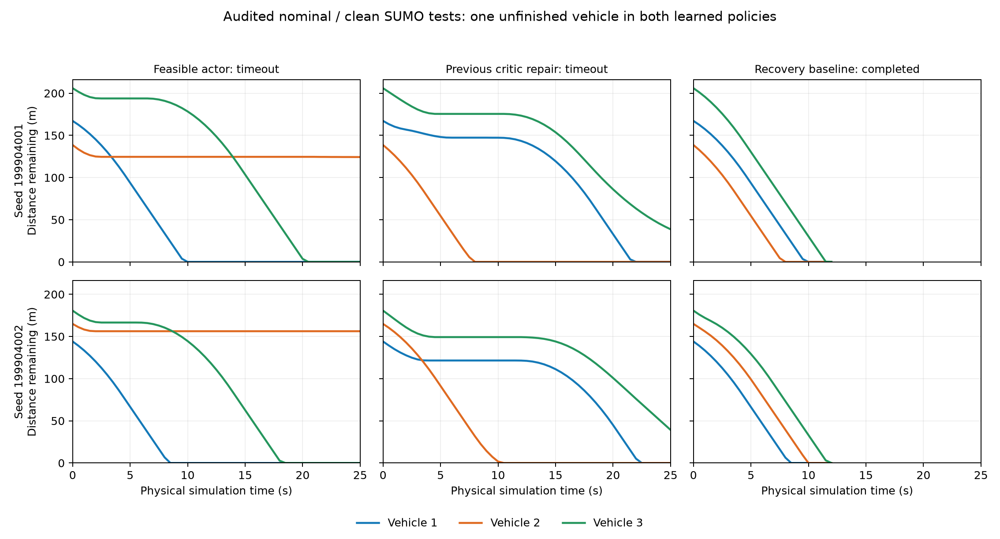

# 可执行区间 actor：完整训练和测试仍未达到任务目标

固定 32,768 次真实 SUMO 决策、30 个测试条件全部执行，原采集进程退出码为 0。
启动前提交的独立审计也正常退出：物理子步、奖励、五个回放数组、最终检查点下的
actor 提案及原 MCTS 选择全部重放一致。新策略仍完成 **0/10** 三车任务，上一版
执行语义 critic 策略也为 **0/10**，同条件传统恢复基线为 **10/10**。这项改动未通过
预定任务目标；全部失败保留，不能用它作为成熟 DMPS 方法被击败的证据。

## 改动及执行证据

仅新增在线/目标 actor 的可执行区间输出映射；父四个 critic 输入映射、原作者
TD3/MCTS 函数体、初始网络权重、奖励和交互预算保持。初始权重相同不等于映射后的
初始策略函数相同。任务适配已明确披露，既不是原论文实验的完整复现，也不是真正
MARL 协作训练的验证。

- 实际训练 32,768 次决策、163,840 个物理子步。
- 回放含 177 条原训练器拒绝提案的合成惩罚，共 32,945 行；没有把它们当成实际交互。
- critic 各更新 30,704 次，actor 更新 15,352 次，六组网络权重均有限且变化。
- 在线/目标 actor 分别调用 46,072/30,704 次；四个 critic 钩子均完整覆盖。
- 656 个非空训练回合包含最后预算前缀，完成三车任务的训练回合为 0。
- 新旧测试策略各有 500 次实际决策，原 MCTS 均接受提案，替换次数为 0。
- 新策略无探索测试请求的指令区间违反最大值为 0；没有据此推断性能改善。

训练探索噪声和目标平滑噪声仍在 actor 输出映射之后施加，可再次触发执行约束。
因此不能将该无探索测试结果推广为全部训练提案免截断。梯度平台减少的设计动机
与最终任务成功是两个不同命题。

## 全部三方测试

两条新鲜初态 seed 199904001/199904002，分别跨名义无外扰及四类动力学/均匀扰动，
共十条件。仅有两个独立初态，不将十条件当成十个 IID 样本。

| 策略 | 三车任务完成 | 同条件基线完成 | 相对完整基线退化 | 全范围成本收益 |
|---|---:|---:|---:|---|
| 可执行区间 actor | 0/10 | 10/10 | 10/10 | null：存在任务失败 |
| 上一版执行语义 critic | 0/10 | 10/10 | 10/10 | null：存在任务失败 |

两个学习角色均没有控制器异常、碰撞或路线几何违反，全部因未在 25 s 内完成而失败。
每条件都观察到相对参考的实际采用，无不可评估采用。共同基线的 1,205 个物理子步
及 241 条参考命令也独立核对。完整的二十条学习轨迹还重放了实际最终检查点下的
提案与名义 MCTS 选择，没有将记录的动作直接冒充策略重演。

名义无外扰下，新策略两初态的三车封顶完成时间分别为 [10,25,20.5] s 和
[8.5,25,18.5] s；第二辆车在截止时分别停在 -64.334 m、-96.238 m，速度均为零。
父策略在这两初态分别为 [22,8,25] s、[22.5,10.5,25] s，第三辆车未完成。
新改动改变了停滞的车辆，并未解决团队任务。不能仅展示已完成车辆的时间改善。

图仅展示两个预定名义无外扰条件的实际物理轨迹。纵轴为距 60 m 目标的剩余距离，
到达后显示为零；不更改原始位置、完成时间或成本。其他八个条件的失败仍在全量审计中。

## 结论与后续边界

执行约束映射、训练更新及策略重放均正确，而任务完成目标仍失败。因此，不能把
可执行区间参数化单独当作本任务的性能修复，更不能继续仅靠检查梯度存在就声称改进。
原 MCTS 没有替换这些安全但无法完成任务的提案，这说明本次失败不是测试中被屏蔽
动作强制接管；它不证明原作者方法在充分训练或其他配置下无效。

后续学习改动需要独立依据与新的固定测试。当前失败不改变 CoopGate 三个固定模型、
正式风险校准、共享预算公平比较或扩展失配验证，也不构成对原方法族的优越性结论。
资源共享下的 planner 计时不能解释成隔离部署延迟或最坏执行时间。

- [启动前协议](dmps_feasible_actor_protocol.md)
- [真实退出证明](../artifacts/literature_reproduction/dmps_feasible_actor_training/observed_execution_exit.json)
- [全量审计](../artifacts/literature_reproduction/dmps_feasible_actor_training/verification.json)
- [资源和计时范围](dmps_feasible_actor_resource_context.md)

完成回执 SHA-256：`7228c65539d50f379b60248698d9c1b30db3871877941f1c7b39eba22ceb6680`。
