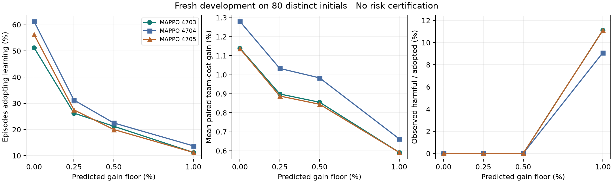

# 真实 MAPPO 门控的八十初态开发结果

80 个全新独立初态的完整开发实验已经完成。三个固定 MAPPO 模型、四个置信度门槛
和同一个传统强基线共执行 1040 次实际 SUMO 仿真；四个采集进程、四个独立复核
进程及主编排进程实际退出码全部为 0。24140 条指令、120700 个物理子步及全部
完整控制器重放通过检查。独立汇总工具再次核对所有采用、逐车退化和配对收益。

每个模型都是已完成联合 on-policy 训练并经过独立审计的 MAPPO，具有三个独立
局部 actor、集中式 critic、GAE 和 clipped PPO 更新。新门控没有替换权重或把
监督模仿训练改称 PPO。通过旧 PI 单车 actor 初始化的来源继续披露，不声称从零
开始的纯模型无关学习，也不继承旧模型的风险证书。

## 全部门槛结果

收益为每个初态相对同一基线的百分比成本改善，再对 80 个初态取平均。它不是总
成本之比，也不是置信下界。每行仍使用同样的 80 个配对初态，不能相加成 960 个
独立初态。没有删除未采用回合、慢调用或高门槛下的负结果。

| MAPPO 模型 | 预测收益门槛 | 采用回合 | 有害采用 | 平均配对成本改善 |
|---|---:|---:|---:|---:|
| 4703 | 0 | 41/80 | 0/41 | 1.140% |
| 4703 | 0.25% | 21/80 | 0/21 | 0.899% |
| 4703 | 0.50% | 17/80 | 0/17 | 0.855% |
| 4703 | 1.00% | 9/80 | 1/9 | 0.591% |
| 4704 | 0 | 49/80 | 0/49 | 1.280% |
| 4704 | 0.25% | 25/80 | 0/25 | 1.033% |
| 4704 | 0.50% | 18/80 | 0/18 | 0.983% |
| 4704 | 1.00% | 11/80 | 1/11 | 0.663% |
| 4705 | 0 | 45/80 | 0/45 | 1.138% |
| 4705 | 0.25% | 22/80 | 0/22 | 0.888% |
| 4705 | 0.50% | 16/80 | 0/16 | 0.845% |
| 4705 | 1.00% | 9/80 | 1/9 | 0.591% |

所有方法均完成仿真，没有观测到碰撞或物理约束违反。成功且没有采用学习的 677 个
控制器回合，其整条指令和状态轨迹与配对基线逐字节相同。首次采用前的指令也均
精确等于基线；本开发集合上的回合采用事件随门槛提高而嵌套。

## 保留高门槛的反例

1% 门槛下三个模型都在同一新初态 `97254303 tight_headway lag_strong bias` 出现
有害采用。前车成本增加 0.015625，后车成本减少 0.4375、到达时间减少 0.5 秒，
团队平均成本仍然改善。然而原研究保护每辆车，前车的真实退化超过原来的 1e-9
容差，因此必须计为有害，不能用团队收益抵消。它是一个共享环境反例的三个模型
结果，不能算三个独立反例，也不能因损失小而删除。

这表明，预测置信度分数和门槛本身不是实际安全概率。更高门槛可以改变首次采用
时刻及整个后续闭环，风险不一定随门槛单调下降；正式验证必须针对完整固定控制器。

## 固定下一阶段候选

在任何新的正式数据采集之前，固定三个模型共用 0.25% 门槛，即代码参数 0.0025。
这是已注册正门槛中最低的一个，在开发数据上保留 26.25%、31.25%、27.50% 的采用
率，平均配对收益分别为 0.899%、1.033%、0.888%，未观测到有害采用。选择依据是
开发结果及先前复用反例的实际修复，不能称为独立正式认证或全局最优门槛。

权重审计身份、140 个控制器源文件 SHA256、运行库版本和不变的正式科学条件已
记录在 `gain_margin_fixed_candidate_20261102.json`。它明确写有未开始正式实验、
未分配新错误预算、没有风险证书及论文尚未准备好。旧证书不转移到该候选。

## 尚未通过的条件

这 80 个初态是场景、执行器、扰动均平衡的开发网格，不是 IID 全混合分布确认。
零次观测有害采用不能直接认证原来的 5% 风险上界，采用率和收益点估计也不能
代替规定的置信界。正式阶段仍需保留 3072 个校准初态和 1024 个独立确认初态，
混合分布与强滞后条件风险上界均不超过 5%，采用率下界至少 20%，平均配对收益
单侧 t 下界严格高于 0.5%，零次基线或候选执行失败，并完成真实同采用率对照。

0.25% 门槛在四路并发开发下的完整回调 P95 为 128.4、164.4、131.6 毫秒，但最大值
仍为 1876.7、1565.8、1563.3 毫秒。共享桌面的实测改善不构成每次 500 毫秒或硬
实时保证，当前物理证书和风险对象仍属于同步仿真的模型条件，不是真车部署认证。

原始 MAPPO 跨种子对强规划基线的普遍优势、稳定优于 IPPO，以及单车第三个种子
的区间条件仍未证明，均保留在论文限制中。旧的 13 页桌面稿使用 PI 结果，需要
根据新的真实 MAPPO 结果及正式验证重写，不能直接更改算法名称后投稿。

完整数据、八个子进程及主进程退出凭据、146 个冻结源文件的分片快照、字节核验
清单在 `artifacts/mappo_ctde_20261101/completed_gain_margin_fresh_delivery_20261102/`。
独立分析和 PNG、SVG 图在同目录下的 `gain_margin_fresh_analysis_20261102/`。
