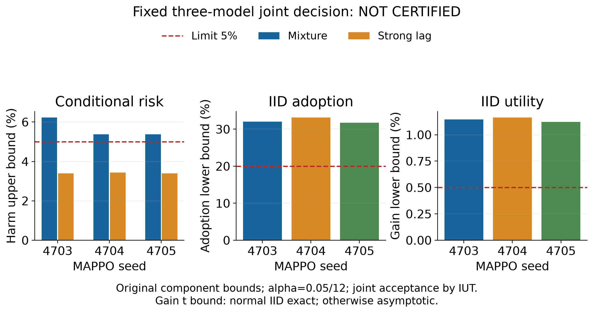

# 真实 MAPPO 正式验证结果

本轮实验和独立复核已全部完成，但固定三模型的联合部署认证未通过。未通过项是
混合分布下的逐车性能退化条件风险上界。收益、采用率、强滞后风险及零观测执行失败
条件均通过；这些结果不能替代原来的全部联合要求。

三个模型均为真实联合 MAPPO：三个独立局部 actor、集中式 critic、联合 on-policy
rollout、GAE 与 PPO 更新。每个联合种子完成 2,097,152 个训练步，所有角色的梯度和
参数变化已审计。PI 和单车 PPO 的初始化来源继续披露，不宣称从零训练或继承旧证书。

## 完整范围与退出证据

校准 3,072 个独立初态，每类执行器 768 个，共 21,504 次 SUMO。确认 1,024 个 IID
全混合初态，共 16,384 次 SUMO。总计 37,888 次实际运行，4,096 个独立初态；其中
基线与三个目标门控的主要执行仍为 16,384 次，额外对照不增加统计样本数。

全部 16 个采集和独立复核进程、校准匹配进程、最终分析进程均实际退出 0。保留的
主进程原生会话 29459 实际退出 0，终端凭据为 9035ee。主进程退出凭据绑定了最终
completion_receipt.json 的 SHA256，未从结果文件存在推测运行成功。

正式源提交为 3734be22c8，157 个依赖源文件的原始字节已保存。三个 actor、共用
门槛 0.0025、样本、随机流、传统基线和统计规则均未改动。attempt 3 的 0.05/12
已消耗，旧 0.025 与 0.05/6 保留消耗。本轮结果不重置或转移错误预算。

## 原定单侧界

| MAPPO 种子 | 混合风险上界 | 强滞后风险上界 | 确认采用率下界 | 确认平均配对收益 | 收益下界 |
|---|---:|---:|---:|---:|---:|
| 4703 | 6.229% | 3.388% | 32.010% | 1.425% | 1.144% |
| 4704 | 5.382% | 3.429% | 33.149% | 1.436% | 1.163% |
| 4705 | 5.380% | 3.388% | 31.725% | 1.399% | 1.121% |

原门槛保留为：两个条件风险上界均不超过 5%，采用率下界至少 20%，平均配对百分比
收益的单侧 t 下界严格高于 0.5%，零次基线或目标执行失败。联合 p 值为
0.0252271923，高于本次 0.0041666667 检验水平，因此联合判定为 false。

校准有害采用为 10/979、7/1001、7/989；强滞后部分为 3/327、3/323、3/327。
混合风险继续使用原分层联合有害概率上界除以采用率下界的方法，没有改用合并二项
界。强滞后和确认采用率保留精确二项推断。收益 t 界在正态 IID 下精确，一般有限
方差下为渐近推断。认证未通过，不等于已经证明总体风险大于 5%。

## 实际随机弃权对照

硬币概率只由完整校准采用计数固定，分别为 0.357039、0.363868、0.362404。
确认中独立执行名义或相同基线分支，全部方法单独执行并计时完整回调。

| 种子 | 目标采用及有害数 | 弃权对照采用及有害数 | 目标收益 | 弃权对照收益 |
|---|---:|---:|---:|---:|
| 4703 | 368，2 | 328，34 | 1.425% | 0.985% |
| 4704 | 380，1 | 329，34 | 1.436% | 0.985% |
| 4705 | 365，2 | 304，27 | 1.399% | 0.867% |

目标采用后的退化点估计为 0.543%、0.263%、0.548%，弃权对照为 10.366%、10.334%、
8.882%。目标在本组数据中同时采用更多学习并观测到更少退化，但实际采用率高出
3.906、4.980、5.957 个百分点，不能写成精确同率。相应同时区间为
[-4.978,12.729]、[-3.826,13.707]、[-2.699,14.518] 个百分点；覆盖零不证明等价。
这些比较是完整确认集的描述结果，不是新增部署认证或因果显著性结论。

H 指任一车辆成本或到达时间退化超过 1e-9，或执行失败，不是单纯的碰撞事件。
全部方法的本轮观测执行失败均为零。MPS/MAMPS 是共享当前物理证书的适配器，
不代表原论文完整复现，不能据此推断原方法在原任务中的优劣。

## 工程成本与交付

目标完整回调的 P95 为 105.7、126.3、102.9 毫秒；最大值为 1508.9、1997.7、
1522.4 毫秒，分别有 82、90、88 次超过 500 毫秒。传统基线 P95 为 3.2 毫秒，
随机弃权对照为 26.1、37.2、20.1 毫秒。风险筛选有实际计算代价；当前同步仿真
没有实施截止期替换，不支持硬实时或真车部署保证。通信延迟不在统计范围内。

完整记录、157 个冻结源快照和原生退出凭据保存在 19 个独立 ZIP 中，1,748 个
原始文件逐字节核验通过，归档总计 482,066,613 字节。每个 ZIP 可独立解压至仓库根目录。

- [原始联合判定](../artifacts/mappo_ctde_20261101/formal_mappo_attempt3_20261102/analysis/certificate.json)
- [完整对照与计时](../artifacts/mappo_ctde_20261101/formal_mappo_attempt3_20261102/analysis/comparisons.json)
- [数据与源码归档清单](../artifacts/mappo_ctde_20261101/completed_formal_mappo_attempt3_delivery_20261102/inventory.json)
- [真实 MAPPO 论文初稿](../artifacts/paper_mappo_20261102/CoopGate_真实MAPPO论文初稿_20261102.docx)

新初稿 12 页，包含 11 个原生可编辑公式、3 幅正式图和 5 张表，已逐页按原始分辨率
检查，并以相同 SHA256 放入桌面。旧 PI 稿保留。本轮未完成整个研究目标，未宣称投稿就绪。

下一步先对本轮全部误接纳逐项诊断，并核对所有原定场景的完整描述结果。保留这次
失败数据作为后续开发证据，不把它复用成新候选的独立确认。找到单一明确的改进机制、
在新独立仿真中证明改进后，再登记未使用预算的下一轮完整验证。原 5% 风险、20%
采用率、0.5% 收益条件和三个固定模型要求均保留，不用删种子或改统计口径获得通过。
