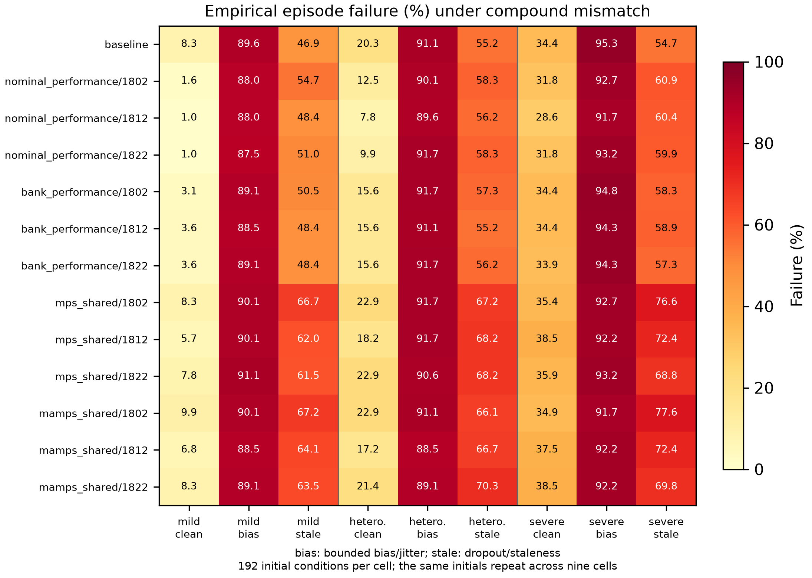

# 扩展场景与复合失配：完整结果及适用边界

原定 **22,464 次 SUMO 运行、1,728 个配对测试块**已全部完成独立物理与门控回放。2026 年 10 月 27 日 13:30（北京时间），保留的原生进程句柄确认复核退出码为 0；原计划、绑定和 114 个冻结源文件再次核对通过。192 个独立初始条件各重复九个动力学/感知组合，运行总数不能充当独立样本量。

总体判定是 **未满足“三个固定模型全部通过”**。1812、1822 通过原定相对比较判据；1802 的失败惩罚代价收益未达到显著性要求。不得事后只保留两个通过者来改写原定全模型判定。

| 固定模型 | 失败率差，百分点（门控−基线） | 失败率非劣性 Holm p | 失败惩罚代价增益，秒 | 代价增益 Holm p | 原定判据 |
|---|---:|---:|---:|---:|---|
| 1802 | −0.1157 | 0.000800 | 0.17694 | 0.103245 | 未通过 |
| 1812 | −0.6366 | 0.000200 | 0.35902 | 0.032198 | 通过 |
| 1822 | −0.6366 | 0.000150 | 0.36315 | 0.009900 | 通过 |

以上直接引用冻结的分层配对初始条件 bootstrap 与 Holm 判定，没有增加检验或修改阈值。原失败率非劣性界限为 1 个百分点；惩罚代价增益必须严格为正并通过检验。它们不是逐因素格的保证，也不是有限样本总体安全证书。原展示百分位界限仍是未校正的描述性量，不能称为同时置信区间。1802 未通过不等于证明其收益为零。

## 绝对失败水平与记录类型

每个方法在九个重复因素格中共有 1,728 次运行。失败包含中止、未完成、几何违规、碰撞等，不应称作碰撞率。

| 方法 | 复合失败 | 软件中止 | 记录碰撞 | 有路线几何违规的运行 |
|---|---:|---:|---:|---:|
| 基线 | 952 / 1,728（55.09%） | 950 | 1 | 14 |
| bank / 1802 | 950 / 1,728（54.98%） | 947 | 2 | 12 |
| bank / 1812 | 941 / 1,728（54.46%） | 938 | 2 | 12 |
| bank / 1822 | 941 / 1,728（54.46%） | 937 | 2 | 15 |

这些标志可以重叠，列数不能相加。基线中止的 950 次中，401 次原因为 `Interval or actuator domain violation`，549 次为 `No actuator-aware stopping certificate from current state`；三个门控模型相应中止数为 947、938、937。软件中止不是已安全停车的证明，缺少当前制动策略族的证书也不是物理上无法避免碰撞的证明。记录碰撞数很少，不能把上述计数差解释为总体碰撞风险的显著变化。

门控的整回合采用率分别为 71.82%、71.76%、71.01%，但较高采用率没有消除这些失配下的失败。失败惩罚代价的相对改善也不能直接写成无失败任务的通行效率改善。

## 因素格揭示的边界

图中每格使用同样的 192 个初始条件，均保留失败。轻度动力学失配且观测精确时，基线经验失败率为 8.3%，三个 bank 门控为 3.1%–3.6%；在有偏观测组合中，各方法失败频繁。部分陈旧观测组合下，门控的经验失败率还高于基线。以上逐格描述没有另外进行显著性检验，不能由混合总体的相对判据推广成每格均更安全。

全部复合动力学实现都超出原物理证书的声明类别；包含观测误差的格子还违反精确状态假设。这批试验完成了适用范围压力验证，揭示了基线恢复域与观测假设的限制，未证明这些状态可以可靠部署。`mps_shared`、`mamps_shared` 是本项目接口适配版本，不能据此声称超过原作者完整方法。计算时延未用于控制器排名，未统计通信延迟。

## 后续状态与复现资料

旧前置校准已通过三处中断边界检查，并自动开始缺失部分采集。新联合风险校准/确认、公平对照、候选因子实验与 CSPI 补充仍待完成。停用旧前置试验的提速提案尚未获授权，当前冻结流程继续执行。

- [原始完整报告](../artifacts/recovery_20261026/ood_recovery/analysis/report.json)：SHA256 `e894faa20226222b96d8361b01e1bc3c021d6c69514c60b0b0dbf95c94703643`。
- [原生退出、源文件和完整回放核对记录](../artifacts/recovery_20261027/ood_finalization_receipt.json)。
- [原始判定表与全部因素格 CSV](../artifacts/recovery_20261027/ood_scope_summary/)。
- [全部十三种方法的失败类型计数](../artifacts/recovery_20261027/ood_failure_types/summary.json)。
- [九个原始轨迹分卷及逐字节清单](../artifacts/recovery_20261027/ood_completed_collection/inventory.json)。
