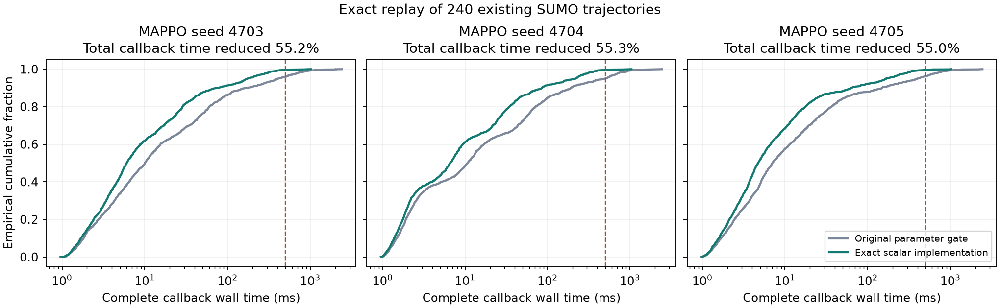

# MAPPO 参数场景门控的等价加速结果

本轮保持三个真实 MAPPO actor 的权重、传统安全基线、33 或 41 条预测路径、候选顺序和
置信度门控判据不变，只优化预测内部反复调用的标称规划。完整开发重放显示，三个
固定模型的整体回调耗时均减少约 55%，全部原指令和非计时证据完全一致。

## 已完成的完整重放

原始数据为已独立检查的 560 次 SUMO 仿真中的全部 240 条参数门控轨迹。每条轨迹
分别运行原实现和新实现，共 480 次完整控制器重放、11,460 次完整回调。两个版本
的执行顺序按轨迹交替。完整进程实际退出码为 0；独立分析再次检查全部回调身份、
指令字节、原证据字段、计时汇总和数据哈希，没有缺失、重复或被删除的慢调用。

| MAPPO 种子 | 每个实现的回调数 | 总回调耗时减少 | 原 P95 毫秒 | 新 P95 毫秒 | 超过 500 毫秒 原到新 |
|---|---:|---:|---:|---:|---:|
| 4703 | 1910 | 55.208% | 412.443 | 174.803 | 78 到 8 |
| 4704 | 1911 | 55.298% | 501.743 | 221.087 | 96 到 9 |
| 4705 | 1909 | 54.952% | 397.510 | 166.550 | 74 到 6 |

合计超时调用从 248 次减少到 23 次，每个实现总计 5730 次调用。三个模型的新最大
回调时延分别为 1022.431、1042.362、1021.709 毫秒，仍未满足所有决策都在 500 毫秒
内完成的要求。计时来自共享桌面，测试与其他工作可能同时运行，没有隔离负载、
独立样本显著性或硬实时最坏执行时间的保证。

## 为什么能保持原决策

新实现将固定三车标称停车证书的小数组运算展开成标量表达式，保留原表达式的浮点
运算次序、几何冲突判据、命令约束和停车终止条件；没有启用 fastmath。它同时使用
此前已单独验证的零分候选投影捷径。全部下游规划与预测函数体保持原 AST，只有
内部调用绑定改变。实际执行前的执行器记忆区间停车证书和外部传统基线仍为原实现。
因此本次测量是组合实现的整体加速，不能单独归因于某一项优化，也不能与历史加速
比例相加或相乘。

固定合法输入下，保持每个停车证书的布尔结果和投影稳定排序次序，就保持下一条
规划指令；逐预测步归纳得到相同的预测轨迹和候选排序，再得到相同的门控指令。
连续闭环等价还要求相同初态、扰动和仿真语义。数值测试覆盖连续与边界输入、输入
不变性、完整规划的返回值和异常、预测全部输出及缓存统计；本轮 7 项检查通过。
全量重放验证的是固定开发输入上的等价，不能单靠这些有限测试证明任意输入等价。

## 不改变的研究结论

这些轨迹仍只有原来的五个独立初态，没有新增 SUMO 仿真、风险认证样本或效能证据。
MAPPO 的三个 actor、集中式 critic、联合 on-policy rollout、GAE 和 PPO 更新身份
保持不变；快速监督门控的分组泛化失败单独保留，没有替换 MAPPO。

原始 MAPPO 跨三个种子稳定优于强基线的证据仍不足。新门控的混合分布和强滞后条件
风险上界、采用率下界、收益下界、同采用率对照以及论文更新仍需完成，旧证书不能
转移。

## 新实际 SUMO 验证

已注册的 140 次新 SUMO 执行、独立物理核对及完整原控制器重放均完成，两个子进程
与主编排进程实际退出码均为 0。20 个独立初态、60 个新旧实现配对的全部非计时行
和轨迹字段一致，3353 条指令和 16765 个物理子步通过复核。下面的收益为固定开发
集总成本之比，不能当作正式实验要求的逐回合百分比收益均值下界。

| MAPPO 种子 | 相对基线总成本降低 | 采用回合 | 有害采用回合 | 整体回调耗时减少 | 超过 500 毫秒 原到新 |
|---|---:|---:|---:|---:|---:|
| 4703 | 3.198% | 14/20 | 1/14 | 55.242% | 20 到 1 |
| 4704 | 2.677% | 12/20 | 1/12 | 54.944% | 19 到 3 |
| 4705 | 3.190% | 13/20 | 1/13 | 53.828% | 18 到 1 |

新实现 P95 为 197.334、193.281、193.244 毫秒，最大值为 739.529、737.482、734.452
毫秒。该实现的等价加速在新实际闭环上重复，但仍不能保证每次都在 500 毫秒内完成。

三个模型均在同一新初态 `97110131 dense lag_strong clean` 出现性能退化，条件有害
采用率的点估计为 7.14%、8.33%、7.69%。这不是总体风险估计，样本也不足以认证
原来的 5% 上界；不得将该负结果删掉或宣称风险已经达标。

## 反例的逐步基线优势分解

仅在离线诊断中，使用真实执行器参数、记忆和已实现扰动，计算同一前缀上采用某个
指令后回到传统基线的真实尾部成本。记这一差值为相对基线优势 A。有限时域内有
逐车成本和到达时间的向量恒等式 `J_G − J_B = Σ A_B(s_G,t,u_G,t)`；传统基线指令
对应的优势为零。这是标准的尾部价值望远镜求和，不是新的算法定理。

该反例中，第一个采用动作让匝道车成本增加 0.3125、到达时间增加 0.5 秒，而所有
41 条现有预测均判定没有退化；第二个采用动作仅补回 0.0625 成本。相加精确等于
最终的 0.25 成本和 0.5 秒退化，三个模型的恒等式数值残差均为 0。这将当前问题
定位到第一个动作的预测误判，不能用后续切换的笼统解释掩盖它。

诊断使用的真实参数和未来扰动严格隔离在离线工具中，没有提供给在线门控。新研究
阶段准备利用已观测运动及实际执行指令收缩滞后参数可行集；仅有参数包含性质仍
不构成性能或风险证书，必须再次完成整个门控的仿真和原科学门槛。

## 复现资料

- 实现与生成器为 `scalar_nominal_recovery.py` 和 `build_scalar_nominal_recovery.py`。
- 完整逐步重放入口为 `tools/verify_scalar_nominal_recovery.py --scope full`。
- `artifacts/mappo_ctde_20261101/completed_scalar_nominal_replay_delivery_20261102/`
  包含独立解压 ZIP、逐文件字节验证清单及原始回调数据和 139 个冻结源文件的快照。
- `artifacts/mappo_ctde_20261101/scalar_nominal_replay_analysis_20261102/`
  包含独立汇总核查、PNG 和 SVG 科学图。
- `artifacts/mappo_ctde_20261101/completed_scalar_nominal_sumo_delivery_20261102/`
  包含 140 次新 SUMO 的完整记录、独立检查、原代码快照和实际进程退出凭据。
- `artifacts/mappo_ctde_20261101/parameter_counterexample_diagnosis_20261102.json`
  保留真实基线优势分解和离线特权信息的用途边界。
