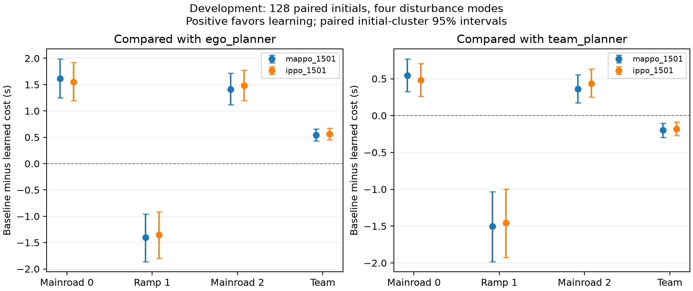

# V15 三车 PPO 开发结果：未达到有效协作要求

固定最终模型在提交 `22e5c17` 上传后，完成 128 个独立初态、四类扰动和五个控制器的 2,560 次实际 SUMO 执行。无中间检查点选优。所有运行完成，无记录碰撞、中止或物理契约违规。

|方法|主路0代价 s|匝道1代价 s|主路2代价 s|团队平均代价 s|
|---|---:|---:|---:|---:|
|ego_planner|10.177246|10.014282|11.906738|10.699422|
|team_planner|9.106323|9.913452|10.857849|9.959208|
|mappo_1501|8.562988|11.417725|10.493896|10.158203|
|ippo_1501|8.626465|11.368652|10.420654|10.138590|
|single_901|10.080078|9.719482|11.854492|10.551351|

|学习器|相对强自车规划的团队改善|相对强协同规划的团队改善|相对强自车规划的匝道退化 s|
|---|---:|---:|---:|
|mappo_1501|5.058%|-1.998%|1.403442|
|ippo_1501|5.242%|-1.801%|1.354370|

不能用对强自车规划的团队均值改善掩盖匝道车退化，也不能忽略更强协同基线。单车前置验收仍然有效，但这两种多车策略没有达到本项目要求。

对强协同规划，MAPPO 的配对初态簇 95% 团队收益区间为 [-0.294232, -0.104124] 秒，IPPO 为 [-0.270510, -0.086161] 秒，均指向退化。区间条件于两个固定训练模型，不能代表训练随机性的总体分布。

模型内的逐 actor 恢复实验使用另外 128 个初态和四类扰动，五种完整策略变体，共 5,120 条模型轨迹，未计入实际 SUMO 数。完整 MAPPO/IPPO 在其访问状态上的主路车贪心提案未改变；恢复任一主路 actor 不改变完整策略的结果，恢复匝道 actor 则显著改变结果。参数变化记录不足以建立有效多车协作。

复核了 80 条完整保存轨迹、1,938 次控制器动作重构及 40 次额外实际 SUMO 重放。所有正负结果和两次原数值失败均保留。

下一开发假设采用既有的逐智能体联合反事实策略迭代，详见 [V16 开发协议](v16_coupled_development.md)。其优势仍待验证，不能提前写成成功结果。

[完整结果](../artifacts/v15/development_stage1/study/summary.json) · [配对分析](../artifacts/v15/development_stage1/analysis/analysis.json) · [复核](../artifacts/v15/development_stage1/audit.json)

