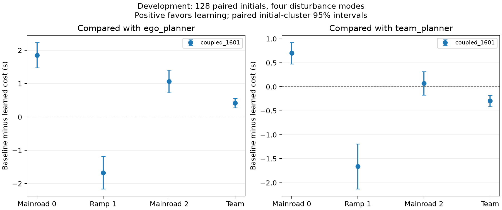

# V16 第一轮开发：仍未达到协作要求

固定最终六次更新模型冻结于 `b51bf70` 后，完成 128 个新初态、四类扰动、四种控制器的 2,048 次实际 SUMO 执行。全部运行完成，无记录碰撞或物理契约违规。

|方法|主路0代价 s|匝道1代价 s|主路2代价 s|团队平均代价 s|
|---|---:|---:|---:|---:|
|强自车规划|10.298828|9.985718|11.926270|10.736938|
|强协同规划|9.148804|9.997070|10.936523|10.027466|
|联合反事实策略迭代|8.446777|11.657410|10.862549|10.322245|
|冻结单车网络901|10.226563|9.679810|11.865967|10.590779|

相对强协同规划，学习策略团队代价增加 2.940%，配对初态簇的团队收益 95% 区间为 [-0.413839, -0.176024] 秒。匝道车代价增加约 1.660 秒，不能将对强自车规划的团队均值改善 3.862% 写成总体成功。

策略替换显示后方主路车的行为开始变化，但前方主路车的最终贪心策略仍接近初始规则。全部中间更新的模型内诊断显示，早期拟合造成闭环退化，后续更新部分修复，却没有超过强协同规划。未选用分数较好的中间模型替代预定最终模型。

验证包括六次更新的其他 actor 参数保持不变、48 个保存状态的完整反事实回报重算、64 条保存轨迹、1,591 次动作重构和 32 次额外实际 SUMO 重放。动作目标由当前完整联合策略生成，确实具有跨车依赖；这只能证明实现含有联合学习，不能替代协作效果。

第二次尝试在 [冻结开发协议](../artifacts/v16/development_protocol_stage2.json) 下重新开始，检验访问分布和拟合预算改进。当前尚无其最终性能结论。

[完整分析](../artifacts/v16/development_stage1/analysis/analysis.json) · [复核](../artifacts/v16/development_stage1/audit.json)

