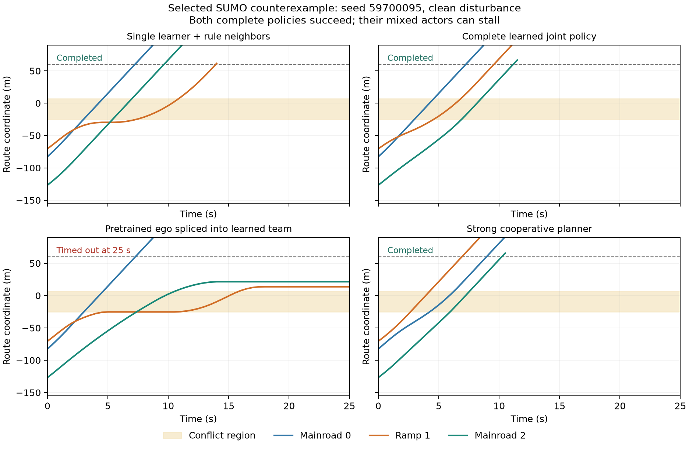

# 压力预测与数据聚合：开发记录

## 完整策略组合的重要性

在 V16 第二轮模型内替换中选出的两个失败条件，另行完成八次实际 SUMO 复现。完整联合策略、单车学习加规则邻车、强协同规划均完成各自两次运行；把已通过单车验收的匝道 actor 拼入另外两个联合 actor 后，两次均未能在 25 秒时域内完成。无记录碰撞，失败体现为通行停滞。它们是事后选定的机制反例，不是总体失效率估计。

## 固定压力情形库

名义差值预测对噪声引起的策略分支变化不够准确。新增固定的 17 个情形：零误差、八个常值偏差角点、八个固定符号脉冲。每个情形对学习策略和同一个强协同基线施加相同外生误差，再对各车成本/时间差取情形最大值。情形库不接收运行种子或真实误差序列，也不覆盖所有可能的有界误差。

128 个开发初态共计算 4,352 条模型预测轨迹，未加算成 SUMO 执行；无扰动分支与保存的 SUMO 成本/时间完全一致。分层共形开发诊断的剩余修正量从名义预测的 1.25/3.3125 秒降至 0/0.1875 秒（名义/密集场景）。但是分割验证的 64 个初态只有两次准入，零观察退化和约 0.07% 团队收益仍不足以证明实用门控成功。不能用小样本零错误冒充可靠的条件风险界。

这一结果说明压力预测改善了误差描述，但学习策略可用的稳健收益仍有限。当前不冻结正式性能结论，也不为了提高采用率放宽已使用的逐车非退化标准。

## 联合策略继续改进

下一轮从已完成的 V16 第二轮联合策略继续训练，使用既有的数据聚合式近似策略迭代。每次只更新一个 actor，并冻结整个参考联合策略。第一遍采集由参考策略完整反事实回报选出的改进动作；第二遍混合改进动作与当前网络；第三遍由当前网络访问状态。三个数据集的回报都由同一个冻结联合策略产生，合并拟合，避免训练目标在同一 actor 更新内混杂。

这仍然是模型式 MARL。所谓 rollout expert 是当前联合策略的自生成改进算子，不是传统规划器提供的演示标签。运行时仍只执行本地网络与共同物理过滤器。训练期间的轨迹推演成本会单独计数，不与 PPO 的环境采样预算混为一谈。

有限时域的性能差满足沿新策略状态分布累计各步参考优势的恒等式。仅在旧轨迹上拟合得好，不保证这些新访问状态上的误差小；数据聚合针对这一差异。有限样本和神经网络逼近仍没有给出全状态保证，实际效果必须重新验证。

数据聚合的既有依据见 [Ross、Gordon 与 Bagnell，AISTATS 2011](https://proceedings.mlr.press/v15/ross11a.html)。本项目将其作为实现改进手段，不把数据聚合或既有多智能体策略迭代写成论文首创。

预算、继承模型和新验证初态在[训练协议](../artifacts/v17/development_training_protocol.json)中固定。种子 1701 控制本次数据采集，但继承 V16 同一父模型，不能将其称为另一个独立随机初始化的训练种子。正式验证仍需要新的独立训练复现。
