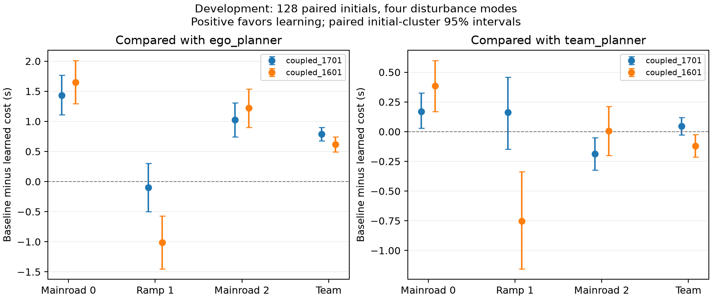

# 数据聚合后联合学习的实际改进与门控失败

本轮按事前协议从 V16 第二轮继续训练，三个 actor 依次更新两轮，每个 actor 更新聚合三遍各 4,096 个新访问状态。共 73,728 个标注状态、88,000 个联合环境步和 6,446,174 个反事实分支转移。权重和完整训练数据在 `d45fcf6` 中冻结后，才开始新的实际 SUMO 验证。种子 1701 是继承模型上的新采样，不能算独立随机初始化的训练复现。

128 个新初态、四类扰动与五个方法共 **2,560 次实际 SUMO 执行**，所有运行完成，未记录碰撞、物理约束违规或中止。配对区间以初态为抽样单位，将四类扰动留在同一簇内；这些是开发结果，条件于固定训练模型。

| 方法 | 全队平均成本（秒） | 前车成本 | 匝道车成本 | 后车成本 |
|---|---:|---:|---:|---:|
| 强自车规划 | 10.6571 | 10.4170 | 9.5062 | 12.0481 |
| 强协同规划 | 9.9174 | 9.1534 | 9.7654 | 10.8334 |
| 上一版联合策略 | 10.0369 | 8.7665 | 10.5166 | 10.8276 |
| 本轮联合策略 | 9.8697 | 8.9845 | 9.6030 | 11.0216 |
| 仅自车学习 | 10.5301 | 10.2954 | 9.3094 | 11.9856 |

本轮相对父模型的全队成本改善 **1.6658%**，配对改善区间为 **[0.0970, 0.2392] 秒**；匝道车减少约 0.914 秒，但前后车成本都有增加。相对强自车规划的全队改善为 7.3884%。这些不同的比较不能互相替代。

相对强协同规划，本轮平均改善 **0.4809%**，区间 **[-0.0269, 0.1208] 秒**仍跨零。高冲突组改善 0.7585%，低冲突组退化 0.4472%；后车成本增加 0.1882 秒，退化区间不含零。因此本轮证明了相对父模型的实际改进，尚未证明稳定超过强协同规划，更未证明所有车辆受益。

在另 128 个初态的模型内替换诊断中，恢复任意一个 actor 为其父模型都会增加全队平均成本。三个 actor 的实际执行变化分别为 1,038、1,305、1,748 次；五个替换版本各 512 条模型轨迹均完成。这支持三车行为确有耦合贡献，但不证明博弈均衡，也不把模型轨迹计入实际 SUMO 次数。

## 门控仍未通过有效性验证

384 条名义完整策略预测与已保存的无扰动 SUMO 成本/时间完全一致。但是，仅根据名义预测做逐车非退化和 0.1 秒团队改善判断，会采用 27/128 个初态，其中 9 个在某扰动、某车辆或成本/时间指标上退化。

固定 17 情形压力预测共计算 4,352 条模型轨迹。按所有逐车差值不大于零、团队收益至少 0.1 秒，会采用 5/128 个初态，未观察到退化，整体净改善 0.2868%。五个样本不足以建立可靠的条件风险结论。加入分层共形修正后，64 个分割验证初态全部拒绝；这不是实用门控成功。

物理风险与性能退化是两件事：这些性能退化运行仍满足当前模型的物理证书。下一阶段继续改善联合策略，同时研究如何在不改变逐车退化标准的前提下，减少性能预测和校准的保守性。

## 重建核验

- 重算两个完整训练链中 18 次 actor 更新、144 个抽样反事实状态，检查其他 actor 冻结与所有训练数据。
- 重建 80 条完整保存轨迹、1,897 次实际控制选择，额外执行 40 次实际 SUMO 重放。
- 本地完整测试为 128 项通过；前一冻结权重提交的 GitHub CI 亦通过全部历史和新增合作实验重放。

原始结果、预测、替换诊断和哈希均保存在 [开发归档](../artifacts/v17/development_stage1/)。数学关系见[证明边界](theory_v17_coupled_gate.md)，接近的已有研究见[相关工作核查](v17_related_work_audit.md)。当前不能凭这个开发结果声称达到顶会投稿标准。
