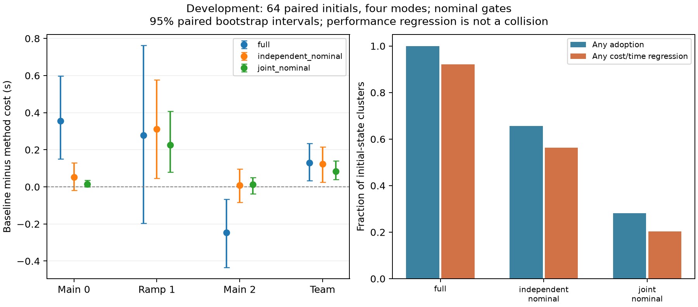
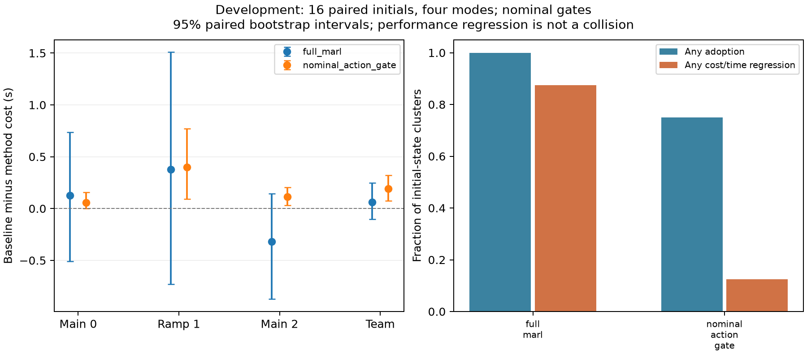

# 门控闭环对照：组合误差与逐步性能判断

## 逐车判断和完整联合判断

模型 1701 固定后，在 64 个新初态、四类扰动中，对强基线、完整 MARL、三个单独学习组件、逐车独立门控和完整联合门控执行 **1,792 次实际 SUMO 运行**。所有方法共用动力学与物理过滤器。所有运行完成，无记录碰撞或约束违规。

逐车门控先推演“只有自己使用学习、另外两车使用基线”的闭环，按自己的成本和时间决定是否切换，然后在 SUMO 真正执行选出的组合。联合门控推演完整三车学习策略，要求所有车辆的成本和时间不退化，以及团队代价至少改善 0.05 秒。两者都仅使用名义预测，**不是经过统计校准的门控**。

320 条名义预测均与对应无扰动 SUMO 成本/时间完全一致。但逐车门控同时选择至少两车学习的九个初态中，三个出现已选择车辆的无扰动性能退化。这是其他车辆策略改变导致原反事实条件失效的实际闭环证据。逐车门控还会伤害未切换的车辆；总计 13 个初态在无扰动运行中出现某车退化。完整联合判断在无扰动条件下为零。

| 名义门控 | 采用的初态 | 任一模式/车辆/指标退化的初态 | 获准后的经验退化率 | 全队平均成本（秒） |
|---|---:|---:|---:|---:|
| 逐车独立 | 42/64 | 36/64 | 85.71% | 9.8572 |
| 完整联合 | 18/64 | 13/64 | 72.22% | 9.8968 |
| 强基线 | 0/64 | 0/64 | 不适用 | 9.9812 |

这里“退化”包含任一指标的微小增加，绝不表示碰撞。联合处理修复了名义组合问题，但没有解决未知扰动造成的预测误差；不能用这个对照宣称已得到可靠风险门控。

## 每一步对照同一个基线后续策略

新增逐步门控只比较两个可执行的完整联合动作：强基线当前动作，以及三个真实学习 actor 经共同物理过滤后的动作。它计算当前动作之后始终执行同一个强基线的逐车剩余成本/时间；只有每项不退化且团队成本严格改善，才执行学习动作，否则执行基线动作。

记强基线的剩余成本向量为 V_t^b，学习联合动作执行后的名义下一状态为 f(z,a)。门控条件是逐分量

\[
c_t(z,a)+V_{t+1}^b(f(z,a))-V_t^b(z)\leq0,
\]

并要求平均成本严格降低。基线自己的动作使上式等号成立。沿实际名义闭环相加，所有中间势值相消，得到每辆车的最终成本/时间均不高于基线。指令变化记忆和时钟都包含在 z 中；每辆车到达后停止累计自己的成本。该关系是既有 rollout/策略改进思想，不能写成新定理。

有扰动时，实际下一状态不同于名义 f(z,a)，上述性能结论不再自动成立。物理过滤器仍使用原有有界扰动证书。这里没有把名义性能裕量伪称为“该场景安全概率”，也没有取得扰动性能的统计证书。

## 小样本实际结果与计算代价

16 个新初态、四类扰动、三个方法共 **192 次实际 SUMO 执行**。强基线、常开 MARL 和逐步门控全队平均成本分别为 **9.9095、9.8475、9.7201 秒**。逐步门控的平均改善为 **1.9118%**，配对初态簇区间为 [0.0742, 0.3219] 秒；三车平均成本改善依次为 0.0576、0.3984、0.1123 秒。

门控在 12/16 个初态的至少一种扰动中采用过学习动作，共采用 69/1,427 个控制步。2/16 个初态在某模式、某车辆或指标上仍有退化，获准后的经验比例为 2/12，最大单车成本退化为 1.5 秒。因此这是值得扩大的开发结果，尚未通过独立风险验收。

门控的 p95 实测计算时间约 **135.5 ms**，强基线约 22.9 ms，常开神经策略约 2.0 ms。门控需要完整基线后续推演，计算成本更高；当前控制周期为 500 ms，但这批 p95 结果不构成最坏执行时间保证。没有统计通信延迟。

全部 192 条物理轨迹均经核验，16 个无扰动初态还验证了“实际成本差等于逐步所选优势之和”的恒等式。抽样重建 1,091 条控制选择，额外执行 24 次 SUMO 重放。组合对照另重建 112 条轨迹、2,575 次控制选择和 20 个反事实预测，并做 56 次 SUMO 重放。

两次工具初始运行分别因浮点坐标逐位断言和审计字段设置顺序中止，各执行过一条 SUMO 轨迹。错误输出、当时源码与修复原因均保存在 failed 归档；不把它们算作已完成对照，也未据此更换模型、初态、阈值或方法。

## 扩大开发对照及后续冻结验证

同一模型和门控在另 128 个新初态中完成 1,536 次 SUMO 执行。强基线、常开学习和门控平均成本分别为 10.1009、9.9287、9.9110 秒。门控改善 1.8796%，配对初态簇区间为 [0.1422, 0.2413] 秒；三车平均成本改善依次为 0.0604、0.4541、0.0551 秒。所有方法均完成 512/512 次执行，无记录事件。

门控采用 615/11,690 个控制步，113/128 个初态曾采用学习。严格任一模式、车辆或指标退化仍有 **44/128**，获准后为 **44/113**。最坏单车成本损失为 2.1875 秒。门控实测计算 p95 为 146.6 ms。这些结果依然没有形成扰动性能风险证书。

完整 1,536 条物理轨迹、128 个名义恒等式、1,164 次控制选择均已核验，另做 24 次 SUMO 重放。记录位于 `artifacts/v18/advantage_development_stage2`，分析位于 `artifacts/v18/advantage_analysis_stage2`。

随后完成三个新随机训练复现并冻结模型，进行 7,168 次新 SUMO 对照。该轮门控平均改善 2.0051%，但一个常开学习模型出现三个超时，预设检查通过 8/9。详见[最终三模型对照](v18_independent_results.md)。开发样本、冻结测试与失败机制重放分别保存，不能混合成一个新的确认性样本。
