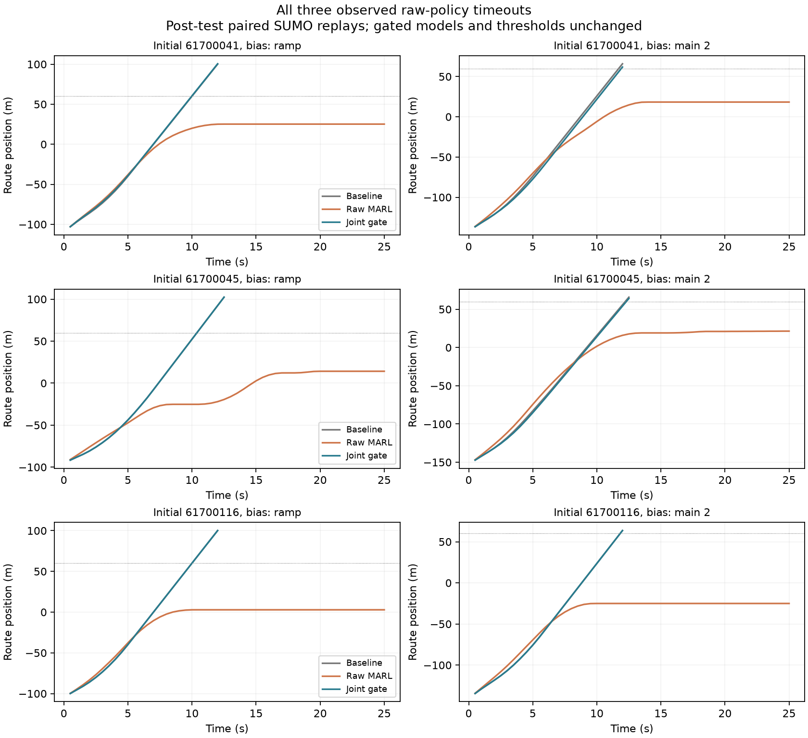

# 三个冻结多智能体模型的联合门控验证

本轮完成了真实三 actor 模型式协作学习及其基线相对门控对照。学习先在单车阶段通过前置验证，再扩展到三个会相互响应的独立 actor。最终原始 MARL 的平均团队成本改善 **1.6312%**，联合门控改善 **2.0051%**。门控使三车平均成本和到达时间全部改善。

**预先冻结的九项检查通过八项，不能写成全部验收通过。** 模型 1812 的常开执行有三个超时，违反了“所有方法全部完成”这一项；三个门控模型的 3,072 次执行全部完成。其他八项没有修改。物理安全、名义性能与扰动性能风险是不同结论。

## 训练和测试固定方式

训练方案在提交 `8b248ec` 固定；第一阶段权重在 `744398a` 公开，最终三组权重和测试协议在 **`79beb44`** 固定，再开始测试。三组对应种子为 1801→1802、1811→1812、1821→1822，自车初始化分别为已通过 V14 的 901、911、921。三组使用独立随机数、访问数据和主路初始 actor，但 V14 自车模型共享早期 DQN 祖先；不宣称从零开始全流程独立。

每组第一阶段 12 次 actor 更新、98,304 个访问状态；第二阶段六次更新、三次数据聚合，共 73,728 个访问状态。使用冻结联合参考策略下的序列团队回报，其他车辆在反事实分支中闭环反应。训练属于模型式多智能体近似策略迭代与数据聚合，**不是 MAPPO，也没有纳什均衡证明**。所有角色确实更新了独立参数；原始网络执行不做未来性能搜索，门控外部才计算基线后续。

256 个新初态来自 `61700001..61700256`，前半名义分布、后半密集分布。每个初态有 clean/uniform/bias/pulse 四种扰动；七个方法严格配对，总计 **7,168 次实际 SUMO 执行**。未来误差序列不输入策略或门控。四分片按初态索引取模，不改变全局场景分组。

## 团队和逐车结果

| 模型 | 常开成本 s | 常开改善 | 门控成本 s | 门控改善 |
|---|---:|---:|---:|---:|
| 1802 | 9.9630 | 1.2427% | 9.8718 | 2.1469% |
| 1812 | 9.9082 | 1.7864% | 9.9166 | 1.7031% |
| 1822 | 9.9003 | 1.8644% | 9.8699 | 2.1653% |
| 三模型固定平均 | 9.9238 | 1.6312% | 9.8861 | 2.0051% |

强团队基线平均成本为 10.0884 秒。原始学习平均改善的配对 95% 区间为 **[0.1116, 0.2160] 秒**，门控为 **[0.1767, 0.2281] 秒**。每个原始模型单独计算的成本改善区间下端也都大于零。模型 1812 门控的团队均值比其常开策略稍差，不能声称门控对每个模型均进一步提高团队收益。

| 车辆 | 原始学习成本改善 s | 门控成本改善 s | 门控到达改善 s |
|---|---:|---:|---:|
| 主路0 | 0.2554 | 0.0883 | 0.0552 |
| 匝道1 | 0.4095 | 0.3977 | 0.3397 |
| 主路2 | **−0.1713** | 0.1208 | 0.0682 |

门控三车成本和到达改善的配对区间下端均大于零；原始学习主路2的成本改善区间为 [−0.2811, −0.0665] 秒，平均损失不能被团队收益掩盖。

高冲突 206 个初态：原始学习改善 **2.1115%**，门控 **2.3355%**。低冲突 50 个初态：原始学习 **−0.3623%**，其区间跨零，门控 **0.6336%**。冲突强度由初始 ETA 差固定划分，不能解释成所有现实复杂/简单场景。

区间条件是三个固定模型。每个初态内先平均四模式和三模型，再进行保持名义/密集分层数量的 5,000 次初态簇 bootstrap；不把同一初态的模型×扰动展开成独立样本，也不据此估计任意训练种子的总体方差。

## 门控采用和风险边界

门控比较实际完整学习联合动作与当前完整基线动作，后续均执行同一个完整反馈基线。逐车成本和时间的名义差均不为正，且团队成本严格改善时采用学习。

获准动作 **4,165/70,005**，约 5.95%；在 **691/768** 个策略初态对中，至少一种模式采用过学习。名义性能保证在 **768 条完整无扰动闭环**中全部重建验证，成本/时间差与所选逐步优势之和完全一致。

严格退化指任一模式、任一车辆的成本或到达时间高于配对基线。原始学习为 **645/768（83.98%）**，门控为 **268/768（34.90%）**；门控获准后的经验比例为 **268/691（38.78%）**。三个模型共享初态，策略初态对只作描述性计数，不能作为独立二项风险验证样本。退化不等于碰撞；所有门控退化都来自有扰动模式。

按每个策略初态对的最坏模式/车辆成本损失，原始学习的中位数、90%、95%、最大值为 [0.5, 3.125, 4.4375, 16.5625] 秒；门控为 [0, 0.4375, 0.5625, 3.0625] 秒。门控显著缩小了本样本中的损失尾部，但**扰动下条件性能风险仍未认证**。


## 三个常开超时和明确退回

所有方法记录碰撞、合同违规和行政中止均为零。三个超时均发生在模型 1812 的 bias 模式，初态为 61700041、61700045、61700116；匝道与主路2最终停车，未在25秒内到达目标。原始记录和完整轨迹均保留。

对**全部三个**超时案例，额外执行其基线、常开学习、对应门控的配对 SUMO 重放，共九次。三次常开超时完全重现，基线和门控六次均完成。前两例门控各采用一次学习动作，第三例全程拒绝学习，轨迹与基线相同。这是测试之后的解释性重放，不是新的效果检验，也没有据此修改模型或阈值。

第一例门控仍让匝道成本从基线10.5秒升至10.75秒；因此“完成了任务”不能改写成该扰动场景中所有性能都不退化。



## 审计和工程代价

- 核验 115 条保存的物理轨迹，其中包括全部三个失败轨迹；重建 2,688 次控制选择。
- 重新核验全部三个训练链的 54 次 actor 更新、432 个反事实目标采样状态和模型哈希。
- 重建全部 768 条名义门控闭环、17,288 次模型控制，恒等式最大残差为0。
- 常规额外 SUMO 重放56次，失败机制解释再重放9次；与主测试7,168次分开计数。
- 强基线计算p95约22.70ms，常开网络约1.82ms，三个门控分别147.87、149.42、147.42ms。它们不是最坏执行时间保证；没有统计通信延迟。

未通过的唯一冻结检查是 `all_actual_runs_complete_and_no_recorded_events`。不修改原协议使其通过，不把门控成功合并成常开学习成功，也不把8/9称为9/9。

## 复核入口

主要文件位于 `artifacts/v18/independent_study`、`artifacts/v18/independent_analysis` 和 `artifacts/v18/timeout_replays`。模型在 `artifacts/v18/independent_models`；第一阶段链在 `artifacts/v18/independent_models_stageA`。

```powershell
python tools/verify_independent_v18.py physical artifacts/v18/independent_study --replay --out runs/independent_physical_check.json
python tools/verify_independent_v18.py nominal artifacts/v18/independent_study --shard 0 --out runs/independent_nominal_0.json
# 同样执行 --shard 1、2、3，再用 assemble 汇总。输出使用新的 runs 路径。
```

主测试 episodes SHA-256：`c1aa08811c8a2a671cbee9679c66451668c3e3e505ef872049cddfa3bb318d1e`。

该结果支持本三车任务中的真实协作学习收益及联合门控价值。尚缺有效采用率下的扰动性能风险证书、匹配预算的近期方法对照、更丰富场景和独立动力学验证；不能据此保证顶刊/顶会录用。
