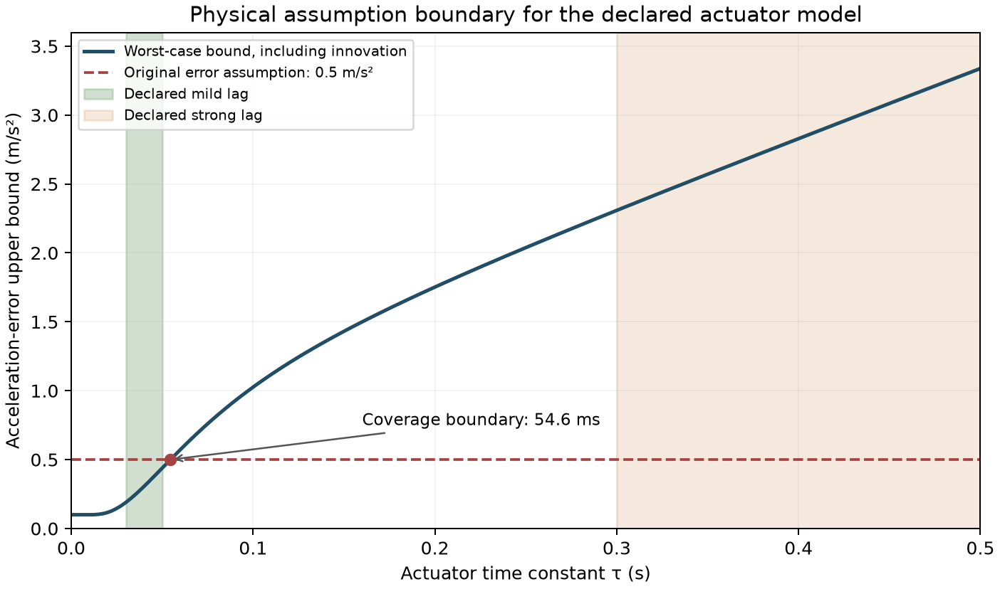

# V19 执行器失配的解析适用边界

这里证明的是实际加速度误差能否满足原物理过滤器的 ±0.5 m/s² 假设。它不提供扰动下的性能保证，也不替代初态可恢复性、碰撞几何、状态观测等其他前提。

实验中控制命令每 0.5 s 更新一次、每 0.1 s 执行一次；命令 u∈[−5,2.5] m/s²，相邻命令差不超过 D=2.5 m/s²，速度 v∈[0,20] m/s。非名义执行器的外生创新满足 |w|≤0.1 m/s²。初始执行器状态和上一命令均为 0。三个车辆分别满足以下推导，故可同时使用该逐车界。

## 增益与阻力

实际加速度为 a=g u−d v²+w，g∈[0.96,1.04]、d∈[0.00025,0.0005]。由三角不等式，

$$|a-u|\le |g-1||u|+d v^2+|w|\le 0.04\times5+0.0005\times20^2+0.1=0.5.$$

因此该声明范围内的增益/阻力失配满足原加速度误差假设；误差可以随状态和动作变化，推导不需要它独立同分布。

## 一阶执行器惯性

令子步保持系数 ρ=exp(−0.1/τ)，执行器状态满足 a_j=ρa_{j−1}+(1−ρ)u_n，实际加速度另加 w_j。同一命令保持 M=5 个子步。

令 e_n 为第 n 个控制周期结束时执行器状态相对当期命令的偏差。命令改变 Δu_n 后，

$$e_n=\rho^M(e_{n-1}-\Delta u_n),\qquad |\Delta u_n|\le D.$$

从零初始偏差递推，周期末 |e_n|≤ρ^M D/(1−ρ^M)。周期内最大偏差出现在新命令的第一个子步；后续子步乘以更小的 ρ 次幂。于是任意允许的命令序列均满足

$$|a_j+w_j-u_n|\le\frac{\rho D}{1-\rho^M}+0.1.$$

这保留了跨周期执行器记忆，没有假设每个控制周期都从零误差开始。右端随 τ 增大而增大。该证明针对 gain=1、drag=0 的惯性实验，不能直接套用到未经声明的复合失配模型。

| 声明的模型 | 全局误差上界 | 与原假设的关系 |
|---|---:|---|
| 增益/阻力 | 0.5000 m/s² | 覆盖声明的参数范围 |
| 轻度惯性，τ≤0.05 s | 约 0.4384 m/s² | 覆盖声明的参数范围 |
| 强惯性，τ≤0.5 s | 约 3.3380 m/s² | 原误差假设无法覆盖整个参数范围 |

求解上述上界等于 0.5，可得到约 **54.6 ms** 的时间常数边界。这个边界是当前模型、命令增量和噪声幅度下的充分条件。超过它不意味着每条轨迹必然失败，而是不能继续沿用原来的统一误差证书。增大允许误差后，需要重新分析可恢复集合和可行初态，不能只改一个阈值就宣称恢复安全性。

数值与图由 `tools/analyze_actuator_bounds_v19.py` 生成，精确数值保存在 `artifacts/v19/actuator_bounds/analysis.json`。该解析结果与已经完成的 [6400 次直接迁移试验](v19_transfer_results.md)互补：前者解释何种参数仍满足原模型假设，后者检查实际闭环收益、退化、约束和中止情况。后续 [V21 配对迁移](v21_matched_dynamics_transfer.md)统一各动力学的外部噪声幅度，以分离执行器变化与噪声强度变化。
