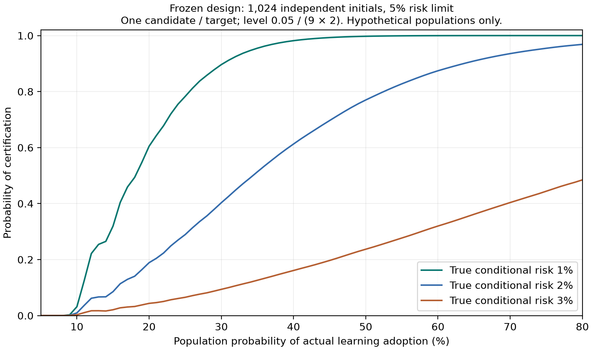

# V19 已冻结风险验证的样本量与检验功效

本说明只读取冻结协议，不读取正在收集的校准结果。候选数、样本量、风险上限及检验规则均不改变；它解释现有检验的数学限制，不是新策略的风险认证。

## 采用后的独立样本数决定风险上界

协议有九个完整控制器和两个风险目标，总置信失败预算为 δ=0.05。每个候选/目标的单侧预算为 `δ_j=0.05/(9*2)=1/360`。对一个固定候选/目标，N 为确实采用过学习的独立初态数，K 为其中发生退化的初态数。

在冻结策略与 IID 初态假设下，给定 N，K 服从参数为真实条件风险 r 的二项分布。5% 风险上限的准入条件为：

`P[Binomial(N, 0.05) <= K] <= 1/360`。

这是既有精确二项检验与 Bonferroni 控制的应用。当 K=0 时，单侧上界为 `U=1-(1/360)^(1/N)`。因此至少需要：

`N >= ceil(log(1/360) / log(0.95)) = 115`。

少于 115 次实际采用，即使没有观测到任何退化，也无法通过当前候选/目标的检验。N=0 明确不认证。两个目标必须各自通过，不能把它们的采用次数相加；同一初态的多个模型、车辆与扰动模式也不能当作额外独立样本。

| 实际采用的独立初态 N | 仍能通过的最大退化数 K |
|---:|---:|
| 50 或 100 | 即使 K=0 也不能通过 |
| 115 | 0 |
| 153 | 0 |
| 205 | 2 |
| 307 | 5 |
| 410 | 8 |
| 512 | 12 |
| 614 | 16 |
| 768 | 22 |
| 1024 | 32 |

表格同时通过二项 CDF 阈值与 beta 分布单侧上界反演核对，并检查下一整数 K 必须不通过。这些是协议阈值，不是当前真实观测数量。

## 采用率影响检验功效

在假设总体学习采用概率为 p、采用后的真实条件风险为 r 时，`N ~ Binomial(1024,p)`。设 k*(N) 为上表对应的精确准入截止数，则单个候选/目标的认证概率为：

`sum_N P[N] * P[Binomial(N,r) <= k*(N)]`。

下面是精确求和，不是基于当前校准结果的估计：

| 假设真实条件风险 | 假设采用率 20% | 假设采用率 50% |
|---|---:|---:|
| 1% | 60.49% | 99.75% |
| 2% | 18.90% | 77.00% |
| 3% | 4.36% | 23.70% |

这说明“真实风险低于 5%”与“本次有限样本足以认证”并不等价。门控过度回退既减少收益，也减少可用于条件风险检验的有效样本。曲线只描述一个候选/目标；两个风险目标有关联，不能将两个通过概率直接相乘得到联合功效。

最终结果应区分“通过认证”和“尚不能认证”。后者本身不证明真实风险已超过 5%；需要结合采用数、退化数、上界和独立最终收益一起解释。当前冻结研究仍按原方案收齐数据，不因这份分析调整阈值、候选或停止时点。

可复核记录：[`analysis.json`](../artifacts/v19/certification_power/analysis.json)。其字段明确保留 `calibration_outcomes_read=false`、`protocol_changed=false`、`risk_certified=false`。
