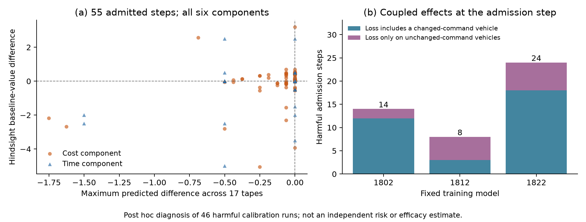

# 完整校准退化案例的机制回放

这项诊断使用已经完成的 V19 校准数据，覆盖全部 46 个严格门控退化运行，并补充每个不同初态／扰动组合的实际基线回放。选择规则在查看校准结果之后制定，属于探索性开发诊断；回放不增加独立风险样本，不读取正在运行的最终确认结果，也不修改任何已冻结策略。

每次 SUMO 回放先执行原控制器，再核对全部非计时指标、物理轨迹和原有有限扰动路径检查。有原始完整轨迹时，还逐步比对命令、状态及扰动。缺少原始完整轨迹的案例只声称指标匹配与新物理轨迹重建，不声称比对未保存的轨迹。

随后才使用已实现的扰动序列重算基线的剩余成本。记包含上一条命令的状态为 `z_t`，固定反馈基线在完整已实现扰动 `w` 下的剩余价值为 `V^b_t(z_t; w)`。沿实际轨迹计算

`D_t(w) = c_t + V^b_(t+1)(z_(t+1); w) - V^b_t(z_t; w)`。

对完成的轨迹，终端剩余价值为零，望远镜求和给出 `Σ D_t(w) = J^π(w) - J^b(w)`。分别对三辆车的成本与时间检查这六个分量，并将数值重建与实际配对基线结果核对。基线预测不匹配、恒等式误差或反事实预测异常均显式保留；不会通过修改已记录结果强行获得恒等关系。

门控采用时保存的 17 条预测路径分量差必须全部不大于原来的 `1e-10`。诊断检查同一步的真实扰动后续价值差是否出现大于 `1e-9` 的正分量，定位有限路径检查与实际退化之间的差异。数值核对容差为 `1e-9`，不改变原控制器的准入条件。

真实未来扰动仅在闭环仿真结束后进入上述计算。这个事后价值函数用于解释失败，不是可以部署的置信度估计器；后续在线改进必须另行设计，并用独立数据验证。

计划：`artifacts/v19/calibration_harm_replay_plan/`。回放及逐步机制记录：`artifacts/v19/calibration_harm_replay/`。入口：`tools/diagnose_calibration_harm_v19.py prepare` 与 `run`；运行前要求计划和源代码已提交。

## 已完成的 84 次 SUMO 回放

46 个严格门控退化运行及 38 个去重后的配对基线全部完成回放，全部非计时指标与原记录一致，物理轨迹也全部通过重建。84 次的真实扰动基线价值及望远镜恒等式均通过 `1e-9` 数值核对；46 个退化运行的求和分解误差均为零。

| 训练模型 | 退化运行 | 其中全部准入步骤 | 正后续成本差的准入步骤 | 正后续成本差的回退步骤 |
|---|---:|---:|---:|---:|
| 1802 | 14 | 17 | 14 | 0 |
| 1812 | 8 | 9 | 8 | 0 |
| 1822 | 24 | 29 | 24 | 0 |

每个退化运行恰好有一个准入步骤出现正的真实扰动后续价值差。所有这些步骤均通过了原 17 条预测路径检查。这个分解说明，之后回到同一反馈基线没有继续增加相对价值偏差，但也没有消除先前准入所造成的损失。它不意味着替换这一动作后可以沿用旧轨迹推断新策略结果；新策略仍须完整闭环复测。

进一步检查该步的实际联合命令与同状态基线命令，有 13 个误准入步骤的全部正偏差都发生在该步命令没有改变的车辆上，三份模型分别为 2、5、6 个。这是后续交互造成的耦合影响；只检查当前改变命令的车辆会漏掉这些案例。

55 个准入步骤共有 330 个成本／时间分量，其中 79 个真实后续价值差为正。这 79 个分量中，61 个在预测路径集合中的最坏差值恰好为零；另有 18 个虽具有负的预测差值，真实后续差值仍为正。因此，简单要求一个很小的严格负余量并不能自动证明问题已经解决。

46 个误准入发生在决策步 0–13，且每次至少还有一辆车未离开冲突区域。这些都是所选退化案例的机制统计，不能当作整体采用策略的风险频率或独立改进效果。

完整证据：[回放核查](../artifacts/v19/calibration_harm_replay/audit.json)、[机制分析](../artifacts/v19/calibration_harm_analysis/analysis.json)、[全部准入状态与命令](../artifacts/v19/calibration_harm_analysis/admission_events.json)。分析入口为 `tools/analyze_harm_mechanism_v19.py`。
