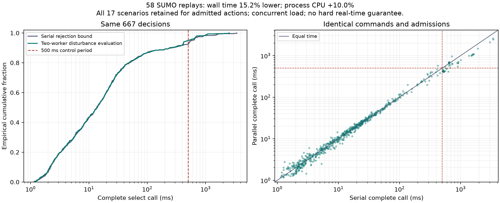

# V19 保持联合准入条件的双线程扰动预测

双线程版本在相同的 29 个开发回放案例中，保留全部 667 个决策的命令、轨迹、联合组合和准入证据，总完整调用耗时降低 15.22%。进程 CPU 时间增加 10.03%，仍有 34/667 个调用超过 500 ms，不能据此声称满足实时要求。

## 并行计算的语义

候选组合、名义排序和扰动逻辑检查顺序沿用下界提前拒绝版本。先单独计算第一个扰动场景，避免常见的首次拒绝引起额外工作；其余场景按两个任务一批执行。每个任务持有独立的精确命令缓存，同一缓存不会由多个任务同时修改。基线续跑值和候选续跑值使用原来的算术和容差。

任务全部完成后，按原来的场景顺序读取结果。第一个不通过的场景仍决定拒绝；同批稍后完成而未参与决定的预测作为额外工作记录。候选顺序和第一个通过的组合不变。每个最终采用的学习动作仍有完整的 17 个场景值，全部车辆的成本和时间差均通过原门限。此实现只支持零失败预算门控，不改变原有限扰动库的性能保证范围。

完整调用计时从进入 `select` 前开始，覆盖缓存复制、线程池建立、任务提交、等待、退出和返回信息构造。所有提交的任务结束后才返回命令。CPU 时间来自当前控制器进程，包含其工作线程，不包含另一个进程中的 SUMO 服务；Windows 的进程 CPU 时间可能有较粗的计量粒度。

## 冻结与完整回放

实现、模型哈希和 58 次实际 SUMO 回放协议在提交 `31a2021704ef8b41732d877803460460cd7e3b33` 中冻结。执行前完成了原有六个慢状态的一致性初查；这六个状态属于事后定位，不代表运行时间分布。完整研究沿用既有 29 个案例，覆盖三个训练模型和四种扰动，包括原有采用后退化案例。

- 两种版本各运行 29 次 SUMO，执行顺序逐案例交替，内核预热。
- 667 个配对决策的命令、状态、实际扰动和逐场景准入证据完全一致，12 个学习采用步均保留完整 17 场景检查。
- 每次运行的到达时间、命令变化量、完成/碰撞/中止/约束指标也与先前归档结果一致。
- 没有发生被忽略的推测性任务异常；全部计算量完整记录。

| 测量 | 串行下界版 | 双线程版 |
|---|---:|---:|
| 完整调用总墙钟时间 | 67,132.09 ms | 56,914.48 ms |
| 控制器进程总 CPU 时间 | 65,453.13 ms | 72,015.63 ms |
| P50 | 13.68 ms | 13.86 ms |
| P95 | 573.44 ms | 498.69 ms |
| P99 | 1,567.21 ms | 1,044.79 ms |
| 最大值 | 3,440.75 ms | 2,572.60 ms |
| 超过 500 ms 的调用 | 50 / 667 | 34 / 667 |
| 内部规划转移次数 | 3,452,783 | 3,642,539 |
| 额外乐观预测转移次数 | 124,438 | 128,939 |
| 已计算但未参与决定的扰动预测 | 0 | 28 |
| 单步最大缓存条目数，含各私有缓存 | 790 | 2,262 |

18 个原来超时的配对决策降至 500 ms 内，2 个原来未超时的决策反而超时，32 个两版都超时。350 个配对决策更快，317 个更慢，不能宣称逐步普遍加速。总耗时下降主要来自昂贵的扰动续跑。

三个固定训练模型的总墙钟时间分别减少 17.93%、14.26%、13.77%；第二个模型的 P95 仍为 548.19 ms。汇总 P95 略低于 500 ms 也不等于全部调用满足控制周期；34 个实际超时和 2.57 秒最大值必须一并报告。

## 结论范围

这是一组有其他冻结研究同时运行的开发案例回放，不是独占机器上的随机延迟样本，也不是最坏执行时间证明。只能使用本组同时测得的串行与并行数据计算 15.22% 的降幅，不能与此前缓存或下界研究的加速比相乘。缓存条目计数用于描述额外存储，不等于实测内存字节数。

主风险校准与最终测试继续使用原来冻结的完整控制器。该优化的等价回放不增加独立性能样本，不建立扰动下的统计风险保证，也不把尚未完成的最终研究替换为这组开发数据。下一项工程要求仍是降低最慢步骤的耗时，并在实际控制调度中验证超时处理。

证据：[冻结协议](../artifacts/v19/parallel_gate_audit/plan.json)、[完整审计](../artifacts/v19/parallel_gate_audit/audit.json)、[逐模型分析](../artifacts/v19/parallel_analysis/analysis.json)。下界原理见[提前拒绝证明与实验](v19_bounded_runtime.md)。

复现入口为 `tools/audit_parallel_gate_v19.py` 的 `freeze`、`run` 子命令和 `tools/analyze_parallel_gate_v19.py`；输出目录已存在时不覆盖结果。
