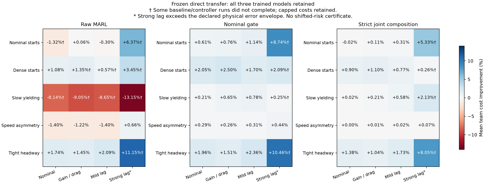

# V19 冻结控制器的跨场景与动力学迁移结果

6400 次实际 SUMO 已全部执行并完成最终汇总。学习权重、强反馈基线、名义门控与严格组合门控均保持冻结，未对新场景重训、重新校准或挑选训练种子。这组研究验证直接迁移的适用范围，不产生分布变化后的风险证书。

## 实验单位与比较

五类初态为 nominal、dense、低速让行、速度不对称、紧密跟车；每类 32 个新初态。每个初态配对四类动力学及十个控制器：一份基线，加三份固定训练模型的 raw、nominal、portfolio0。总数为 `5 * 32 * 4 * 10 = 6400`。

动力学为名义、增益/二次阻力、轻度惯性、强惯性。名义动力学的外生加速度创新范围为 ±0.5，其余三类为 ±0.1；强惯性参数 τ 为 0.3–0.5 s，轻度惯性 τ 为 0.03–0.05 s。跨控制器固定相同植物参数和外生创新，实际误差可因各自命令而不同。跨植物结果同时改变了动力学与声明的创新强度，不能将差异完全归因于某一个动力学参数。

每个场景/动力学格子的独立初态数为 32，三个模型的 96 个结果有关联。均值先在同一初态内平均固定模型；95% 区间按初态自举。区间是逐格探索性区间，没有声称 60 个格子同时覆盖或代表训练随机性的总体分布。所有未完成运行以原来的 25 s 时域截断计入主结果。

## 原物理误差范围内的结果

前三类动力学共 4800 次运行，所有实际加速度误差均处于原来的 ±0.5 m/s² 假设内。

| 控制器 | 完成数 | 中止 | 碰撞／约束违反 |
|---|---:|---:|---:|
| 强规划基线 | 480 / 480 | 0 | 0 / 0 |
| 原始学习，三个模型合计 | 1429 / 1440 | 0 | 0 / 0 |
| 名义门控，三个模型合计 | 1440 / 1440 | 0 | 0 / 0 |
| 严格组合门控，三个模型合计 | 1440 / 1440 | 0 | 0 / 0 |

原始学习的 11 次未完成均保留。原始学习在低速让行三类植物中，平均团队成本分别增加约 8.14%、9.05%、8.65%；这明确否定了“原始学习在所有迁移场景普遍优于基线”的表述。

严格组合门控相对同格基线的团队成本改善如下，负数表示退化：

| 初态分布 | 名义动力学 | 增益／阻力 | 轻度惯性 |
|---|---:|---:|---:|
| nominal | −0.019% | +0.111% | +0.312% |
| dense | +0.898% | +1.105% | +0.770% |
| 低速让行 | +0.020% | +0.212% | +0.578% |
| 速度不对称 | +0.004% | +0.015% | +0.015% |
| 紧密跟车 | +1.385% | +1.040% | +1.735% |

dense 三格与紧密跟车三格的逐格收益区间下界均为正。速度不对称时，收益与学习采用都很少；不能把非常小的正均值写成显著改善。nominal 初态/名义动力学格出现微小负均值，收益区间为 [−0.00846, 0.00195] s，也不能宣称处处不退化。

在前三类植物中合计，严格组合实际采用发生于 214/1440 个模型—初态—植物记录，其中 12 个出现采用后任一车辆成本/时间退化。名义门控为 844 次采用、141 次采用后退化。它们是有关联的描述性计数；严格组合的 12/214 也不是满足 5% 风险限额的证据。物理误差假设成立与性能风险受控是不同要求：均匀扰动轨迹不一定属于 17 条有限预测序列。

## 强惯性给出的适用边界

强惯性 1600 次执行全部至少一次超出原来的加速度误差范围，最大实际残差为 3.10757 m/s²。原始物理证书的统一假设在这里不成立。

| 控制器 | 完成数 | 中止 | 未完成但未中止 |
|---|---:|---:|---:|
| 强规划基线 | 152 / 160 | 8 | 0 |
| 原始学习 | 456 / 480 | 20 | 4 |
| 名义门控 | 468 / 480 | 12 | 0 |
| 严格组合门控 | 467 / 480 | 13 | 0 |

合计 57 次未完成，其中 53 次是控制器在离开原备份可恢复集合或无法找到认证命令后中止，另有 4 次原始学习未在时域内完成。没有记录碰撞或路线约束违反；中止后的真实车辆持续运动不属于该仿真运行，不能把停止仿真等同于已经安全停稳。

部分强惯性格子的相对收益较大，例如紧密跟车严格组合为 +8.05%，但其中包含失败基线的 25 s 截断成本。该数不能单独用于宣传抗失配性能，更不能推导强惯性下的安全保证。论文应明确：需要显式建模执行器状态、扩大并重建备份可恢复集，才可能继续讨论这一范围内的保证；当前实验没有完成这项扩展。



## 复核状态

原执行器逐条重建了实际命令、执行器状态、外生创新和位置/速度。855 条预定或失败轨迹已经保存，并在 finalize 中再次复核。

在完整汇总之前冻结了额外实际回放规则：每个场景/植物/控制器的初态 0、各格首次学习采用，以及所有失败。按该规则执行的 **336 次实际 SUMO 回放已全部通过**，全部 **68 次未完成运行**原样重现，包括基线和零采用失败。

336 次的逐车到达时间、命令变化、完成/碰撞/中止/约束指标、实际误差和学习采用次数均与原记录一致；全部新轨迹重新构建了实际执行器状态。有原始保存轨迹的 291 个案例，命令、状态、实际扰动、外生创新和执行器状态逐步完全一致。其余 45 个案例核对完整指标并独立重建物理轨迹，不声称与未保存的原轨迹逐步比较。

结果见 [`shifted_replay/audit.json`](../artifacts/v19/shifted_replay/audit.json)。回放不增加独立性能样本数，也不把有限试验中的零碰撞提升为任意失配下的安全保证。

主数据：[`shifted_study/summary.json`](../artifacts/v19/shifted_study/summary.json)、[`shifted_analysis/analysis.json`](../artifacts/v19/shifted_analysis/analysis.json)。物理假设边界见[执行器误差上界](v19_actuator_bounds.md)。

复现命令：

```powershell
python tools/study_shifted_v19.py finalize artifacts/v19/shifted_study
python tools/analyze_transfer_v19.py artifacts/v19/shifted_study artifacts/v19/shifted_analysis
python tools/replay_transfer_v19.py run artifacts/v19/shifted_replay
```

上述结果目录已存在时，不覆盖运行。独立的 40960 次同分布风险校准和 20480 次最终对照是另外的研究，当前结果不替代它们。
