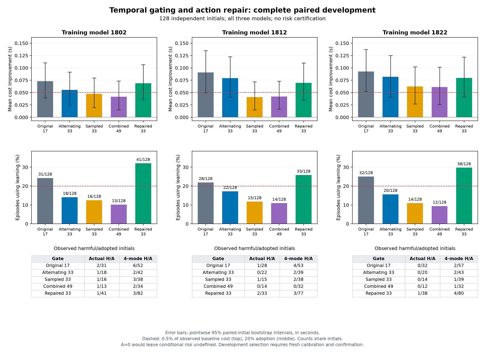

# 128 初态动作调整扩展：完整配对结果

新增的 1,536 次实际 SUMO 运行及独立复算均已完成，与原 6,656 次时变路径研究合并为 8,192 条不同控制器运行记录。独立初态仍为 128 个；四种扰动、不同模型和回放不增加独立样本数。原生监督进程于 2026-10-19 08:04:10 UTC 退出，退出码为零。

完整动作调整在三个模型上均恢复了原采样门控损失的采用机会，并提高平均收益。但它没有消除逐车退化，也没有获得风险认证或满足 500 ms 决策周期。以下结果属于开发证据，不能替代新的独立校准与确认。

## 采用与收益

实际模式沿用冻结随机流，每个初态只选择一种扰动进入主统计。采用指整次运行中至少执行过一次学习候选；成本为三辆车到达时间与控制变化量成本的平均值。

| 模型 | 原采样门控采用 /128 | 完整调整采用 /128 | 原成本改善 | 调整后成本改善 | 调整后实际退化 /采用 | 四模式组合退化 /采用 |
|---|---:|---:|---:|---:|---:|---:|
| 1802 | 16 | 41 | 0.4683% | 0.6791% | 1/41 | 3/82 |
| 1812 | 15 | 33 | 0.4023% | 0.6872% | 2/33 | 3/77 |
| 1822 | 14 | 38 | 0.6148% | 0.7853% | 1/38 | 4/80 |

调整后采用率为 32.03%、25.78%、29.69%。相对同初态、同扰动的原采样门控，实际成本增量收益及其逐模型 95% 配对自举区间为：

| 模型 | 增量收益 秒 | 95% 区间 秒 | 四模式平均增量 秒 | 95% 区间 秒 |
|---|---:|---|---:|---|
| 1802 | 0.02132 | [0.00643, 0.04171] | 0.01331 | [0.00687, 0.02314] |
| 1812 | 0.02881 | [0.00769, 0.05575] | 0.01815 | [0.00864, 0.03027] |
| 1822 | 0.01725 | [0.00277, 0.03512] | 0.01768 | [0.00834, 0.02894] |

这些区间以初态为重采样单位，是逐模型开发区间，不是经过开发选择后仍有效的最终区间或百分比比值区间。调整后的绝对收益区间也均为正。四模式中原有采用分别保留 65、66、69 条，并新增 89、81、85 条采用。新增采用中分别有 0、1、3 条发生逐车退化；采用包含不意味着实际风险或收益单调。

较少路径的原 17 路径门控在本数据上的实际收益为 0.721%、0.896%、0.916%，高于完整调整版，但其检查范围和风险表现不同。本研究因此支持“相对严格采样门控恢复收益”，不支持“全面优于所有原版本”。

普通场景 63 个初态中的调整后收益为 0.210%、0.345%、0.399%；密集场景 65 个初态为 1.162%、1.039%、1.183%。这支持在本任务的密集交互中收益更明显的开发观察，尚未覆盖任意复杂交通。

## 风险与执行时间

任一车辆成本、到达时间退化或执行失败即计为有害，不以团队收益抵消个体退化。实际经验风险为 1/41、2/33、1/38；其中 2/33 约为 6.06%。四模式组合中模型 1822 为 4/80，即 5%。有限样本比例不等于风险上界；三份新策略均未获得认证。扩展运行及全部合并运行完成，不意味着没有性能退化。

| 模型 | P95 毫秒 | P99 毫秒 | 最大值 毫秒 | 超过 500 ms 的决策 /全部决策 |
|---|---:|---:|---:|---:|
| 1802 | 2277.40 | 4878.17 | 10219.35 | 1706/11862 |
| 1812 | 2516.07 | 5100.80 | 11083.17 | 1726/11842 |
| 1822 | 2225.42 | 4935.05 | 16359.52 | 1631/11818 |

时间来自并发桌面负载与不同采集阶段，不能据此计算与原采样门控严格配对的速度变化，也不能将其他等价加速审计的比率直接套用到本数据。500 ms 周期未满足。

## 独立核验与证据

独立复算覆盖全部 1,536 条新物理轨迹、35,522 个候选集合、85,299 个候选命令、295 个不同已采用动作的完整 33 路径预测，以及 526 次准入决策，其中 336 次为衰减动作。全部 16 种合并方法的采用、退化、完成数和收益均经独立重算一致。

证据包括[冻结协议](../artifacts/v20/temporal_repair_extension/protocol.json)、[完整结果](../artifacts/v20/temporal_repair_extension/summary.json)、[执行退出记录](../artifacts/v20/temporal_repair_extension_execution/supervisor_native_exit.json)和[绘图数据](../artifacts/v20/temporal_repair_presentation/presentation.json)。结果 SHA-256 为 `316fc511139f8b197ebf228f0ca7f8d8286368aa3184e5b82e7b18ed82bdbb34`；研究清单 SHA-256 为 `6f00300042690859017a76da0764d827ee1771cb2cf58c72d545b7bc2b277193`。

后续需诊断全部剩余退化，而后冻结候选、误差预算与样本量，使用新数据校准风险并独立确认收益和采用率。已有公平对照与迁移失败保留，当前策略不会继承 V19 证书。
