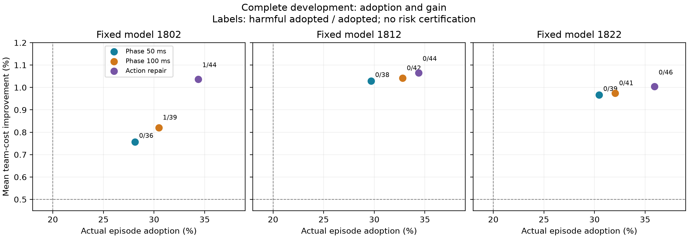
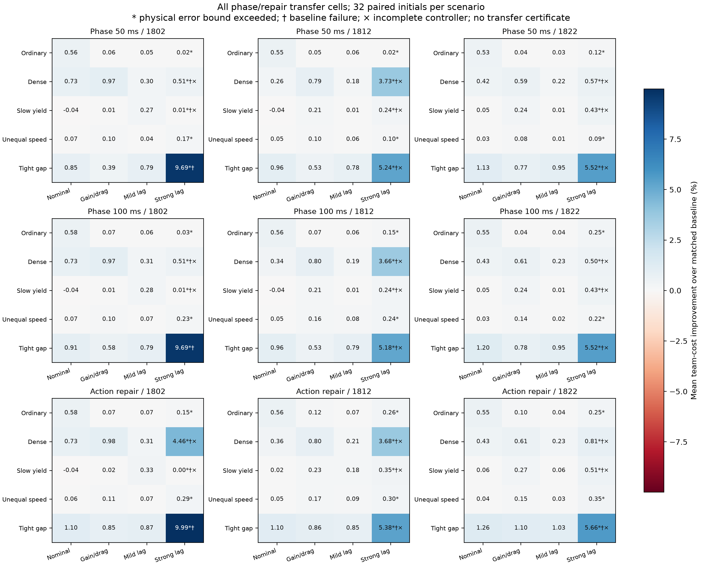

# V21 完整结果：时序门控的收益、风险与迁移边界

两组研究的全部 18,816 条主执行记录已完成独立复核。新监督进程于 2026-10-22 04:56 UTC 成功退出；原中断过程和未知退出状态保留，不补写为成功。完整冻结选择规则选中三份固定模型共同使用的 **50 ms 时序门控（phase05）**。这是进入新校准的开发资格，尚未取得新的风险证书。

## 在保留收益的同时更审慎地采用学习动作

时序门控研究包含 128 个新 IID 初态、四种扰动和 13 个控制器，共 6,656 次主执行。所有模型均保留；同一初态的不同模式与控制器不增加独立样本数。每个初态的实际模式按冻结随机流选取，四模式压力组另外计数。

| 固定模型 | phase05 成本改善 | 实际采用 /128 | 采用率 | 实际有害 /采用 | 四模式组合有害 /采用 | 平均收益的逐模型 95% 区间（秒） |
|---|---:|---:|---:|---:|---:|---|
| 1802 | 0.7572% | 36 | 28.13% | 0/36 | 1/85 | [0.04260, 0.11719] |
| 1812 | 1.0287% | 38 | 29.69% | 0/38 | 1/84 | [0.06168, 0.15210] |
| 1822 | 0.9664% | 39 | 30.47% | 0/39 | 1/84 | [0.05725, 0.14551] |

有害指任一车辆成本或登记到达时间退化，或执行失败。零次观察到的实际有害事件不代表风险为零；四模式组合仍有有害初态，且它与实际模式使用不同的采用分母。以上区间是开发阶段的逐模型配对区间，不是经过选择后仍有效的最终确认区间。

phase05 在本组普通场景中的成本改善为 0.367%、0.547%、0.456%，密集场景为 1.207%、1.584%、1.555%。这与当前任务中密集交互收益更明显的观察一致，不能推广到任意复杂交通。三个模型在全部 512 个初态/模式运行中均完成，没有执行失败。

## 必须保留的代价与对照

三种完整候选族均通过本开发集的最低收益、采用率、完成和经验风险条件。冻结规则依据六个风险目标中最差的开发上界分数选中 phase05；没有跨模型拼接方案，也没有挑选最佳训练种子。

相对同一批初态、相同扰动下的原动作调整门控，phase05 的平均增量收益分别为 **−0.02820、−0.00366、−0.00378 秒**，三个逐模型配对区间均为负。原动作调整门控的成本改善为 1.0368%、1.0650%、1.0039%，实际采用为 44、44、46 /128。因此不能把时序门控表述为全面提高收益或采用率。

模型 1802 的实际有害计数由 1/44 变为 0/36，四模式组合由 2/92 变为 1/85；另外两个模型的实际有害计数原本就是零，组合有害计数仍各为一，但采用分母更小。经验条件风险没有在所有模型上一致下降，更未证明真实风险显著降低。合理结论是：较审慎的门控仍保留了足够收益和采用率，值得用新的独立数据检验预定风险目标。

phase05 的实际决策耗时 P95 为 1,554、1,687、1,641 ms，仍超过 500 ms 周期。不同采集阶段和并发桌面负载混合，不能据此计算严格的独占加速比。完整动作候选、原成本/登记时间条件和 33 条预测路径未缩减；50 ms 是额外的插值到达时差容差，不是状态级的安全概率。

独立复核重建全部 6,656 条物理轨迹、142,023 个候选集合、338,652 个候选命令和 390 个不同的已准入完整预测；核验 2,433 次准入及 1,536 对原方法/关闭时序条件参考轨迹的一致性。

## 扩展场景与相同外部噪声下的动力学失配

迁移研究包含普通、密集、低速让行、速度不对称、紧密跟车五类场景，各 32 个独立初态；四种动力学、19 个控制器共 12,160 次主执行。所有动力学共用 ±0.1 m/s² 外生创新，控制器仍采用原 ±0.5 m/s² 物理误差假设。未重新训练、校准或筛选模型。

| 动力学 | phase05 三模型未完成 /各160 | 对应基线失败 /160 | phase05 实际误差越界 /各160 | 可支持的范围 |
|---|---|---:|---|---|
| 名义 | 0 / 0 / 0 | 0 | 0 / 0 / 0 | 本组运行完成；低速让行中两个模型平均收益为负 |
| 增益/阻力 | 0 / 0 / 0 | 0 | 0 / 0 / 0 | 本组运行完成，最大实测误差约 0.3872 m/s² |
| 轻度惯性 | 0 / 0 / 0 | 0 | 0 / 0 / 0 | 本组运行完成，最大实测误差约 0.4363 m/s²；采用减少 |
| 强惯性 | 8 / 8 / 9 | 10 | 160 / 160 / 160 | 超出原误差假设，不支持原物理或性能保证 |

在名义动力学的低速让行场景，phase05 的三个模型成本改善分别为 −0.0401%、−0.0401%、0.0463%，采用后有害计数分别为 1/2、1/2、1/3。样本很小，但这些反例必须保留，不能写成所有新场景都有效。

强惯性下的基线和学习门控都存在未完成案例。某些单元中较大的基线相对收益同时伴随基线失败，不能将其作为可靠性提升证据。全部控制器的强惯性执行共 3,040 次，其中 146 次未完成（144 次中止、2 次其他未完成）。名义、增益/阻力、轻度惯性的全部控制器中另有 1、3、1 次未完成，全研究合计 151 次；phase05 在这三类动力学中均完成，不应将其结果泛化为所有控制器均完成。强惯性全部运行至少出现一次物理误差越界。全研究未记录碰撞或约束事件，不意味着中止后的实际车辆已安全停止，也不构成道路安全概率保证。

完整独立复核覆盖 12,160 条执行器/物理轨迹、131,468 个候选集合、44,848 次原始 actor 输出、1,954 次名义准入和 1,723 次严格准入；其中 564 个不同完整扰动预测独立重建。全部 380 个场景/动力学/控制器单元及逐格区间见[完整结果表](../artifacts/v21/completed_presentation_20261022/report.md)。这些区间是逐格开发分析，不是同时覆盖或迁移风险认证。

## 下一步与证据

后续保持 phase05 的三个模型为同一完整族。完整执行器已通过旧初态的九十次真实集成：40 次主执行、10 次观测预测和 40 次独立部署回放全部完成，18 个实际选择与离线接口一致。正式校准执行协议已冻结并提交，原预留的4,096初态校准现已中断，449个完整块和3个部分块已核验并备份，恢复尚未启动；1,024 个新最终确认初态尚未执行。原始学习、名义门控、phase05、LTT、conformal 和均值策略改进适配仍共用候选与数据预算。最终新初态的实际部署回放将按完整协议执行，已有旧初态集成和人工校准配置不替代统计校准。见[完整执行协议](v21_complete_execution_protocol.md)。

- [完整模型组选择及预算](../artifacts/v21/validation_attempts/attempt_1/selection.json)
- [时序研究完整汇总](../artifacts/v21/interrupted_recovery_20261022/results/phase/summary.json)
- [匹配迁移完整汇总](../artifacts/v21/interrupted_recovery_20261022/results/transfer/summary.json)
- [监督进程实际成功退出](../artifacts/v21/interrupted_recovery_20261022/execution/supervisor_exit.json)
- [原冻结前瞻规则与适用边界](v21_prospective_validation.md)

当前结论是开发候选通过了原定准入条件，并且迁移边界已通过完整配对实验暴露；不是所有模型在扰动下的风险目标已经获证，也不是实时部署或全面优于已有方法的结论。

上述结果已同步至桌面论文第十六稿，共24页。新增正文给出时序诊断、九个开发控制器的完整比较、相同噪声下的迁移边界及完整模型组风险检验，明确保留负收益和失败案例。原17个可编辑公式保持不变，新增6个公式；全部页面经过渲染检查。见[构建来源](../artifacts/v21/manuscript_v16/build.json)和[文档核验](../artifacts/v21/manuscript_v16/qa.json)。该稿未读取正在运行的校准效果，也未新增风险认证结论。
