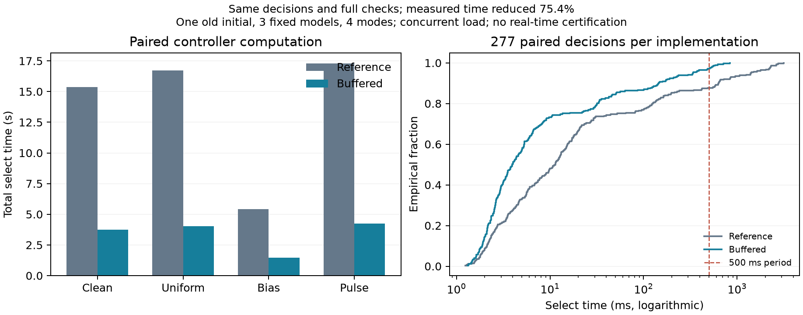

# 保留完整物理检查的区间缓冲复用

此前完整调用剖析显示，反馈基线续跑占慢调用的80.6%—92.5%，而时序比较本身只占0.11%—0.24%；跨决策缓存又只减少约0.52%耗时。因此本次针对基线续跑中反复调用的物理证书，消除每个物理子步都复制两个区间状态矩阵的开销。

新实现始终保留四个3×2矩阵：当前上下界lo、hi和下一子步的qlo、qhi。计算完成并通过原有物理转换判据后，交换当前与下一缓冲区。没有减少子步、备份时域、候选、扰动路径或安全检查，也没有引入近似值函数。运行中的正式校准仍使用原冻结实现。

## 等价论证和验证范围

给定验证过的有限三车状态和原参数，两个实现从相同的上下界开始。若某一物理子步开始时上下界相同，则它们以相同运算次序计算同一加速度误差界下的速度裁剪、位置推进，并调用未改动的interval_transition；该子步的判定和下一上下界相同。缓冲区交换不改变值，故该关系可逐步归纳。命令变化约束、每个备份阶段的制动命令、最大备份阶段数和停止条件也保持一致。首个提议命令执行后不提前检查备份终止，和原实现一致。

三个基线规划函数、五个完整预测辅助函数、三个门控方法的函数体均与原版本逐项AST一致；只有各辅助函数解析到的物理证书依赖使用新缓冲实现。原候选排序、阈值、全部33条预测路径、完整时域、错误处理、回退和工作计数因此保持原逻辑。Numba仍禁用fastmath。

30项针对性测试通过，包括随机与物理边界证书对照、输入不被修改、停止条件和备份长度、投影同分顺序、完整基线命令/代价/工作量，以及历史预先固定的慢调用和采用调用的完整门控证据一致性。这是实现等价论证与实际对照验证，不是新的安全定理或机器验证的全状态证明。

## 内核配对测量

冻结协议从一个已经完成独立复核的旧初态、三模型及四模式的277个决策输入中，保留全部206个不同的状态/上一命令/决策步组合。每个输入先对两实现预热并核对，再交替执行三轮配对计时；共412次预热和1,236次计时调用。每次命令、目标代价、规则代价及工作计数均完全一致。

原基线内核计时总和为1,300.517 ms，新内核为300.731 ms，本组减少76.876%。原始逐调用墙钟与进程CPU计时均保留；Windows进程CPU计时粒度较粗，不宜用单次很短调用的CPU差额解释微小差异。并发桌面负载和原校准同时存在。这只是内核测量，不能由此推算完整门控加速、总体时延分布或实时性。

该实验没有新的SUMO运行或独立有效性样本，没有读取正在校准的效果。见[冻结内核协议](../artifacts/v25/buffered_baseline_kernel/plan.json)、[完整测量](../artifacts/v25/buffered_baseline_kernel/results/report.json)和[实现](../src/coopgate/buffered_baseline_v25.py)。

## 完整SUMO检查

完整门控版本继承原初始化，并复制原方法体到独立实验模块；它不是跨调用缓存。冻结的三模型×四模式×两实现共24次实际SUMO配对检查已经完成，执行会话89137实际退出码为0。全部277次配对决策、9次采用、命令、轨迹、候选、准入、内部工作计数和决策摘要均与参考实现及旧独立复核档案完全一致；仅计时字段不同。独立复核重建24条物理轨迹、554个候选集合，以及18次准入所涉及的7个不同完整预测。

首次入口调用早于冻结命令完成，被未提交协议检查拒绝，且没有创建结果目录或执行新仿真；该记录单独保留。实际数据生成在冻结完成并提交协议后启动。见[完整门控源码](../src/coopgate/buffered_phase_v25.py)、[固定24次检查协议](../artifacts/v25/buffered_phase_sumo_audit/plan.json)、[拒绝的提前启动记录](../artifacts/v25/buffered_phase_sumo_audit/prelaunch_guard.json)。

| 扰动 | 配对决策数 | 参考计算耗时合计（ms） | 缓冲实现（ms） | 耗时减少 |
|---|---:|---:|---:|---:|
| clean | 67 | 15,379.156 | 3,750.955 | 75.610% |
| uniform | 70 | 16,723.989 | 4,023.959 | 75.939% |
| bias | 72 | 5,434.523 | 1,447.030 | 73.373% |
| pulse | 68 | 17,299.321 | 4,255.159 | 75.403% |
| 全部 | 277 | 54,836.989 | 13,477.103 | 75.423% |

这里计量完整select生命周期，包括内存分配、候选生成、全部预测、物理和性能检查以及证据整理；初始化耗时另存。该组参考/缓冲实现的样本P95为1,400.758/335.154 ms，P99为2,631.581/591.055 ms，最大值为3,155.360/838.140 ms；超过500 ms的决策由34次降为8次。因此仍不能宣称所有决策满足周期。所有配对使用同一旧初态，三模型和四种扰动不增加独立有效性样本；并发校准及桌面负载也限制硬件时延结论。这是明显的工程计算改进，尚需完整开发和迁移样本验证其覆盖范围，不能当成新的性能风险证书。

完整原始结果见[24次SUMO及逐对检查](../artifacts/v25/buffered_phase_sumo_audit/results/report.json)，[可复核汇总](../artifacts/v25/buffered_phase_presentation/report.json)和[汇总代码](../tools/present_buffered_phase_v25.py)。本次不修改正在运行的冻结校准控制器。
