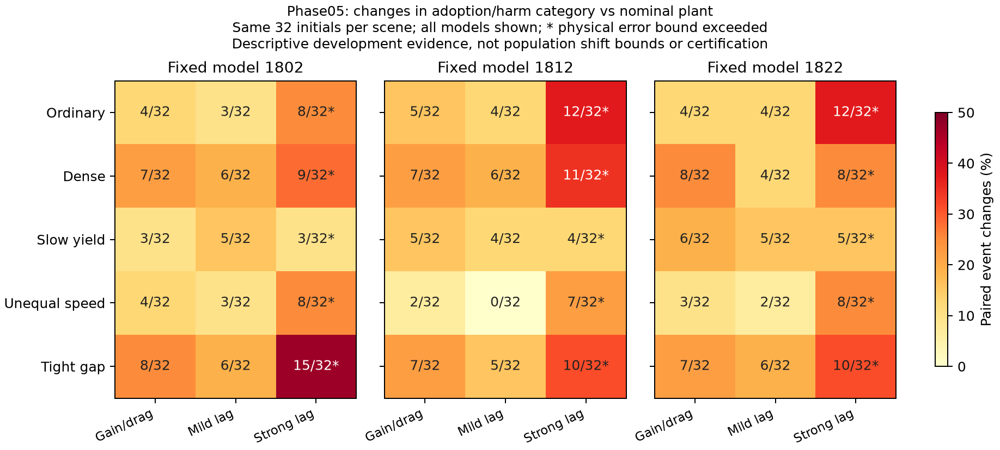

# 采用率如何影响性能风险的迁移边界

本补充给出一个自包含的条件风险敏感性推导，并分析已完成的匹配迁移实验。它使用标准总变差和耦合工具解释门控的适用边界，不作为新的统计方法宣传，不修改正在运行的校准，也不把开发集经验比例变成总体风险证书。

## 定义与结论

对一个冻结控制器，A表示整次运行实际使用过学习候选，H表示任一车辆成本或到达时间相对匹配基线退化，或执行失败。压缩后的结果Y有三类：0=未采用，1=采用且没有上述退化，2=采用且发生退化。未采用时的失败仍保留在单独的总失败指标中，条件风险不能替代总体失败率。

令P、Q是源条件与目标条件下Y的分布，a=P(A)>0，r_P=P(H|A)。假设Q(A)>0，且事件分布的总变差不超过rho：

\[
d_{TV}(P_Y,Q_Y)=\frac12\sum_{y=0}^2|P(Y=y)-Q(Y=y)|\le\rho.
\]

则有

\[
r_Q=Q(H\mid A)\le\min\{1,\ r_P+\rho/a\},\qquad Q(A)\ge a-\rho.
\]

如果只知道r_P≤u、a≥a_min>0及rho≤rho_max，同样可用min(1,u+rho_max/a_min)。a_min>rho_max保证目标采用概率仍为正；否则必须另外确认Q(A)>0，不能把目标零采用解释成零风险。

这里的rho是**采用/退化事件分布变化**，不是加速度误差的数值上限。±0.5 m/s²的物理残差界不能直接代入rho，也不能推出rho很小。不同初态分布、执行器参数和控制器实现都可能改变这些事件。

## 证明与可达到性

设B={Y=2}、C={Y=1}，定义f(Y)=(1-r_Q)1_B-r_Q1_C。其值域长度为1，且

\[
E_Qf=0,\qquad E_Pf=(r_P-r_Q)a.
\]

对任意值域长度为1的函数，总变差定义给出|E_Pf-E_Qf|≤rho，故(r_Q-r_P)a≤rho。采用率下界直接来自|P(A)-Q(A)|≤rho。

这个界的rho/a项不能一般性删除：令源分布P(Y=0,1,2)=(0.8,0.19,0.01)，目标分布为(0.8,0.18,0.02)。采用率均为20%，事件TV仅为1%，但采用后的风险从5%变为10%，恰好达到上式。这是合成概率例子，不是本项目的实测风险。

总变差及耦合的基础可参见Levin与Peres的[《Markov Chains and Mixing Times》第二版第4章](https://darkwing.uoregon.edu/~dlevin/MARKOV/mcmt2e.pdf)。上面的门控事件推导已完整给出，实验和统计假设另行核验。

## 配对模拟、实现替换与统计置信度

如果在同一初态及外部随机性下耦合两套系统，记epsilon=P(Y_P≠Y_Q)。任意事件E的概率差绝对值不超过该耦合的不一致概率，因此rho≤epsilon。这给出较保守但容易解释的界r_Q≤min(1,r_P+epsilon/a)。同一批案例中的配对事件可能相互抵消，所以事件TV可以为零而配对不一致率非零。

全域实现等价意味着相同条件下的闭环轨迹、采用和退化事件一致，epsilon=0，因而统计命题保持不变。有限回放零差异并不证明总体epsilon=0；尤其不能将同一个旧初态的模型、模式和决策步当作新增独立样本。本轮6,912次运行用于检验完整既有范围中的实现等价，不能替代该全域前提。

若要把界用于高置信迁移认证，需要同时有效的源风险上界U、源采用率下界L和偏移上界R。在三者同时覆盖的事件上，目标风险不超过min(1,U+R/L)，L>R还保证正采用。分别有错误概率delta_r、delta_a、delta_s时，可用联合界将总错误概率控制在三者之和；这不要求三次推断相互独立，但各自的覆盖必须在实际选择和数据使用规则下有效。

当前20%采用率验收线是预定的经验验收条件，不能直接当作真实采用率的高置信下界L。已有[Learn then Test风险控制](https://arxiv.org/html/2110.01052v5#S3.SS2)也不能自动提供部署分布变化的R。本项目尚未为这个迁移命题分配额外置信预算或估计有效的总体R，所以本补充没有新风险证书。

一个设计示例：若有有效的U=3%、L=20%，要维持5%的风险目标，需要R≤0.4%。如果仅有U=5%，上式便没有正偏移余量。这说明较低源风险和足够采用率对可解释的部署余量都有作用；示例参数并非正在校准的实测结果。

## 完整匹配迁移数据的诊断

分析读取已经完整独立复核的12,160次运行，覆盖全部六类非基线方法、三个固定模型、五类场景和三个目标动力学相对名义动力学的对比，共270个单元。每单元32个旧初态；模型和动力学不增加独立样本。源P是**匹配迁移实验的名义动力学与±0.1外部创新条件**，不是正式风险校准的四模式混合总体，因此两者的数字不能直接拼接成迁移证书。

每个单元保存完整3×3事件转移表、源/目标采用与有害计数、经验TV、配对变化率，以及控制器和匹配基线的失败总数、物理误差越界数。风险仍分别相对各自动力学下的匹配基线计算。所有原失败均保留，270个单元全部报告，没有只保留有利案例。

对phase05完整族的45个单元：增益/阻力的15个单元都存在配对事件变化，轻度惯性有14/15个，强惯性有15/15个。前两类动力学的phase05运行均未越出物理误差界且全部完成，目标采用后没有记录到定义的有害事件；这不代表零总体风险。强惯性下所有phase05运行都越界，三模型分别有8、8、9次未完成，原有限误差物理前提已不成立。

低速让行的名义条件下，三个模型分别仅采用2/32、2/32、3/32次，其中各有1次有害；小分母导致50%、50%、33.3%的经验条件比例。这里不能用总体平均收益掩盖逐车退化，也不能将几个样本的比例当成稳定总体风险。完整45个单元中，基于经验分布计算的上式有11个达到无信息的100%上限，说明仅凭这种通用敏感性界往往不足以迁移认证。

这些诊断的作用是解释边界，而不是声称所有失配都会增加风险：轻度失配下有些旧退化消失，采用对象和数量也改变。是否在目标条件下达到5%总体风险，仍需要有效的偏移上界或目标条件的独立校准。

## 可复核性

- [完整270单元与3×3原始事件计数](../artifacts/v25/matched_event_transfer/report.json)
- [完整表格](../artifacts/v25/matched_event_transfer/report.md)
- [概率界实现](../src/coopgate/selective_transfer_v25.py)
- [完整数据重算工具](../tools/audit_event_transfer_v25.py)
- [540次源/目标计数交叉核验](../artifacts/v25/matched_event_transfer_checks/verification.json)：全部采用、有害、失败及误差越界计数与原独立复核汇总一致。
- [29项测试](../tests/test_selective_transfer_v25.py)，包含5,000个随机联合概率表、达到等号的构造、零采用和无效输入。

测试验证数值实现和反例处理，不替代上述数学证明。此补充新增SUMO运行与独立样本数均为零；两项正在运行的实验保持原冻结方案。
