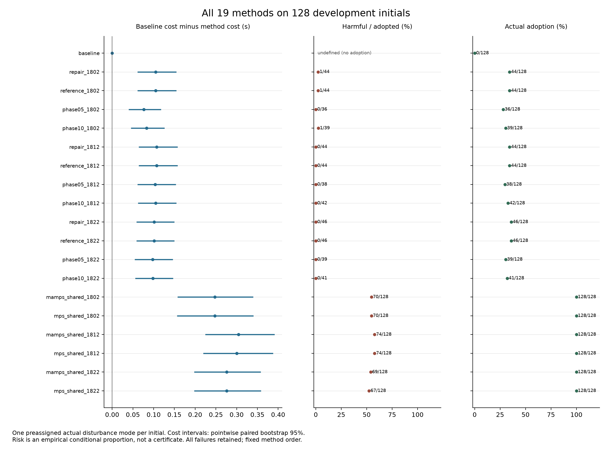
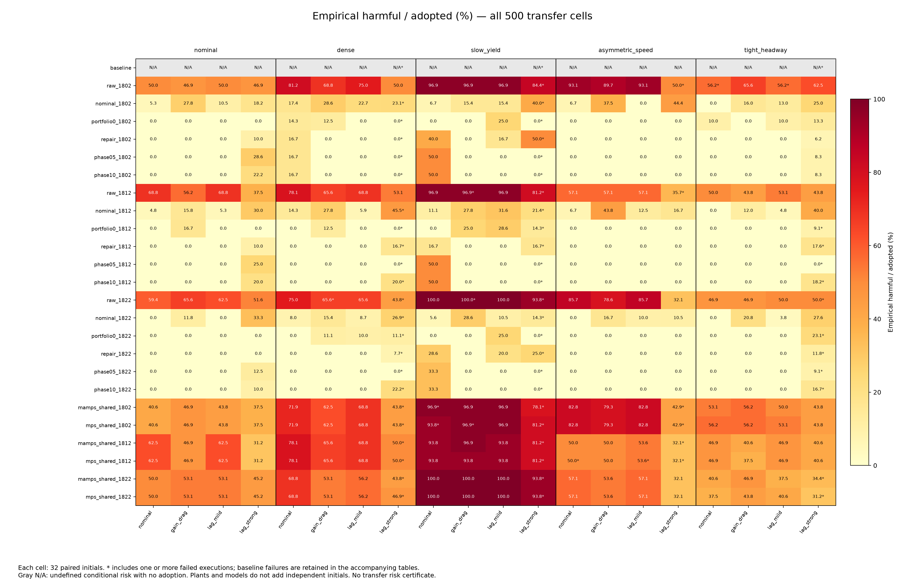

# 共同条件对照的完整结果与结论边界

新增 MAMPS/MPS 适配器的 6,912 次 SUMO 执行、157,841 条命令复核全部完成，真实工作进程退出码为 0。51 次控制器终止失败原样保留。与 18,816 条历史执行合并后，统一分析覆盖 19 个开发方法、500 个迁移单元和 126 项预声明主对照。历史 432,486 个控制步骤的实际动作采用事件已全量重算。

该对照复用既有的 128 个开发初态及 160 个迁移初态，没有新增独立有效性初态。分析代码和规则在读取新增完整效果之前冻结；正在进行的正式风险校准没有参与本次分析。

## 开发集：收益、采用率与逐车性能风险的明确取舍

实际模式沿用原冻结随机流，每个初态只计一个实际扰动模式。以下“有害”表示任一车辆成本或到达时间相对全程基线恶化，或者本方法执行失败。

| 固定模型 | 方法 | 团队成本改善 | 实际采用 / 128 | 有害 / 采用 |
|---|---|---:|---:|---:|
| 1802 | phase05 | 0.7572% | 36 | 0 / 36 |
| 1802 | MAMPS 适配器 | 2.4552% | 128 | 70 / 128 |
| 1802 | MPS 适配器 | 2.4552% | 128 | 70 / 128 |
| 1812 | phase05 | 1.0287% | 38 | 0 / 38 |
| 1812 | MAMPS 适配器 | 3.0168% | 128 | 74 / 128 |
| 1812 | MPS 适配器 | 2.9797% | 128 | 74 / 128 |
| 1822 | phase05 | 0.9664% | 39 | 0 / 39 |
| 1822 | MAMPS 适配器 | 2.7352% | 128 | 69 / 128 |
| 1822 | MPS 适配器 | 2.7352% | 128 | 67 / 128 |

这些实际模式回合全部完成。物理门控保留了更高团队收益，同时有 52.34%—57.81% 的采用回合出现逐车性能退化。phase05 的采用率为 28.13%—30.47%，仍保留正收益，但六项配对成本增量区间均在零以下，即平均成本确实高于对应物理门控。

这支持在物理可恢复性之外单独约束相对性能风险，也明确了其收益和采用率代价。当前证据不支持 phase05 在所有指标上占优。原有 repair/reference 方法仍保留在完整表中，它们的团队收益也高于 phase05；两个模型的实际有害计数同样为零，不能把新增时序条件描述成无代价、普遍必要的改进。

零观察退化不是风险认证。四模式组合中，phase05 仍分别出现 1/85、1/84、1/84 次组合有害/采用。组合目标先分别对采用与退化取“任一模式”，不要求两者发生在同一模式。

## 迁移：风险改善较一致，成本优势依赖条件

每个方法、场景和动力学单元包含 32 个配对初态。三个模型、五类场景、四种动力学产生 60 个 phase05 与 MAMPS 对照，以及 60 个 phase05 与 MPS 对照；这些单元共享初态，不能当作 120 个独立研究。

- 全部 120 项比较中，phase05 的经验采用后条件退化率均较低。该结论仅描述这批有限开发/迁移数据，没有同时置信保证。
- 平均成本方面，phase05 分别在 29/60 个 MAMPS 单元、28/60 个 MPS 单元更低，不能宣称普遍更快。
- 两类对照各有 13 个单元的成本增量逐项 95% 区间为正，各有 7 个单元为负，其余跨越或接触零。这些区间没有多重比较同时覆盖保证。
- phase05 在名义、增益/阻力及轻度滞后三种动力学的 1,440 次执行全部完成。两个物理门控适配器分别有 1 次、4 次任务超时，没有在这些单元发生控制器终止中止。

物理误差未超界也不能推出相对性能风险达标。在上述 45 个 phase05 场景/动力学/模型单元中，有四格经验条件退化率超过 5%：名义动力学密集场景模型 1802 为 1/6；名义动力学低速让行的三个模型分别为 1/2、1/2、1/3。其中两个低速让行单元的负均值收益也原样保留。其分母很小，不应将这些点估计解释成准确总体概率，更不能删去这些单元来延伸证书。

强滞后条件下，phase05、MAMPS、MPS 分别有 25/480、28/480、23/480 次终止失败；共享基线为 10/160。这里的 480 次包含三个固定模型对同一批 160 初态的重复执行，不是 480 个独立初态。所有这些模型执行都观察到物理误差超过原 ±0.5 m/s² 前提。phase05 没有统一降低失败数，基线自身失败也会放大部分相对收益；本报告不将这些收益当作安全证据。

## 对论文主张的影响

当前证据可以支持：使用相同学习模型、强基线和物理可恢复性检查时，加入相对性能准入能降低所测条件下的逐车经验退化风险，同时保留部分平均收益。完整数据明确展示了采用率与收益代价，以及低速让行和超界动力学下的限制。

当前证据仍不足以支持：扰动下完整模型组的 5% 风险认证、每个迁移条件的风险达标、等计算预算下的优势、实车可部署性或绝对安全。正式独立校准、最终确认及全范围实现耗时复测继续按原方案执行。

共同外部条件不代表相同候选搜索。phase05 还使用动作组合、衰减修正和完整后续预测；两个物理适配器的搜索结构不同。对照是完整方法之间的比较，其解释边界见[冻结分析规则](v27_common_condition_analysis.md)。全部结论仅针对本项目的明确适配，原论文的定理与实验条件不在此次验证范围内。

## 完整证据

- [19 个开发方法、500 个迁移单元和全部主对照表](../artifacts/v27/physical_switch_analysis/results/report.md)
- [机器可读结果及逐车指标](../artifacts/v27/physical_switch_analysis/results/report.json)
- [6,912 次实际执行的复核记录](../artifacts/v27/physical_switch_comparison/full/analysis/verification.json)
- [真实执行退出凭据](../artifacts/v27/physical_switch_comparison/full/execution/session_observation.json)
- [完整收益热图](../artifacts/v27/physical_switch_presentation/transfer_cost_gain.png)
- [完整采用率热图](../artifacts/v27/physical_switch_presentation/transfer_adoption.png)

四幅图均提供 PNG 和 SVG；固定方法顺序，不按结果排序，也不删除失败、零采用或负收益。
