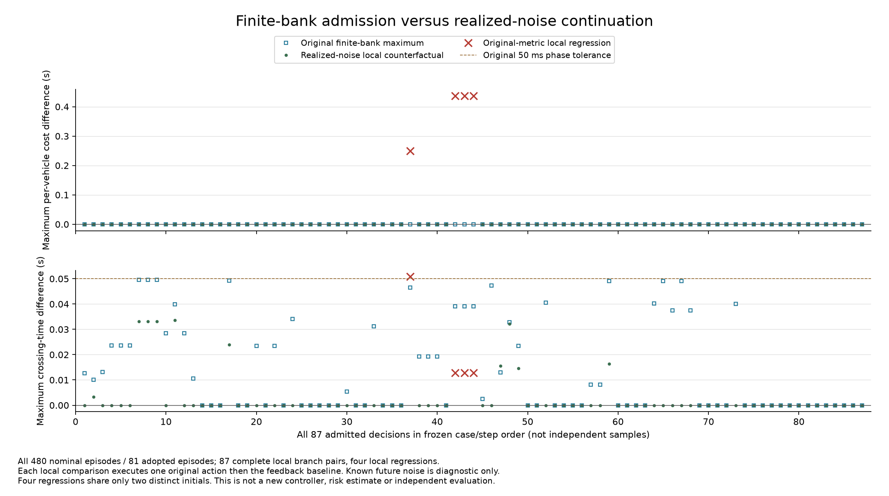
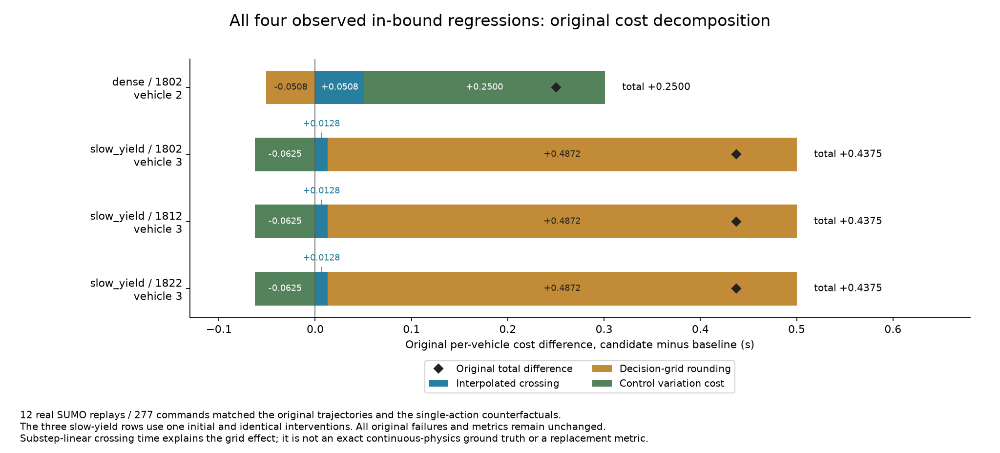

# 界内性能退化的完整机制诊断

V27 完整对照发现，phase05 在物理误差未越界的 1,440 次迁移执行中全部完成，但四个采用回合出现个体性能退化。它们来自两个初态：密集场景模型 1802，以及同一个低速让行初态的三个模型。三个模型的相同失效不能算作三个独立初态。

本研究用于解释上述现象，不调整正在运行的校准、生产控制器、时序容差或原评价指标。案例是在查看已完成结果后确定的，因此属于事后机制研究，不是新的独立有效性试验。

## 范围与反事实

离线部分覆盖名义动力学下全部 480 个 phase05 回合及相应 160 个基线回合；其中 81 个回合共采用学习 87 次。每次准入的完整 33 路成本/时间检查和时序检查均保存。用该初态实际外生噪声的未来，分别计算当前状态下“基线后续”和“这一次原动作后接基线”。已知未来只供诊断，不作为控制器输入。

反事实加性预测限定于名义执行器。增益、阻力或滞后条件下，执行器误差随命令改变，不能将学习轨迹中的已实现误差直接移植给基线。这些条件的完整效果仍保留在 V27 报告中。

真实 SUMO 回放覆盖全部四个界内退化回合，每个案例三种执行：全程强基线、原 phase05，以及单次原准入动作后接反馈基线，共 12 次。四个回合都只有一次学习准入。回放验证准入前的基线前缀、所有执行命令、物理轨迹及原到达时间和成本；随后核对离线已实现噪声预测。全部原失败保留，不更换种子、不调参数。

## 时间计分与成本分解

原仿真在决策周期边界登记到达，周期为 Δ=0.5 秒。对子步线性插值得到的过线时间 T，采用相同计分网格可写为 Q(T)=Δ ceil(T/Δ)。定义登记误差 e(T)=Q(T)−T，在已完成且按同一时间网格登记的轨迹上有 0≤e(T)<Δ。因此候选与基线的登记时间差满足

\[
Q(T_C)-Q(T_B)=(T_C-T_B)+e(T_C)-e(T_B).
\]

对原成本 J=Q(T)+0.05 TV，有

\[
J_C-J_B=(T_C-T_B)+[e(T_C)-e(T_B)]+0.05(TV_C-TV_B).
\]

这只是原成本的分解，不替换原指标，也不把插值结果当作连续车辆动力学的精确真值。它能区分真实过线差、登记边界放大和动作变化量代价。

完整回放现已完成，原工作进程真实退出码为 0。480 个回合的原指标分解、全部 87 次准入的两个局部反事实分支均完成，未丢弃不利结果；87 次局部比较中有四次退化。12 次实际 SUMO 回放的全部 277 条命令与原始记录一致，物理轨迹复核通过，四条退化记录的局部预测均与完整回放的原成本、登记时间及插值过线差一致。三条低速让行记录共享一个初态和相同干预，总计仅两个不同初态。

| 原退化记录 | 受损车辆 | 插值过线差（秒） | 登记误差差（秒） | 动作变化成本差 | 原成本差 |
|---|---|---:|---:|---:|---:|
| 密集场景 / 1802 | 2 | +0.050807 | −0.050807 | +0.250000 | +0.250000 |
| 低速让行 / 1802 | 3 | +0.012834 | +0.487166 | −0.062500 | +0.437500 |
| 低速让行 / 1812 | 3 | +0.012834 | +0.487166 | −0.062500 | +0.437500 |
| 低速让行 / 1822 | 3 | +0.012834 | +0.487166 | −0.062500 | +0.437500 |

低速让行案例的过线由 9.487334 秒变为 9.500168 秒，约 12.8 毫秒差异跨过 9.5 秒登记边界，使原登记时间由 9.5 秒变为 10.0 秒。尽管动作总变化量减少了 1.25，原成本仍增加 0.4375。密集案例的受损车辆登记时间不变，动作总变化量增加 5，原成本增加 0.25。

两类案例均只有一次学习干预，且干预前与全程基线轨迹一致。实际 SUMO 中“原门控”和“这一次原动作后接反馈基线”的全部命令对应，因此可以把这四条记录的全回合差异归因于该单次干预。其他多次采用回合的局部后续比较不具备这个全回合归因性质，87 次局部决策也不能作为 87 个独立风险样本。

小时间差被网格放大不意味着原退化可以删除。物理界内、有限场景库全部通过与新扰动下逐车性能不退化，是不同命题。正式性能风险结论继续等待独立校准和最终确认。

## 对后续方法的约束

这些结果支持研究登记边界裕量和后续反馈动作的敏感性，而非仅继续收紧统一时序容差。一个固定正容差无法独自防止跨登记边界；即使登记时间不变，后续动作变化成本也可能增加。完整 33 路预测在这些反例中均通过，说明增加确定性有限库筛选不能直接替代分布外的性能风险认证。

新的准入分数必须只使用当时可得的信息；已实现未来噪声只能解释失败。任何依据本报告开发的新控制器都需要重新冻结并在独立数据上验证收益、采用率和风险，不能继承正在进行的 phase05 校准证书，也不能把同一两个初态上的修复当成总体改进。

## 完成条件

冻结源码、完整输入数据库及计划后才执行；保留所有 480 条分解和 87 次局部预测，包括不完整反事实分支。实际执行须保存 12 条 SUMO 轨迹及逐条复核，取得真实成功退出凭据后才汇总。任何观测不一致停止并保留前缀，不能静默覆盖或按结果重跑。

工具：[诊断与回放入口](../tools/diagnose_regression_v28.py)、[分解及单次干预实现](../src/coopgate/regression_diagnostic_v28.py)。

完整证据：[冻结计划](../artifacts/v28/regression_mechanisms/plan.json)、[真实退出凭据](../artifacts/v28/regression_mechanisms/execution/observation.json)、[全部诊断结果](../artifacts/v28/regression_mechanisms/analysis/report.json)、[12 次回放逐条复核](../artifacts/v28/regression_mechanisms/replays/complete.json)。图表保留所有准入与四条退化记录，提供 PNG/SVG 及机器可读绘图输入，不增加独立样本。
