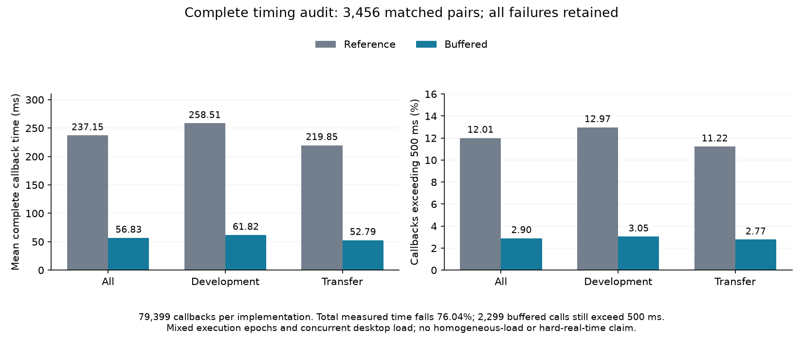

# 缓冲复用的完整范围结果

完整复测已完成 6,912 次角色执行、3,456 组成对条件和 288 个封存块。独立复核检查了全部原记录、两实现的非计时轨迹、物理重构及失败身份；实际工作进程退出为 0，完整汇总进程也实际退出为 0。不是根据进度文件推定完成。

## 全部调用的计时

以下计入成功调用和导致控制器终止的异常调用。每组两个实现的调用数相同；均值由全部调用总耗时除以总调用数得到，没有平均各单元分位数。

| 范围 | 配对回合 | 每实现调用数 | 原实现均值 / ms | 缓冲均值 / ms | 总耗时减少 | 原实现 >500 ms | 缓冲 >500 ms |
|---|---:|---:|---:|---:|---:|---:|---:|
| 开发集 | 1,536 | 35,533 | 258.510 | 61.816 | 76.088% | 4,610 | 1,082 |
| 迁移集 | 1,920 | 43,866 | 219.846 | 52.793 | 75.987% | 4,923 | 1,217 |
| 全部 | 3,456 | 79,399 | 237.149 | 56.831 | 76.036% | 9,533 | 2,299 |

全部条件的原实现累计回调时间为 18,829.402 s，缓冲实现为 4,512.296 s。超过 500 ms 的比例由 12.006% 变为 2.896%；缓冲版本最大调用时间仍为 3,497.257 ms，不能由均值改善推出最坏时限保证。

完整报告保留全部 84 个场景/动力学/模型/扰动单元。开发部分 433 个回合采用学习，迁移部分 333 个回合采用学习；迁移部分原有 25 个中止全部复现，480 个强滞后回合的物理误差超界也没有删除或重新解释为安全。重复实现测时不增加独立初态数，也不扩大原安全前提。

## 中断和负载的边界

恢复保留 5,435 条原角色记录，仅执行剩余 1,477 条，并额外完成一次真实边界重放。原中断退出原因仍未知。初态 66、clean、模型 1822 的一组成对执行跨越中断前后时段，全部原计时逐字节保留。

汇总混合执行时段及并发桌面负载，是本机实测性能证据。它不等于同一负载条件下的严格速度因果估计、部署时延保证或硬实时证明。正式风险校准仍使用原冻结实现；不能把另一实现的测时结果当作风险校准的运行耗时。

证据：[完整报告](../artifacts/v29/buffered_scope_recovery_20261023/analysis/report.json)、[全部块独立复核](../artifacts/v29/buffered_scope_recovery_20261023/execution/all_blocks_reviewed.json)、[真实退出](../artifacts/v29/buffered_scope_recovery_20261023/execution/exit.json)、[恢复与跨时段配对记账](../artifacts/v29/buffered_scope_recovery_20261023/recovery_accounting.json)。
