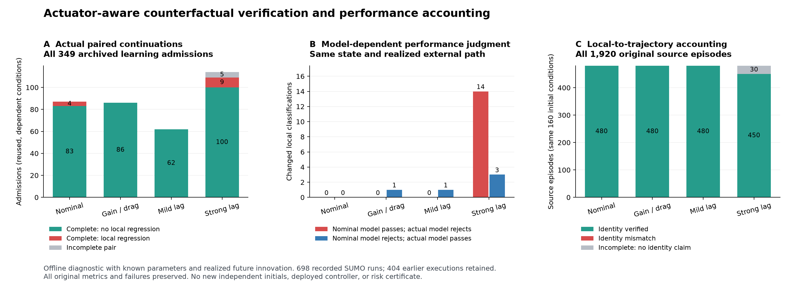

# 执行器失配下的完整成对干预验证

本阶段检验门控比较所依赖的后续预测，而不是另换评价指标。范围为已完成迁移研究的全部 1,920 个 phase05 回合：五类场景、四种动力学、三个固定学习模型，每格 32 个初态。333 个采用回合中包含 349 次学习动作准入，全部进入成对干预；不筛掉强滞后、中止或原有性能退化案例。

## 为什么必须从完整历史分支

存在执行器滞后时，位置和速度相同并不能确定下一步响应。预测状态必须保留执行器记忆、上一条指令和原决策时钟。两条反事实轨迹共用外生创新，各自递推内部状态，不能把原轨迹的实际指令误差移植过去。

每个准入点执行两次真实 SUMO 回合：

1. 完整重放该准入点之前的原始命令，然后接反馈基线。
2. 重放相同历史，在该点执行原学习动作一次，然后接相同反馈基线。

历史中更早的学习动作也必须保留。两条分支通过物理执行到达同一边界，不把 SUMO 位置或执行器状态直接重置为预测值。基线保留全局时钟，并在每步执行原物理检查。总范围为 698 次 SUMO 执行。

设各车原评价为 J_i=T_i+0.05 TV_i，边界前已累计部分为 P_i，预测剩余部分为 V_i。逐车核对

\[
J_i^{\mathrm{SUMO}}=P_i+V_i^{\mathrm{prediction}}.
\]

P_i 中的时间和动作变化在该车到达时停止累计。相同完整前缀使两个分支的 P_i 相同，因此后续代价差必须等于实际整回合代价差。此前已经到达的车辆、尚未到达的车辆及提前中止均按原时域处理。

## 比较与完整报告

- 对全部 349 个准入点，使用真实动力学参数和共同已实现外生路径，分别预测两条分支；另算同一边界和外生路径下的名义执行器预测，用于定位模型失配影响。
- 698 次实际执行独立核对完整前缀、后续每条命令、位置/速度、执行器记忆、实际指令误差、到达时刻、原成本和中止身份。
- 保留全部不完整分支及其截断成本。不把较小的失败截断成本当成收益，不在基线分支失败时计算一个虚假的相对改善。
- 完整封存并取得真实成功退出后才汇总。报告全部 60 个场景/动力学/模型单元，包括零准入单元、失配数、局部退化及名义/扩展状态预测的判定变化。

这些局部反事实共享旧初态、模型及轨迹前缀。349 次准入或 698 次执行均不构成相应数量的新独立初态，也不能直接估计整回合采用后的总体风险。

## 在线应用边界

真实参数与已实现未来外生路径只用于离线诊断。SUMO 执行分支的控制器不读取未来创新，后续始终使用原反馈基线。预测准确也不等于一个可部署的置信度；在线方案还需要可获得的执行器状态/参数估计、预先指定的扰动预测，以及独立校准。

强滞后超出原 ±0.5 m/s² 物理前提的案例继续保留。原物理证书、训练模型、正式校准候选和阈值均不因本诊断改变。

实现：[成对前缀与指标核对](../src/coopgate/actuator_intervention_v31.py)、[冻结和全量执行入口](../tools/audit_interventions_v31.py)。

## 完整轨迹与单次准入之间的恒等式

令 z_k 包含位置、速度、执行器记忆、上一指令和原时钟；固定实际外生路径 w。V_B(k,z_k;w) 是从该状态继续执行反馈基线的逐车剩余成本/时间向量。一次候选后接基线的相对差记为

\[
A_B(k,z_k,u_k;w)=\ell(z_k,u_k)+V_B(k+1,z_{k+1};w)-V_B(k,z_k;w).
\]

在相关分支均完整、预测模型与实际动力学一致的条件下，对实际学习轨迹逐步相加，中间价值项相消。执行基线动作的步骤中 A_B 为零，于是

\[
J_{\pi}(z_0;w)-J_B(z_0;w)=\sum_{k:\,\text{采用学习动作}} A_B(k,z_k,u_k;w).
\]

这是有限时域的代数恒等式，不是新的强化学习定理。它解释了门控为什么需要检查逐车相对后续价值，也明确说明局部损失可以被其他步骤收益抵消：整回合均值变好不等于每次准入或每辆车都不退化。

完整核验覆盖全部 1,920 个旧回合，包括零采用及多次采用；在任一相关分支不完整时，保留原结果并明确标记无法用本完整轨迹命题判断。已知失败截断值不会被当成成功的策略改进证据。

如果未来在线预测能够提供逐次、逐车有效的误差上界 epsilon_k，使真实 A_B 不超过估计值加 epsilon_k，那么每次仅接受“估计值 + epsilon_k ≤ 0”的动作，就能在这些界共同成立的路径上推出整回合逐车不退化。当前有限扰动库尚未提供这种共同有效的上界；本离线核验不替代正在进行的独立风险校准。

## 首轮执行中止与完整复跑

首轮已完成 202 个准入点、404 次 SUMO 执行后，进程以退出码 1 停止。下一准入点的记录状态为 2.5000000000000004，比数学上限 2.5 高一个浮点舍入量；严格输入检查将其误判为物理越界。原数据库、计划、输入与真实失败退出凭据全部保留。

[修正版预测器](../src/coopgate/actuator_prediction_roundoff_v31.py)仅对输入边界检查允许以执行器量程尺度计算的八个 ULP 容差，不裁剪、不覆盖实际执行器值，动力学递推保持原样；1e−10 的实际越界仍被拒绝。通过[明确的完整复跑入口](../tools/replay_interventions_v31.py)对同一 349 点清单重新执行全部 698 次回放。两份完整输入数据库及封存清单要求字节一致；原 404 次执行与复跑分开记账，总实际执行预算 1,102 次，新增独立初态仍为零。

## 完整结果

完整复跑和独立汇总均取得真实退出码 0。698 个实际分支与预测全部匹配，共核对 16,230 条命令，全部原指标和中止身份保留。这里的完成指执行及记录完成，不代表所有车辆任务成功；五条基线后续仍不能完成。

| 动力学 | 全部准入点 | 两分支均完整 | 局部逐车性能退化 | 基线后续不完整 | 名义/执行器模型判定变化 |
|---|---:|---:|---:|---:|---:|
| 名义 | 87 | 87 | 4 | 0 | 0 |
| 增益/阻力 | 86 | 86 | 0 | 0 | 1 |
| 轻度滞后 | 62 | 62 | 0 | 0 | 1 |
| 强滞后 | 114 | 109 | 9 | 5 | 17 |

“局部退化”指同一真实前缀处，一次学习动作后接基线比立即接基线增加任意一辆车的原成本或到达时间。它不是碰撞率，也不是这些相关干预点的总体风险估计。

在相同已实现外生路径下，强滞后有 14 次被名义模型判断为可提供性能准入依据，却被执行器模型否定：九次有实际局部退化，五次基线后续不完整。另有三次相反；增益/阻力和轻度滞后各有一次名义模型过度保守。全部 19 次判定变化说明，执行器状态会同时影响误放行与误拒绝。该比较使用已知真实参数和未来外生路径，只能作为离线机制证据。

完整轨迹恒等式在 1,890 个满足条件的回合上全部匹配，最大绝对差为 0。其余 30 个强滞后回合单独列出，其中源策略失败 25 个、初始基线失败 30 个、局部分支不完整五个；这些原因重叠，不能相加为 60 个失败回合。13 个可核验回合包含多次准入，其中强滞后有两个回合的局部损失被后续收益抵消，最终逐车没有退化。局部逐次不退化是一个充分条件，不能当作整回合改善的必要条件。

名义执行器下原有四个局部退化仍然存在，因此仅补充执行器状态并不能解决有限扰动库之外的性能风险。这一结果支持后续将状态预测与独立风险校准共同用于门控，但没有提供新的在线选择器、门控收益或风险证书。

证据：[698 分支完整报告](../artifacts/v31/actuator_interventions_roundoff/analysis/report.json)、[全部 1,920 回合的恒等式核验](../artifacts/v31/performance_identity/analysis/report.json)、[真实完整退出](../artifacts/v31/actuator_interventions_roundoff/execution/observation.json)、[首轮失败与复跑记账](../artifacts/v31/actuator_interventions_roundoff/repeat.json)。
