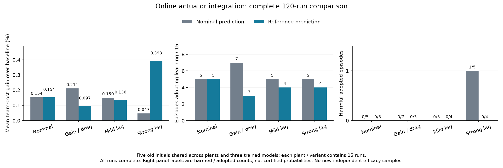

# 从执行器反事实诊断到在线准入

V31 已证明执行器状态会改变同一状态处的相对性能判断，但它使用了真实参数和已实现未来扰动。本阶段实现可在线计算的版本：选择器仅接收当前运动状态、实际上一条指令和原决策时钟，使用实验前固定的参考执行器参数与扰动库，不读取仿真器每回合生成的随机参数、真实内部状态或未来扰动。

## 预先配置的模型与状态重建

参考参数按执行器配置类型固定，三辆车使用相同标称值：

| 配置 | 增益 | 阻力系数 | 时间常数 |
|---|---:|---:|---:|
| 名义 | 1 | 0 | 0 |
| 增益/阻力 | 1 | 0.000375 | 0 |
| 轻度滞后 | 1 | 0 | 0.04 s |
| 强滞后 | 1 | 0 | 0.4 s |

这是已知配置类别下的标称模型，不是在线辨识，也不是精确知道各车随机真值。例如强滞后真实时间常数仍为各车独立的 0.3–0.5 s，而控制器始终使用 0.4 s。配置类别作为公开的实验条件预先给定，结果不能解释成未知类别下的自适应性能。

从已声明的零初始执行器状态出发，每次决策用实际已执行的上一条指令递推五个 0.1 s 子步，得到参考内部状态。它不会用上一条建议动作替代实际执行动作，也不会从 SUMO 的隐藏变量更新状态。

## 共同候选与可解释准入条件

名义预测版本和参考执行器版本共用三个冻结训练模型、联合动作组合及衰减修正规则、33 条固定外生扰动路径、25 s 时域、原逐车成本/到达时间、50 ms 到达相位条件，以及传统回退和原物理检查。

扰动库沿用原预先固定的随机流，将外生幅值缩放至此次动力学迁移研究声明的 ±0.1 m/s²。两个版本之间只改变预测执行器模型和由此产生的候选排序；闭环访问状态和实际计算量可能不同，因此不宣称逐次计算预算相等。旧 phase05 使用不同的扰动幅值和实现，其结果作为保留的历史对照，不能把全部差异都归因于执行器状态。

候选需在全部 33 条路径上满足：两个反馈后续均完整、每辆车原成本和到达时间均不恶化、到达相位差不超过 50 ms，且无扰动路径的平均成本严格改善。否则执行原反馈基线。导出的性能余量是确定的有限路径检查余量，不是当前状态的安全概率，也不是新的统计风险证书。

如果参考基线后续不完整，就没有相对性能准入依据。原基线本身在强失配下仍可能失败；新模块没有扩大原 ±0.5 m/s² 物理误差合同或证明新的可恢复集合。

## 先核验预测，再执行真实闭环

1. 对 V31 全部 349 个干预点的 698 条已真实验证分支，核对快速预测器的每条命令、全轨迹、执行器记忆、实际误差、成本、到达相位及中止类别/时刻。这里可以使用旧已实现扰动，因为这是预测器一致性验证，不是部署输入。
2. 固定选择旧网格每个场景的第一个初态，覆盖五场景、四动力学、三个模型和两个新版本，共 120 次真实 SUMO 集成。全部旧基线和 phase05 比较结果保留，不替换失败、删去强滞后或选择表现最好的模型。
3. 实际轨迹逐步复核独立动力学、参考状态重建、实际采用事件及完整准入证据。只有全部执行、封存和真实退出验证完成后汇总。

这 120 次执行只覆盖五个共享的旧初态，属于开发集成，不能当作新独立有效性验证。后续需要完整网格比较和新的独立确认；正式风险校准的代码、候选和数据保持原样。

47 项检查已经通过。快速预测器随后对全部 698 条旧干预分支完成独立核对，每条命令、完整状态轨迹、内部记忆、实际误差、原指标和失败类别/时刻全部匹配，原核验进程实际退出码为 0。

## 完整在线集成结果

120 次实际 SUMO 集成及独立复核均已完成，两个进程均真实退出为 0。每个动力学/版本单元包含五个旧初态与三个训练模型，共 15 次运行；全部完成。全轨迹、参考状态递推、实际采用事件和有限扰动库证据均通过复核。

| 实际动力学 | 预测版本 | 成本改善 | 采用回合 / 15 | 采用后退化 / 采用 | 回调 p95 / ms |
|---|---|---:|---:|---:|---:|
| 名义 | 名义 | 0.1540% | 5 | 0 / 5 | 1206.8 |
| 名义 | 参考执行器 | 0.1540% | 5 | 0 / 5 | 1112.7 |
| 增益/阻力 | 名义 | 0.2113% | 7 | 0 / 7 | 1069.5 |
| 增益/阻力 | 参考执行器 | 0.0967% | 3 | 0 / 3 | 875.5 |
| 轻度滞后 | 名义 | 0.1504% | 5 | 0 / 5 | 1250.8 |
| 轻度滞后 | 参考执行器 | 0.1361% | 4 | 0 / 4 | 1409.9 |
| 强滞后 | 名义 | 0.0474% | 5 | 1 / 5 | 1964.0 |
| 强滞后 | 参考执行器 | 0.3930% | 4 | 0 / 4 | 1734.0 |

强滞后下，名义预测版本在原 nominal 场景第一个初态、模型 1822 上出现逐车性能退化，团队成本也恶化 1.6260%；参考版本在相同条件下不再产生该退化。其他轻度失配下参考版本更保守，采用率和收益下降，因此不能宣称全面优于名义版本。五个共享旧初态和相关模型重复也不能用于认证总体退化概率。

本次所有单元的 p95 都超过 500 ms；最大值最高约 7.91 s。执行器预测增加了工程开销，现阶段没有实时部署证据。已有缓冲优化的完整提速结果属于 phase05 的另一个实现，不能直接移植为本版本的耗时结果。

证据：[完整 120 次结果](../artifacts/v32/online_actuator_preflight/analysis/report.json)、[真实退出和独立汇总核验](../artifacts/v32/online_actuator_preflight/completion_verification.json)。后续按[完整网格协议](v32_full_online_actuator_protocol.md)保持两个控制器原样，运行全部 3,840 个条件，并保留强失配失败。

实现：[在线门控与快速预测](../src/coopgate/online_actuator_gate_v32.py)、[完整预测核验及集成协议](../tools/audit_online_actuator_v32.py)。
