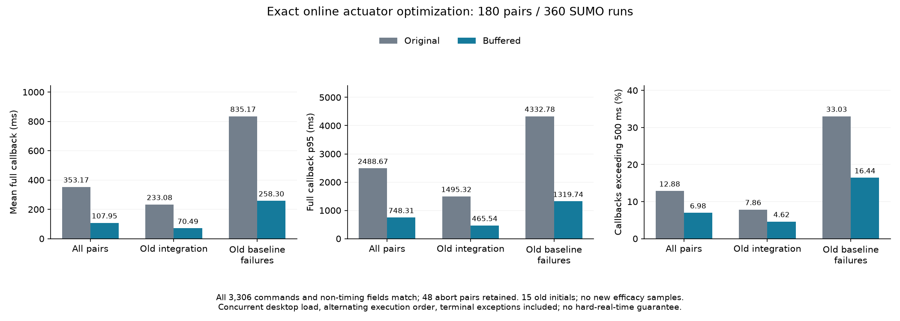

# 在线执行器门控的完整等价优化结果

固定的 360 次实际 SUMO 运行、180 组成对条件已全部完成，工作进程实际退出为 0，完整独立汇总也实际退出为 0。优化前后的 3,306 条命令和全部非计时字段一致，内部模型工作计数、有限扰动库证据及失败身份均保留。

范围包括原完整在线集成的全部 120 个条件，以及全部 10 个旧基线失败初态交叉三模型和两个预测版本所得的 60 个条件。所有 15 个初态均来自旧研究；新增独立有效性样本为零。包含失败条件是预先声明的工程覆盖，不能当作总体交通分布。

| 范围 | 配对条件 | 每实现调用数 | 原均值 / ms | 优化均值 / ms | 原 p95 / ms | 优化 p95 / ms | 累计耗时减少 |
|---|---:|---:|---:|---:|---:|---:|---:|
| 全部 | 180 | 3354 | 353.175 | 107.951 | 2488.669 | 748.315 | 69.434% |
| 原集成条件 | 120 | 2685 | 233.080 | 70.488 | 1495.324 | 465.541 | 69.758% |
| 全部旧基线失败条件 | 60 | 669 | 835.169 | 258.305 | 4332.778 | 1319.743 | 69.072% |

计时包含全部成功与终止异常调用。原实现有 432 / 3354 次调用超过 500 ms，缓冲实现为 234 / 3354；优化后的最大调用仍为 4799.218 ms。均值或分位数改善不构成最坏时限保证。

保留 48 组控制器中止以及 90 组物理误差超出原合同的条件。本次优化保持控制器行为，因此没有修复或消除这些模型适用范围限制，也没有产生新的总体风险证书。正式风险校准和 V32 完整收益比较仍使用原冻结实现。

来源：[完整独立报告](../artifacts/v33/buffered_actuator_audit/analysis/report.json)、[真实完成凭据](../artifacts/v33/buffered_actuator_audit/completion_verification.json)、[语法约束、等价性论证与实验协议](v33_buffered_actuator_protocol.md)。全部测量是在并发桌面负载下完成，配对执行先后交替；没有均质负载、硬实时或任意分布的认证结论。
