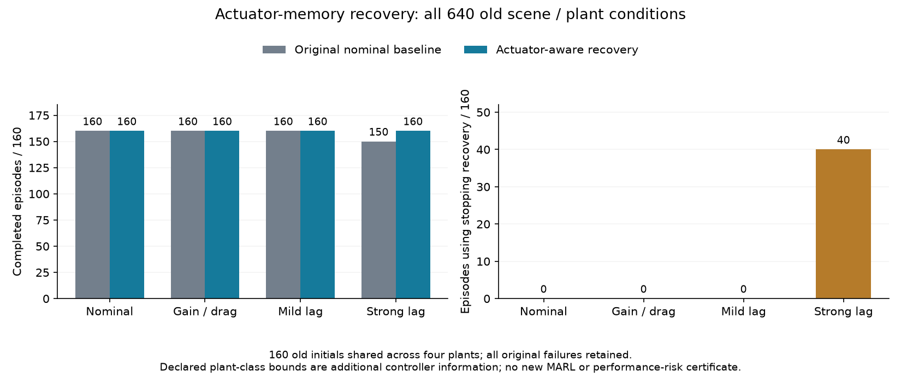

# 执行器状态恢复的完整开发结果

全部 640 次真实 SUMO 执行和独立复核已完成，工作进程及汇总进程实际退出均为 0。范围为五场景、每场景 32 个旧初态及四类动力学，包含全部旧基线失败条件；新增独立初态为零。复核重建 15,032 条命令、每个物理子步及在线内部状态区间。

| 动力学 | 原基线完成 /160 | 新恢复完成 /160 | 新中止 | 新超时 | 使用恢复的回合 | 双方完整配对数 | 完整配对子集成本改善 |
|---|---:|---:|---:|---:|---:|---:|---:|
| 名义 | 160 | 160 | 0 | 0 | 0 | 160 | 0.000% |
| 增益/阻力 | 160 | 160 | 0 | 0 | 0 | 160 | 0.000% |
| 轻滞后 | 160 | 160 | 0 | 0 | 0 | 160 | 0.000% |
| 强滞后 | 150 | 160 | 0 | 0 | 40 | 150 | -3.208% |

原未完成条件中，新恢复完成 10 个；原完成条件中，新恢复未完成 0 个。全部实际执行的固定路线几何违反为 0。每个场景/动力学单元的完整数据都保留在报告中，不能只选择总表中较好的动力学。

旧/新运行的实际命令、位置、创新、内部执行器状态和实际误差也逐项比较。完全相同的轨迹数（各类分母 160）为：{"nominal": 160, "gain_drag": 160, "lag_mild": 160, "lag_strong": 120}。它与控制器内部证书字段相同是不同命题；新控制器明确记录新的物理合同。

收益列仅描述双方均完成的配对子集；有任一失败时，它不构成全范围效能结论。原始截断成本、中止、超时和初始无法认证均保留。新控制器额外使用事先声明的参数类别范围，因此不是等信息的算法优势对照；与其他预测安全过滤器的全面比较尚未实现。安全恢复也不自动给出相对原基线的性能不退化保证。

全部完整调用共 15032 次，含 0 次终止异常；p95 为 3.930 ms，最大值 53.662 ms，超过 500 ms 共 0 次。这是并发桌面负载下本控制器的测量，不是硬实时或原 MARL 门控的耗时证明。

数学条件是正确的类别界、|w|≤0.1、已知零初始执行器状态、准确观测和固定命令周期。区间停车论证及数值实现限制见[协议与推导](v34_actuator_recovery_protocol.md)。正在运行的正式性能风险校准及 V32 全网格仍使用原冻结代码；本研究不替换其控制器、不读取其中途效果、不继承其证书。

## 全部场景单元

| 场景 | 动力学 | 原完成 /32 | 新完成 /32 | 使用恢复 | 完整配对子集成本改善 |
|---|---|---:|---:|---:|---:|
| nominal | nominal | 32 | 32 | 0 | 0.000% |
| dense | nominal | 32 | 32 | 0 | 0.000% |
| slow_yield | nominal | 32 | 32 | 0 | 0.000% |
| asymmetric_speed | nominal | 32 | 32 | 0 | 0.000% |
| tight_headway | nominal | 32 | 32 | 0 | 0.000% |
| nominal | gain_drag | 32 | 32 | 0 | 0.000% |
| dense | gain_drag | 32 | 32 | 0 | 0.000% |
| slow_yield | gain_drag | 32 | 32 | 0 | 0.000% |
| asymmetric_speed | gain_drag | 32 | 32 | 0 | 0.000% |
| tight_headway | gain_drag | 32 | 32 | 0 | 0.000% |
| nominal | lag_mild | 32 | 32 | 0 | 0.000% |
| dense | lag_mild | 32 | 32 | 0 | 0.000% |
| slow_yield | lag_mild | 32 | 32 | 0 | 0.000% |
| asymmetric_speed | lag_mild | 32 | 32 | 0 | 0.000% |
| tight_headway | lag_mild | 32 | 32 | 0 | 0.000% |
| nominal | lag_strong | 32 | 32 | 3 | -2.116% |
| dense | lag_strong | 27 | 32 | 18 | -8.509% |
| slow_yield | lag_strong | 29 | 32 | 7 | -1.256% |
| asymmetric_speed | lag_strong | 32 | 32 | 5 | -3.418% |
| tight_headway | lag_strong | 30 | 32 | 7 | -1.437% |

## 全部原未完成条件

| 原失败种子 | 场景 | 原中止时刻 / s | 新完成时刻 / s | 新恢复决策次数 |
|---|---|---:|---:|---:|
| 63401005 | dense | 3.0 | 15.5 | 1 |
| 63401009 | dense | 2.5 | 15.0 | 1 |
| 63401012 | dense | 2.5 | 16.0 | 1 |
| 63401021 | dense | 3.5 | 12.5 | 2 |
| 63401026 | dense | 3.0 | 15.0 | 1 |
| 63402005 | slow_yield | 4.0 | 16.5 | 2 |
| 63402008 | slow_yield | 4.0 | 15.5 | 1 |
| 63402030 | slow_yield | 4.0 | 16.0 | 2 |
| 63404010 | tight_headway | 3.0 | 14.5 | 2 |
| 63404029 | tight_headway | 3.0 | 13.0 | 1 |

证据：[全部条件与独立报告](../artifacts/v34/actuator_recovery_scope/analysis/report.json)、[真实完成核验](../artifacts/v34/actuator_recovery_scope/completion_verification.json)、[冻结计划](../artifacts/v34/actuator_recovery_scope/plan.json)。
