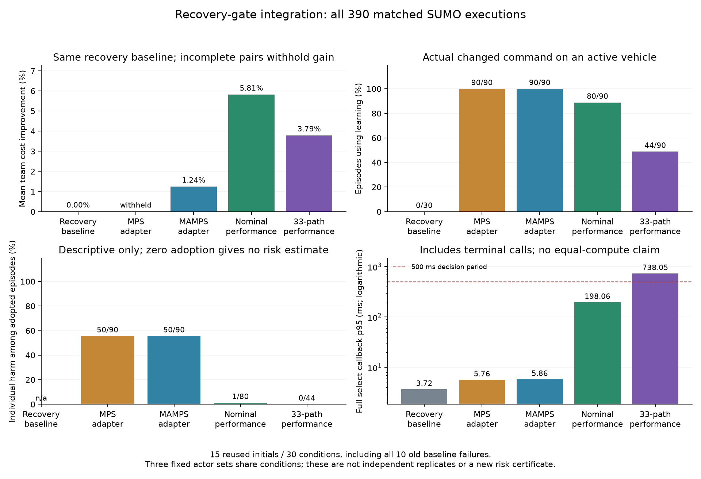

# 同一恢复基线下的门控集成结果

全部 390 次实际 SUMO 执行及完整门控重放结束，实际进程退出均为 0；核验 9,399 条命令和全部物理子步。三十条共同基线的实际物理轨迹均复现对应的 V34 记录，固定路线几何违反共 0 次。

| 范围 | 规则 | 完成 | 采用回合 | 采用后个体退化 | 全范围成本改善 | p95 / ms | >500 ms 调用 |
|---|---|---:|---:|---:|---:|---:|---:|
| 全部 | baseline | 30/30 | 0/30 | 未定义 | 0.000% | 3.717 | 0/752 |
| 全部 | mps_shared | 89/90 | 90/90 | 50/90 | 不报告（有未完成配对） | 5.758 | 0/2212 |
| 全部 | mamps_shared | 90/90 | 90/90 | 50/90 | 1.237% | 5.865 | 0/2204 |
| 全部 | nominal_performance | 90/90 | 80/90 | 1/80 | 5.811% | 198.056 | 27/2081 |
| 全部 | bank_performance | 90/90 | 44/90 | 0/44 | 3.785% | 738.046 | 160/2150 |

学习方法每行合并三个固定模型，共 90 次执行；基线执行 30 次。两者按条件配对，模型重复不增加独立初态。退化指任一车辆成本或到达时间变差，或者执行失败；它不同于碰撞。采用仅统计实际改变未到达车辆命令的回合。

该对照使用同一恢复基线、执行器类别信息、停车检查、真实参数与外生创新。真实参数与外生创新用于设置相同仿真环境，不作为在线门控输入。两种性能门控共享候选生成和排序。MPS/MAMPS 是共享判据的切换适配器，不是原论文的完整复现；各类规则的搜索机制和计算量不同。

结果来自 15 个旧初态的 30 个条件，特意保留全部十个旧基线失败条件；没有新增独立效能样本。以下同时拆分覆盖条件和旧失败条件，避免将这种混合分布视作一般交通分布。这里的经验退化率不是风险证书，新恢复门控没有继承旧正式校准结论。

## 两类预定来源条件

| 来源 | 规则 | 完成 | 采用回合 | 采用后个体退化 | 全范围成本改善 | p95 / ms | >500 ms 调用 |
|---|---|---:|---:|---:|---:|---:|---:|
| 原二十覆盖条件 | baseline | 20/20 | 0/20 | 未定义 | 0.000% | 3.377 | 0/453 |
| 旧失败十条件 | baseline | 10/10 | 0/10 | 未定义 | 0.000% | 3.971 | 0/299 |
| 原二十覆盖条件 | mps_shared | 60/60 | 60/60 | 35/60 | -2.490% | 5.241 | 0/1418 |
| 旧失败十条件 | mps_shared | 29/30 | 30/30 | 15/30 | 不报告（有未完成配对） | 6.299 | 0/794 |
| 原二十覆盖条件 | mamps_shared | 60/60 | 60/60 | 35/60 | -1.502% | 5.529 | 0/1404 |
| 旧失败十条件 | mamps_shared | 30/30 | 30/30 | 15/30 | 5.928% | 6.721 | 0/800 |
| 原二十覆盖条件 | nominal_performance | 60/60 | 50/60 | 1/50 | 2.212% | 165.546 | 12/1326 |
| 旧失败十条件 | nominal_performance | 30/30 | 30/30 | 0/30 | 11.975% | 275.635 | 15/755 |
| 原二十覆盖条件 | bank_performance | 60/60 | 16/60 | 0/16 | 1.491% | 298.419 | 49/1337 |
| 旧失败十条件 | bank_performance | 30/30 | 28/30 | 0/28 | 7.714% | 1113.200 | 111/813 |

## 全部固定模型

| 模型 | 规则 | 完成 | 采用回合 | 采用后个体退化 | 全范围成本改善 | p95 / ms | >500 ms 调用 |
|---|---|---:|---:|---:|---:|---:|---:|
| none | baseline | 30/30 | 0/30 | 未定义 | 0.000% | 3.717 | 0/752 |
| 1802 | mps_shared | 30/30 | 30/30 | 18/30 | 3.175% | 5.551 | 0/717 |
| 1812 | mps_shared | 29/30 | 30/30 | 18/30 | 不报告（有未完成配对） | 5.931 | 0/734 |
| 1822 | mps_shared | 30/30 | 30/30 | 14/30 | -2.851% | 5.680 | 0/761 |
| 1802 | mamps_shared | 30/30 | 30/30 | 18/30 | 2.296% | 5.604 | 0/727 |
| 1812 | mamps_shared | 30/30 | 30/30 | 18/30 | 1.971% | 6.033 | 0/731 |
| 1822 | mamps_shared | 30/30 | 30/30 | 14/30 | -0.556% | 5.933 | 0/746 |
| 1802 | nominal_performance | 30/30 | 27/30 | 0/27 | 5.901% | 189.073 | 8/694 |
| 1812 | nominal_performance | 30/30 | 26/30 | 1/26 | 5.514% | 201.646 | 8/698 |
| 1822 | nominal_performance | 30/30 | 27/30 | 0/27 | 6.017% | 177.154 | 11/689 |
| 1802 | bank_performance | 30/30 | 15/30 | 0/15 | 3.600% | 631.948 | 44/720 |
| 1812 | bank_performance | 30/30 | 15/30 | 0/15 | 3.650% | 843.855 | 63/717 |
| 1822 | bank_performance | 30/30 | 14/30 | 0/14 | 4.105% | 663.726 | 53/713 |

逐场景、动力学和模型的完整单元、原始截断成本、完整配对子集及全部终止调用保留在[完整报告](../artifacts/v35/recovery_gate_integration/analysis/report.json)。[协议与数学边界](v35_recovery_joint_gate_protocol.md)及[实际退出核验](../artifacts/v35/recovery_gate_integration/completion_verification.json)给出复核入口。正在运行的正式风险校准及 V32 全网格未改动。
